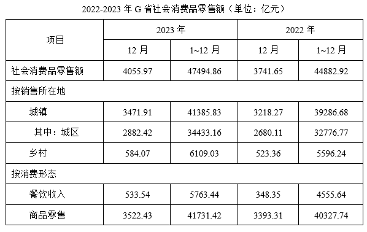

# 同比增长率比较（多指标横向排序）

考点：[[20-考点/资料分析/增长/同比增长率比较（多指标横向排序）|增长 / 同比增长率比较（多指标横向排序）]]
材料：[[15-材料/资料分析/3849854 2022—2023年G省社会消费品零|3849854 2022—2023年G省社会消费品零]]

**问法模型**：题干问'2023年下列指标……同比增长率最高的是'并给出4个表内分项 → 对每个选项用增长率公式 g=(现期-基期)/基期 分别求值后比较大小

## 推理链
1. 第1步：从表格按'按销售所在地'与'按消费形态'两行组提取各指标2023年1~12月（现期）与2022年1~12月（基期）累计值（单位亿元）：城镇41385.83/39286.68、乡村6109.03/5596.24、餐饮收入5763.44/4555.64、商品零售41731.42/40327.74
2. 第2步：增长率公式 g=(现期-基期)/基期，同比须用2023年1~12月列对2022年1~12月列同口径配对，不用12月当月值
3. 第3步：代入计算增长量与增速：城镇(41385.83-39286.68)=2099.15，2099.15/39286.68≈5.3%
4. 第4步：乡村(6109.03-5596.24)=512.79，512.79/5596.24≈9.2%
5. 第5步：餐饮收入(5763.44-4555.64)=1207.80，1207.80/4555.64≈26.5%
6. 第6步：商品零售(41731.42-40327.74)=1403.68，1403.68/40327.74≈3.5%
7. 第7步：四个增速26.5%＞9.2%＞5.3%＞3.5%，餐饮收入最高，对照选项选D

**最快解法**：⚡ 截位直除+先比量级：四个分项增长量约为城镇2099、商品零售1404、餐饮1208、乡村513，但餐饮基期4556远小于城镇39287和商品零售40328，分子不小而分母小一个量级，其增速必然远超其余三项（乡村虽基期5596接近，但分子513不到餐饮1208的一半），无需精算即可锁定D（精算1207.80/4555.64≈26.5%验证）

## 易错点
- ⚠ 口径错配：必须用1~12月累计对1~12月累计求同比，误用12月当月值（如533.54/348.35）会得不同结论方向的错误数据
- ⚠ 增长量与增长率混淆：城镇增长量2099.15亿元最大，若只比增长量会误选A，本题须比'增长量/基期'的比率
- ⚠ '其中：城区'是城镇的子项（34433.16＜41385.83），选项'城镇'对应城镇整行，不能误用城区行32776.77作基期，更不能把城区与乡村并列混加

## 母题抽象
> 🧩 当题干出现'下列指标中……同比增长率最高（最低）的是'且选项为表中多个分项时，取同口径的现期与基期累计值，用(现期-基期)/基期对每个选项估算增速，先用'分子（增长量）与分母（基期）的量级对比'快速排除，再对最接近的两项截位直除定胜负

**同类特征**：同比增长率最高的是、四个分项横向比较（城镇/乡村/餐饮收入/商品零售）、双分组维度（按销售所在地+按消费形态）、现期基期均为1~12月累计值、增长率比较排序题

## 相关题
- [[10-真题/资料分析/增长/10718166 一般增长率比较（增长量÷基期值横向比大小）|10718166]]（深圳市考 2024，相关度1）

---

### 题干
2023年，G省下列指标的社会消费品零售额同比增长率最高的是（    ）。

### 选项
- A. 城镇
- B. 乡村
- C. 商品零售
- D. 餐饮收入　✅

### 官方解析
根据题干“2023年·····同比增长率最高的是”，可判定本题为一般增长率问题。定位表格可得2022年、2023年G省城镇、乡村、商品零售、餐饮收入等指标的社会消费品零售额。根据公式：增长率，则四个指标的社会消费品零售额同比增长率分别为：
A项，城镇：；
B项，乡村：；
C项，商品零售：；
D项，餐饮收入：。
综上，同比增长率最高的是餐饮收入。
故正确答案为D。

### 给定材料

