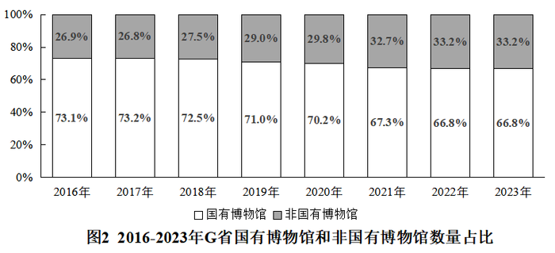

# 年均增长量计算（基期与间隔年数判定）

考点：[[20-考点/资料分析/增长/年均增长量计算（基期与间隔年数判定）|增长 / 年均增长量计算（基期与间隔年数判定）]]
材料：[[15-材料/资料分析/4113660 G省博物馆事业发展情况：2016—2|4113660 G省博物馆事业发展情况：2016—2]]

**问法模型**：'2016～2022年……年均增加（ ）家'→ 年均增长量模型：（末期值−初期值）÷间隔年数，间隔年数=末期年−初期年=2022−2016=6

## 推理链
1. 第1步：由题干'2016～2022年''年均增加'判定为年均增长量问题，区间为2016—2022年，与2023年无关
2. 第2步：定位图1柱状图，取区间两端点数据：2016年G省博物馆275家（基期），2022年377家（末期）
3. 第3步：套用公式 年均增长量=（末期值−基期值）÷间隔年数，间隔年数=2022−2016=6年
4. 第4步：代入计算：（377−275）÷6=102÷6=17家
5. 第5步：与选项对照：A.15、B.16、C.17、D.18，计算结果17正好对应C项，无需估算即可锁定

**最快解法**：⚡ 公式法+端点直取：只看图1两个端点柱（2016年275、2022年377），心算差值102，除以6年得17，直接选C；全程不需要中间年份，10秒内完成

## 易错点
- ⚠ 间隔年数错算：误用'2022−2016+1=7'作除数得102÷7≈14.6（无对应选项，易慌乱改用其他年份数据）；正确口径是除以年份差6
- ⚠ 基期/末期取错：误把题目年份区间外的2023年385家代入，算成(385−275)÷6≈18.3误选D或(385−275)÷7≈15.7误选B；题干明确止于2022年，2023年数据是干扰
- ⚠ 时间口径混淆：'截至2023年来'等文字表述是2023年末存量，本题区间为2016—2022年，勿被材料主时间（2023年）带偏；另注意各年数据均为年末存量，无需再做累计/新增换算

## 母题抽象
> 🧩 当题干出现'某年～某年……年均增加/年均增长量'特征时，用（末期值−初期值）÷（末期年−初期年）模型，只取图表两端点数据，验证间隔年数=年份差而非年份差+1，且末期取区间终点年份而非材料最新年份

**同类特征**：2016～2022年（明确年份区间）、年均增加、家（单位）、年均增长量问题、只取两端点、间隔年数=6、区间终点与材料现期年（2023）不同

## 相关题
- [[10-真题/资料分析/增长/2742310 年均增长量计算|2742310]]（北京 2021，相关度1）
- [[10-真题/资料分析/增长/5514931 年均增长量|5514931]]（广东 2023，相关度1）

---

### 题干
2016～2022年，G省博物馆年均增加（    ）家。

### 选项
- A. 15
- B. 16
- C. 17　✅
- D. 18

### 官方解析
根据题干“2016～2022年······年均增加（    ）家”，可判定本题为年均增长量问题。定位图1可知：2016年、2022年G省博物馆数量分别为275家、377家。根据公式：年均增长量，则所求家。
故正确答案为C。

### 给定材料

        2023年，G省博物馆系统落实国家文物局、G省人民政府关于推进文物事业高质量发展战略合作协议，锚定博物馆事业高质量发展任务，全省博物馆事业发展取得明显成效。

        截至2023年来，G省备案博物馆385家。其中，国有博物馆257家，非国有博物馆128家。国有博物馆中，文物系统国有博物馆227家，行业国有博物馆30家。G省国家一、二、三级博物馆共82家，数量位居全国第二。

