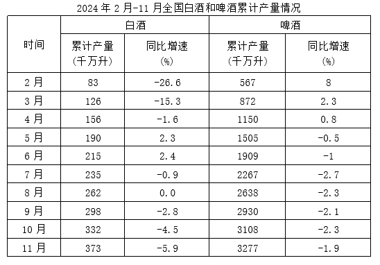

# 基期量计算（基期=现期÷(1+同比增速)，正增速累计口径）

考点：[[20-考点/资料分析/增长/基期量计算（基期=现期÷(1+同比增速)，正增速累计口径）|增长 / 基期量计算（基期=现期÷(1+同比增速)，正增速累计口径）]]
材料：[[15-材料/资料分析/7789045 2024年2-11月全国白酒与啤酒的|7789045 2024年2-11月全国白酒与啤酒的]]

**问法模型**：题干问'2023上半年产量'（基期），材料给出2024年6月累计产量（现期）及同比增速 → 直接用基期量=现期量÷(1+增长率)回推，无需作差

## 推理链
1. 第1步：定位表格6月行：2024年上半年（1-6月累计）全国白酒产量为215千万升，累计同比增速+2.4%（6月行的累计值恰好等于上半年总量，直接可用）
2. 第2步：题干求2023年（基期）上半年产量，材料给现期量与同比增长率，判定为基期计算，公式：基期量=现期量÷(1+同比增速)
3. 第3步：代入计算：215÷(1+2.4%)=215÷1.024≈210千万升（验证：210×1.024≈215.04，吻合）
4. 第4步：210千万升落在200～220千万升区间内，对照选项锁定C；A(不到150)、B(180~200)、D(220以上)均不匹配

**最快解法**：⚡ 百化分/截位直除：2.4%≈1/42，基期=215÷(1+1/42)=215×42/43≈210；或用放缩口算 215÷1.024≈215×(1-2.4%)≈215-5.2≈210，选项区间跨度大，直接锁定C

## 易错点
- ⚠ 累计口径误读：6月行的'累计产量'就是上半年产量，无需再作差；若误当成6月单月值或去与5月行作差则全错
- ⚠ 基期方向搞反：g=+2.4%为正增速，基期=现期÷(1+g)应略小于215（≈210）；若误乘(1+g)得≈220会误选D，或误用215×(1-2.4%)≈210虽数值近似但模型错误
- ⚠ 单位量级陷阱：单位为'千万升'，勿误读为亿升或万吨而错选低一档区间；量级上白酒与啤酒差约一个数量级，读行读列勿串位

## 母题抽象
> 🧩 当题干问'上年同期（基期）某累计时段的总量'，且材料给出'今年该时段累计产量+累计同比增速'时，直接基期=现期÷(1+g)回推，再用选项区间锁定；正增速时分母大于1，基期略小于现期

**同类特征**：问基期年份（2023）的产量、现期为累计口径（上半年）、给出同比增速+2.4%、选项为数值区间（非精确值）、单位千万升、正增速、无需作差直接回推

## 相关题
（暂无）

---

### 题干
2023上半年，全国白酒产量为多少（    ）。

### 选项
- A. 不到150千万升
- B. 180～200千万升
- C. 200～220千万升　✅
- D. 220千万升以上

### 官方解析
根据题干求“2023上半年，全国白酒产量”和表格材料中2024年现期量和增长率，可判定本题为基期计算问题。定位材料表格可得：2024年6月全国白酒累计产量215千万升，同比增长2.4%。根据公式：基期量，则2023上半年，全国白酒产量千万升，在C项范围内。
故正确答案为C。

### 给定材料

