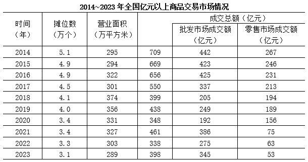

# 两期同比增速之差（百分点比较）

考点：[[20-考点/资料分析/增长/两期同比增速之差（百分点比较）|增长 / 两期同比增速之差（百分点比较）]]
材料：[[15-材料/资料分析/3290750 2014～2023年全国亿元以上商品|3290750 2014～2023年全国亿元以上商品]]

**问法模型**：题干'A年同比增速较B年提高/降低…个百分点'→ 分别以A−1年、B−1年为基期计算两个当年同比增速，再作差判方向定幅度

## 推理链
1. 第1步：题干比较的是2023年与2019年各自的同比增速，需从表中取四年数据：2018年399亿元、2019年438亿元、2022年338亿元、2023年398亿元
2. 第2步：增长率=（现期−基期）÷基期，2019年增速基期为2018年，2023年增速基期为2022年
3. 第3步：2019年增速=(438−399)/399=39/399≈9.8%
4. 第4步：2023年增速=(398−338)/338=60/338≈17.7%
5. 第5步：两者之差17.7%−9.8%≈8个百分点，为正（提高）且小于10个百分点
6. 第6步：与选项对照：'提高不到10个百分点'，锁定A

**最快解法**：⚡ 截位直除+粗判幅度：39/399直除首位得9（约9.8%），60/338直除得17.7%（约18%），差约8个百分点；方向上398>338为增长、438>399为增长，两者均为正且2023年增速更高，差值8<10，直接选A

## 易错点
- ⚠ 时间口径陷阱：本题是'2023年同比增速'与'2019年同比增速'两个当年增速之差，不是2019→2023年的区间增速，需多取2018年和2022年两个基期年数据
- ⚠ 基期混淆：2019年增速的基期是2018年（399），2023年增速的基期是2022年（338），拿错基期年（如误用2019年为2023年基期）必错
- ⚠ 表述陷阱：增速之差用'百分点'衡量且要先判方向（提高/降低）再判幅度；2023年成交总额398仍低于2019年的438，若凭'现期低=增速低'的直觉定方向会误选C/D

## 母题抽象
> 🧩 当题干出现'X年同比增速较Y年提高/降低…个百分点'时，分别用X−1年、Y−1年为基期算两个增长率再作差，先看分子差定方向，再估差值是否跨过10个百分点这条线

**同类特征**：同比增速较XXXX年、提高/降低、个百分点、成交总额、两期各自同比、增速之差

## 相关题
- [[10-真题/资料分析/比重/2261969 两期比重差（比重变化量）计算与方向判断|2261969]]（广东 2019，相关度2）
- [[10-真题/资料分析/增长/10718183 名义增速与实际增速之差（百分点计算）|10718183]]（深圳市考 2024，相关度1）
- [[10-真题/资料分析/比重/16070258 现期比重差值（两个部分占比相减）|16070258]]（重庆 2026，相关度1）
- [[10-真题/资料分析/比重/1752600 两期比重变化（比重差，百分点表述）|1752600]]（北京 2016，相关度1）
- [[10-真题/资料分析/比重/1789664 比重差值计算（百分点搭桥）|1789664]]（江苏 2016，相关度1）

---

### 题干
2023年全国亿元以上商品交易市场成交总额同比增速较2019年：

### 选项
- A. 提高不到10个百分点　✅
- B. 提高超过10个百分点
- C. 降低不到10个百分点
- D. 降低超过10个百分点

### 官方解析
根据题干“2023年······同比增速较2019年”，结合选项为“提高/降低+百分点”，可判定本题为一般增长率问题。定位统计表可得： 2018年、2019年、2022年、2023年全国亿元以上商品交易市场成交总额分别为399亿元、438亿元、338亿元、398亿元。根据公式：增长率，可得2019年全国亿元以上商品交易市场成交总额的同比增长率为，2023年的同比增长率为，18%-10%=8%，即2023年全国亿元以上商品交易市场成交总额同比增速较2019年提高了8个百分点，在A项范围内。
故正确答案为A。

### 给定材料

