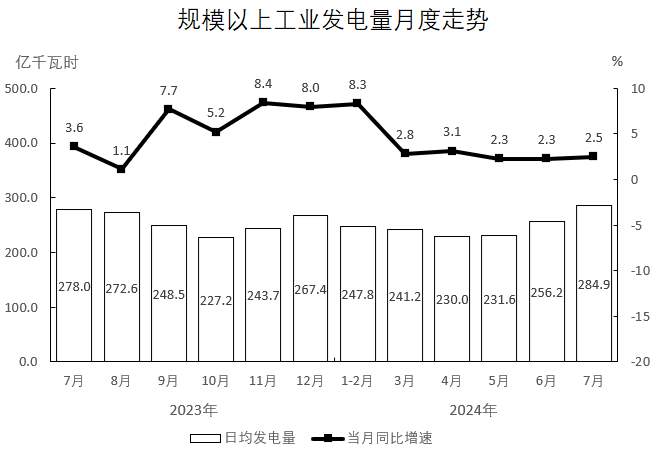

# 基期量比较（用同比增速反推基期日均后排序）

考点：[[20-考点/资料分析/增长/基期量比较（用同比增速反推基期日均后排序）|增长 / 基期量比较（用同比增速反推基期日均后排序）]]
材料：[[15-材料/资料分析/5064235 规模以上工业发电量：2024年7月当|5064235 规模以上工业发电量：2024年7月当]]

**问法模型**：题干问上一年同期（2023年二季度）各月日均发电量排序 → 判定为基期量比较，用基期量=现期量/(1+同比增速)逐月反推，再按分数性质比较大小

## 推理链
1. 第1步：题干问2023年第二季度（4/5/6月）日均发电量排序，而统计图只有2024年4-6月数据，判定需借助同比增速反推基期
2. 第2步：定位统计图读数：2024年4月日均230.0、同比+3.1%；5月日均231.6、同比+2.3%；6月日均256.2、同比+2.3%
3. 第3步：同月跨年天数相同（4月30天、5月31天、6月30天），日均排序与总量排序一致，可用公式 基期日均=现期日均/(1+同比增速) 直接反推
4. 第4步：代入计算：2023年4月≈230.0/1.031≈223.1，5月≈231.6/1.023≈226.4，6月≈256.2/1.023≈250.4亿千瓦时
5. 第5步：比较得250.4>226.4>223.1，即6月>5月>4月，对照选项仅D（6月、5月、4月）符合，故选D

**最快解法**：⚡ 分数性质比较（免精算）：把三个月写成三个分数 230.0/1.031、231.6/1.023、256.2/1.023；4月分子最小且分母最大→必为最小值，排除A、C；5月与6月分母相同（均为1.023），分子256.2>231.6→6月最大、5月次之，直接锁定D，全程无需做除法

## 易错点
- ⚠ 现期当基期：题干问2023年，若直接读2024年柱值排序（6>5>4）本题碰巧同序，但方法错误，一旦各月增速差异大就会排错，必须先除以(1+增速)反推
- ⚠ 增速须看双轴图右轴（-20~10%）：4月3.1%、5月2.3%、6月2.3%，若误读增速（如把4月读低）会导致分母大小关系颠倒、性质比较失效
- ⚠ 口径混淆：柱是日均（亿千瓦时）、折线是当月总量同比增速；因同月跨年天数相同，增速可直接用于反推日均，既不要误乘天数，也不要与1~7月累计增速4.8%混淆

## 母题抽象
> 🧩 当题干出现'上一年同期（基期）多个时期指标由大到小排序'特征时，用基期量=现期/(1+增速)化为分数，先用'分子最小且分母最大'定最小项，再对分母相同的分数比分子定其余名次，用分数性质免算除法直接锁定排序

**同类特征**：2023年第二季度（基期时间）、由大到小排序、日均发电量、现期值+同比增速反推基期、选项为月份排列组合、统计图柱（现期日均）线（同比增速）结合

## 相关题
- [[10-真题/资料分析/增长/13504657 环比增长率计算与比较（基期量反推+选图）|13504657]]（辽宁 2025，相关度1）
- [[10-真题/资料分析/综合/11881053 综合判断题（增长率比较+基期量差值+现期比重三模型混合验证）|11881053]]（黑龙江 2024，相关度1）

---

### 题干
2023年第二季度，规模以上工业日均发电量由大到小排序正确的是：

### 选项
- A. 4月、5月、6月
- B. 5月、6月、4月
- C. 6月、4月、5月
- D. 6月、5月、4月　✅

### 官方解析

根据题干“2023年第二季度······发电量由大到小排序正确的是”，结合材料给出2024年4-6月相关数据，可判定本题为基期比较问题。定位统计图可知2024年4-6月规模以上工业日均发电量及其同比增速。根据公式：基期量，则2023年4-6月，规模以上工业日均发电量分别为：4月，亿千瓦时；5月，亿千瓦时；6月，亿千瓦时。

在三个分数中，4月对应分数的分子最小，分母最大，则4月对应分数值最小，可排除A、C两项；其余两个分数分母相同，分子大的分数值大，则6月分数值最大，5月分数值次大。因此，2023年第二季度，规模以上工业日均发电量由大到小排序为：6月、5月、4月。

故正确答案为D。

### 给定材料

        2024年7月，规模以上工业发电量8831亿千瓦时，同比增长2.5％，增速比6月加快0.2个百分点；规模以上工业日均发电量284.9亿千瓦时。

        2024年1~7月，规模以上工业发电量53239亿千瓦时，同比增长4.8％。分品种看，2024年7月，规模以上工业火电发电量同比下降4.9％，规模以上工业水电发电量同比增长36.2％，规模以上工业核电发电量同比增长4.3％，规模以上工业风电发电量同比增长0.9％，规模以上工业太阳能发电量同比增长16.4％。

