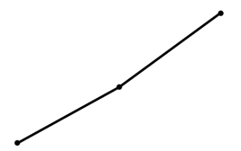
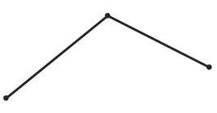
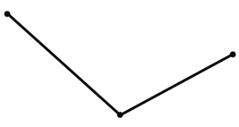

# 环比增长率计算与比较（基期量反推+选图）

考点：[[20-考点/资料分析/增长/环比增长率计算与比较（基期量反推+选图）|增长 / 环比增长率计算与比较（基期量反推+选图）]]
材料：[[15-材料/资料分析/5064235 规模以上工业发电量：2024年7月当|5064235 规模以上工业发电量：2024年7月当]]

**问法模型**：题干出现'能正确反映2022年第四季度各月日均发电量的环比增长率变化'→ 先用2023年9-12月日均与同比增速反推2022年各月基期日均，再算10/11/12月环比增长率，按'10月、11月、12月'三点走势对照选项折线

## 推理链
1. 第1步：定位统计图，读取2023年9-12月日均发电量及同比增速：9月248.5(+7.7%)、10月227.2(+5.2%)、11月243.7(+8.4%)、12月267.4(+8.0%)（增速看右轴）
2. 第2步：同月跨年天数相同，可用基期量=现期量/(1+增长率)反推2022年各月日均：9月=248.5/1.077≈230.7、10月=227.2/1.052≈216.0、11月=243.7/1.084≈224.8、12月=267.4/1.080≈247.6亿千瓦时
3. 第3步：环比增长率=(本期-上期)/上期：10月=(216.0-230.7)/230.7≈-6.4%；11月=(224.8-216.0)/216.0≈+4.1%；12月=(247.6-224.8)/224.8≈+10.1%
4. 第4步：三点走势为'10月最低且为负、11月转正、12月最高'，即12月>11月>10月，10月为最小值（负增长）
5. 第5步：与选项折线对照，只有A呈现'先降至最低（负值）后逐月回升、12月最高'的形态，故选A

**最快解法**：⚡ 基期倍数比较法（增长率比较技巧：若本期/上期大，则增长率大）：环比增长率大小只需比较相邻两月之比，10月环比比=(227.2×1.077)/(248.5×1.052)≈244.7/261.4≈0.94（负增长）；11月环比比=(243.7×1.052)/(227.2×1.084)≈256.4/246.3≈1.04；12月环比比=(267.4×1.084)/(243.7×1.080)≈289.9/263.2≈1.10。由12月>10月排除C、D，12月>11月排除B，且10月<1（负值、全图最低），锁定A

## 易错点
- ⚠ 10月环比的基期是反推出的2022年9月（248.5/1.077≈230.7），不是图上2023年9月的248.5，基期年份用错会算成2023年的环比
- ⚠ 柱值为日均而非当月总量；本题同月跨年天数相同可直接用同比增速反推日均，无需乘天数，但勿把日均误当月总量处理
- ⚠ 读增速必须看右轴（-20~10%），误读左轴刻度会取错增速；另外10月环比为负，易误判三点走势单调递增而错选

## 母题抽象
> 🧩 当题干要求'判断某年各月指标环比增长率的变化走势'而图中只提供后一年数据时，先用'基期量=现期/(1+同比增速)'反推上年各月值，再算相邻月环比；比较时可跳过具体数值，直接比较'分子现期×(1+分母增速)'与'分母现期×(1+分子增速)'的基期倍数大小，最后按'大小排序+正负号'匹配选项图形

**同类特征**：能正确反映……环比增长率变化、2022年第四季度各月、日均发电量、选项为折线图、需由同比增速反推基期量、增长率大小比较选图

## 相关题
- [[10-真题/资料分析/增长/13504656 基期量比较（用同比增速反推基期日均后排序）|13504656]]（辽宁 2025，相关度1）

---

### 题干
以下折线图中，能正确反映2022年第四季度各月日均发电量的环比增长率变化的是：

### 选项
- A. 

　✅
- B. 

- C. 

- D. 

### 官方解析

方法一：根据题干“······能正确反映2022年第四季度各月日均发电量的环比增长率变化的是”，可判定本题为一般增长率比较问题。定位统计图可得2023年9-12月日均发电量及其同比增速。根据公式：基期量，可得2022年9-12月各月日均发电量分别为：9月，亿千瓦时；10月，亿千瓦时；11月，亿千瓦时；12月，亿千瓦时。根据公式：增长率，可得2022年第四季度各月日均发电量的环比增长率分别为：10月，；11月，；12月，，比较可知，12月最大，10月最小，只有A项符合。

方法二：根据增长率比较技巧：若大，则增长率大。题目所需比较的2022年第四季度各月日均发电量的环比增长率，故只需比较即可。结合材料时间为2023年，可判定本题为基期倍数问题。定位统计图可得2023年9-12月日均发电量及其同比增速。根据公式：基期倍数，可得2022年第四季度各月环比倍数分别为：

10月，；

11月，；

12月，。

比较可知12月&gt;10月，排除C、D两项；12月&gt;11月，排除B项。

故正确答案为A。

### 给定材料

        2024年7月，规模以上工业发电量8831亿千瓦时，同比增长2.5％，增速比6月加快0.2个百分点；规模以上工业日均发电量284.9亿千瓦时。

        2024年1~7月，规模以上工业发电量53239亿千瓦时，同比增长4.8％。分品种看，2024年7月，规模以上工业火电发电量同比下降4.9％，规模以上工业水电发电量同比增长36.2％，规模以上工业核电发电量同比增长4.3％，规模以上工业风电发电量同比增长0.9％，规模以上工业太阳能发电量同比增长16.4％。

