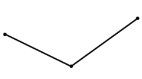
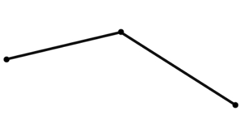
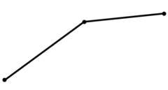
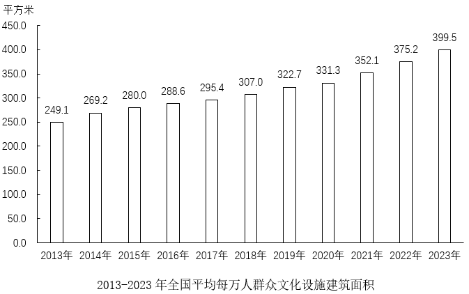
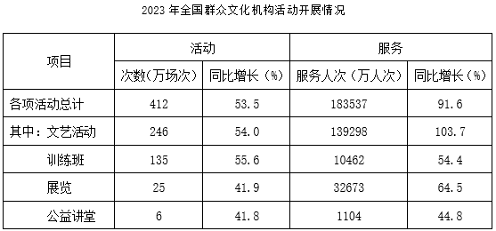

# 增长率计算与趋势比较（折线图匹配）

考点：[[20-考点/资料分析/增长/增长率计算与趋势比较（折线图匹配）|增长 / 增长率计算与趋势比较（折线图匹配）]]
材料：[[15-材料/资料分析/6377953 2023年（含2013~2023年历|6377953 2023年（含2013~2023年历]]

**问法模型**：题干问'能准确反映2019~2021年同比增长率变化趋势'→材料只给绝对值无现成增速，需逐年用'（现期-基期）/基期'算出三年增长率，再按高低点与升降方向匹配折线

## 推理链
1. 第1步：题干要求2019~2021年三年同比增长率，柱状图只给绝对值，需回取基年2018年数据：2018=307.0、2019=322.7、2020=331.3、2021=352.1平方米
2. 第2步：公式：同比增长率=（现期值-基期值）/基期值，逐年分子为相邻年份差值
3. 第3步：2019年=（322.7-307.0）/307.0=15.7/307.0≈5.1%；2020年=（331.3-322.7）/322.7=8.6/322.7≈2.7%；2021年=（352.1-331.3）/331.3=20.8/331.3≈6.3%
4. 第4步：排序比较：2021年（6.3%）最大＞2019年（5.1%）＞2020年（2.7%）最小，趋势为2019→2020下降、2020→2021上升，呈'V'形且右端点最高
5. 第5步：与四个折线选项对照，只有A项为'先降后升、2020年最低、2021年最高'的形状，故选A

**最快解法**：⚡ 定性比较法（不必精算增速）：三年增量分别为15.7、8.6、20.8，2020年增量最小且基期（322.7）偏大→2020年增速最低；2021年增量最大且基期（331.3）与2019年基期（307.0）相差不大→2021年增速最高；故趋势'先降后升、2021最高、2020最低'，直接锁定A，可跳过除法

## 易错点
- ⚠ 柱状图只给绝对值不给增速，2019~2021年增速无现成数据可抄，必须自算，且算2020年增速的基期是2019年（322.7）而非2018年（307.0）
- ⚠ 问的是'同比增长率'趋势而非数值或增量趋势：柱高逐年递增易误判为增速一直上升，实际增速有降有升
- ⚠ 相邻差值15.7、8.6、20.8需精确读一位小数，读错（如20.8看成20.0）可能改变2019与2021的大小排序而错选其他'先降后升'形状的选项

## 母题抽象
> 🧩 当题干出现'能准确反映某几年同比增长率变化趋势'且材料只给绝对值序列时，用'增量÷基期'逐年求增速（或只比增量与基期大小定性排序），抓最低点与最高点匹配折线升降形状

**同类特征**：折线图、2019~2021年、同比增长率变化趋势、平均每万人群众文化设施建筑面积、柱状图取数、先降后升

## 相关题
- [[10-真题/资料分析/增长/13504277 同比增速计算与折线趋势匹配（增长率数列比较）|13504277]]（云南 2025，相关度2）
- [[10-真题/资料分析/增长/15833698 环比增速计算与折线趋势图匹配|15833698]]（黑龙江 2026，相关度1）
- [[10-真题/资料分析/增长/2030132 年均增长率比较|2030132]]（四川 2016，相关度1）
- [[10-真题/资料分析/增长/2051184 增长量比较（同比增长量趋势折线图判断）|2051184]]（黑龙江 2017，相关度1）
- [[10-真题/资料分析/增长/5509651 环比增长率计算与趋势（折线图匹配）|5509651]]（吉林 2023，相关度1）

---

### 题干
以下折线图中，能准确反映2019~2021年全国平均每万人群众文化设施建筑面积同比增长率变化趋势的是：

### 选项
- A. 

　✅
- B. 

- C. 

- D. 

### 官方解析

根据题干“······能准确反映2019~2021年······同比增长率变化趋势的是”，可判定本题为一般增长率问题。定位统计图可知：2018~2021年全国平均每万人群众文化设施建筑面积分别为307.0平方米、322.7平方米、331.3平方米、352.1平方米。根据公式：增长率，可得2019~2021年全国平均每万人群众文化设施建筑面积同比增长率分别为：

2019年，；

2020年，；

2021年，。

比较可知，2021年同比增长率最大、2020年同比增长率最小，只有A项符合。

故正确答案为A。

### 给定材料

        2023年末，全国群众文化机构的实际使用房屋建筑面积5631.6万平方米，同比增长7.8%，全国平均每万人群众文化设施建筑面积399.5平方米，同比增长6.5%。

