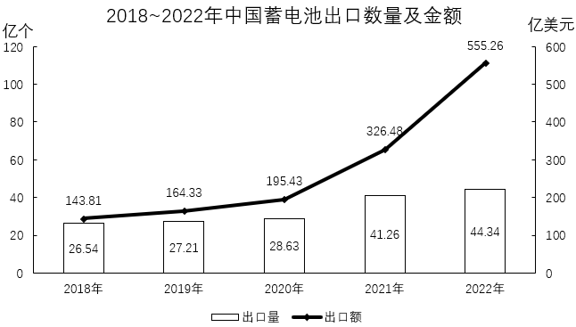

# 增长率计算与比较（双指标同超20%的年份计数）

考点：[[20-考点/资料分析/增长/增长率计算与比较（双指标同超20%的年份计数）|增长 / 增长率计算与比较（双指标同超20%的年份计数）]]
材料：[[15-材料/资料分析/6503422 中国蓄电池出口情况：文字给2023年|6503422 中国蓄电池出口情况：文字给2023年]]

**问法模型**：题干出现'某几年内，两个指标的同比增长率均超过20%的年份有几个'→逐年对两个指标分别套用增长率=(现期-基期)/基期，判断是否同时>20%，符合条件的年份计数

## 推理链
1. 第1步：从统计图读取2018~2022年出口数量（亿个）：26.54、27.21、28.63、41.26、44.34；出口金额（亿美元）：143.81、164.33、195.43、326.48、555.26
2. 第2步：套用增长率公式 g=(现期-基期)/基期，逐年分别计算出口数量与出口金额的同比增速
3. 第3步：2019年出口数量0.67/26.54≈2.5%（金额20.52/143.81≈14.3%），2020年出口数量1.42/27.21≈5.2%，均不满足>20%
4. 第4步：2021年出口数量12.63/28.63≈44.1%、出口金额131.05/195.43≈67.1%，两项均超过20%，满足
5. 第5步：2022年出口数量3.08/41.26≈7.5%，不满足；2019、2020、2022年均因出口数量增速远低于20%被排除
6. 第6步：仅2021年同时满足两指标增速>20%，故符合条件的年份有1个，对照选项选B

**最快解法**：⚡ 放缩法（基期×1.2）+数量先行排除：先用出口数量筛（波动小、增速低），2019年26.54×1.2≈31.8>27.21、2020年27.21×1.2≈32.7>28.63、2022年41.26×1.2≈49.5>44.34均不满足，仅2021年28.63×1.2≈34.4<41.26满足；再验2021年金额：195.43×1.2≈234.5<326.48，也满足，故仅1个年份，选B

## 易错点
- ⚠ 双轴图陷阱：柱（出口量·亿个，左轴）与线（出口额·亿美元，右轴）刻度不共用，图形高度不可直接比大小，必须读各点标注数值
- ⚠ 指标混淆陷阱：本题问'同比增长率'（%），与兄弟题第3题的'同比增量'（亿个）不同，切勿用增量0.67、1.42、12.63、3.08去判断，更勿与文字段2023年1~5月的同比数据（-9.4%、+58.2%）混用，本题只需图中年度数据
- ⚠ 条件理解陷阱：'均超过20%'要求数量与金额两个增速同时>20%，任一不满足即排除该年份；且统计区间为2019~2022年，2018年数据仅作基期，勿误算2018年

## 母题抽象
> 🧩 当题干出现'若干年份内两指标增长率均超过X%的年份有几个'时，先选增速低、易排除的那个指标逐年用'基期×(1+X%)'放缩或截位直除快速排除，再仅对幸存年份验证另一指标，从而最小化计算量

**同类特征**：2019~2022年区间、出口数量和金额两指标、同比增长率均超过20%、年份有几个（计数问法）、统计图逐年数据、双轴柱线图

## 相关题
- [[10-真题/资料分析/综合/10297256 多指标逐年加和与固定阈值比较计数|10297256]]（浙江 2025，相关度1）

---

### 题干
2019~2022年，中国蓄电池出口数量和金额同比增长率均超过20%的年份有几个？

### 选项
- A. 0
- B. 1　✅
- C. 2
- D. 3

### 官方解析

根据题干“2019~2022年······同比增长率均超过20%的年份有几个”，可判定本题为一般增长率问题。定位统计图可得2018~2022年中国蓄电池出口数量和金额。根据公式：增长率，则2019~2022年，中国蓄电池出口数量和金额同比增长率分别为：

2019年出口数量：，不满足；

2020年出口数量：，不满足；

2021年出口数量：；出口金额：，满足；

2022年出口数量：，不满足。

综上，2019~2022年，中国蓄电池出口数量和金额同比增长率均超过20%的年份只有1个（2021年）。

故正确答案为B。

### 给定材料

        2023年1~5月，中国蓄电池出口量16.81亿个，同比下降9.4%；出口金额283.77亿美元，同比增长58.2%。

