# 增长量与增长率双比较

考点：[[20-考点/资料分析/增长/增长量与增长率双比较|增长 / 增长量与增长率双比较]]

**问法模型**：题干问'增加额最多'和'增长率最高'分别是谁 → 用增长量=现期−基期比较增加额，用增长率=增长量/基期比较增速

## 推理链
1. 第1步：定位表格，基础研究2010年324.5亿元、2011年411.8亿元；应用研究2010年893.8亿元、2011年1028.4亿元；试验发展2010年5844.3亿元、2011年7246.8亿元
2. 第2步：增长量=现期−基期，增长率=增长量/基期
3. 第3步：增长量比较：基础研究411.8−324.5=87.3亿元，应用研究1028.4−893.8=134.6亿元，试验发展7246.8−5844.3=1402.5亿元，增加额最多的是试验发展，排除B、C
4. 第4步：增长率比较：试验发展1402.5/5844.3≈24%，基础研究87.3/324.5≈26.9%
5. 第5步：基础研究增长率（约26.9%）高于试验发展（约24%），故增长率最高的是基础研究
6. 第6步：增加额最多为试验发展、增长率最高为基础研究，对照选项选D

**最快解法**：⚡ 先比增长量：试验发展1402.5亿元远大于134.6和87.3，直接排除B、C；再比增长率用截位直除：87.3/324.5≈0.27 与 1402.5/5844.3≈0.24，前项更大，锁定D

## 易错点
- ⚠ 只算了增长量就选A（试验发展、试验发展），漏看第二问考增长率
- ⚠ 基础研究与试验发展增长率接近（约26.9%对24%），粗放估算容易判反
- ⚠ 基期现期方向弄反，误用2011年做分母

## 母题抽象
> 🧩 当题干出现'增加额最多+增长率最高'双问时，先作差比增长量（量级悬殊可直接秒杀），再用'增长量/基期'比增长率，警惕大基数的增长率反而偏低

**同类特征**：从活动类型看、比上年增加额最多、增长率最高、三项并列比较、现期与基期数据成对给出

## 相关题
- [[10-真题/资料分析/增长/1796654 同比增长率比较（逐年增速取最大）|1796654]]（广东 2016，相关度1）

---

### 题干
从活动类型看，2011年研究经费比上年增加额最多的和增长率最高的活动类型分别是：

### 选项
- A. 试验发展 、试验发展
- B. 应用研究 、试验发展
- C. 应用研究、 基础研究
- D. 试验发展 、基础研究　✅

### 官方解析

根据题干“······比上年增加额最多和增长率最高······”，判定本题为一般增长率和增长量比较问题。定位表格材料:基础研究2010年和2011年经费投入额分别为324.5亿元和411.8亿元；应用研究2010年和2011年经费投入额分别为893.8亿元和1028.4亿元；试验发展2010年和2011年经费投入额分别为5844.3亿元和7246.8亿元。基础研究增长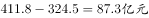，应用研究增长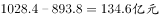，试验发展增长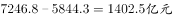，所以增长量最大的是试验发展，排除B、C两项。计算增长率，试验发展增长率为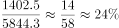，而基础研究增长率为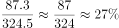，则基础研究增长率较大。

故正确答案为D。

### 给定材料

        2010年，我国投入研究与试验发展（以下简称R&amp;D）经费7062.6亿元，比去年增长；R&amp;D经费投入强度（与国内生产总值之比）为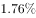，比上年的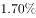有所提高。按R&amp;D人员（全时工作量）计算的人均经费为27.7万元，比上年增加2.3万元。

        分产业部门看，R&amp;D经费投入强度（与主营业务收入之比）最高的行业是专用设备制造业，为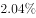；其他投入强度在及以上的还有4个行业，分别是医药制造业（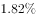）、通用设备制造业（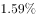）、电器机械及器材制造业（）和仪器仪表及文化、办公用机械制造业（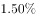）。

        2011年，我国投入R&amp;D经费8687亿元；R&amp;D经费投入强度为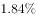。按R&amp;D人员（全时工作量）计算的人均经费支出为30.1万元。

        分产业部门看，R&amp;D经费投入超过200亿元的行业有8个，这8个行业的研发费用占全部规模以上工业企业的比重达；R&amp;D经费投入强度超过规模以上工业平均水平（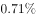）的有11个行业。

