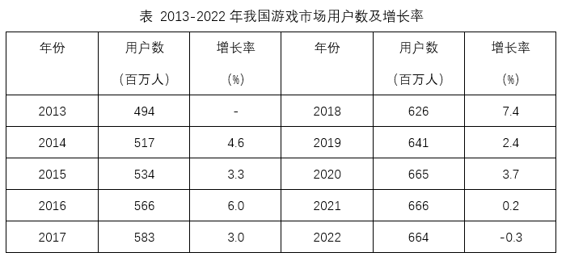
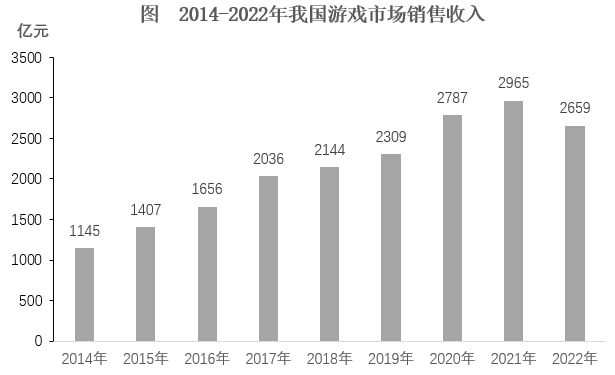

# 增长率计算与两期增长率之差（百分点）

考点：[[20-考点/资料分析/增长/增长率计算与两期增长率之差（百分点）|增长 / 增长率计算与两期增长率之差（百分点）]]
材料：[[15-材料/资料分析/7798297 2013-2022年我国游戏市场用户|7798297 2013-2022年我国游戏市场用户]]

**问法模型**：题干问'2022年增长率与2021年相差'且选项为'百分点'→分别用(现期-基期)/基期求两年增速，再作差，答案以百分点表示

## 推理链
1. 第1步：从柱状图读取销售收入：2020年2787亿元、2021年2965亿元（峰值）、2022年2659亿元（回落）
2. 第2步：增长率公式：增长率=(现期-基期)/基期，2021年基期为2787、2022年基期为2965
3. 第3步：2021年增速=(2965-2787)/2787=178/2787≈+6.4%
4. 第4步：2022年增速=(2659-2965)/2965=-306/2965≈-10.3%，为负增长
5. 第5步：作差：6.4%-(-10.3%)≈16.7个百分点（一正一负，相差等于两者绝对值相加）
6. 第6步：与选项对照：16.7个百分点与D项一致，故选D

**最快解法**：⚡ 截位直除+异号作差：178/2787截位直除商首两位≈6.4%；306/2965≈306/3000≈10.3%（负增长）；两增速一正一负，相差值=6.4%+10.3%≈16.7个百分点，直接锁定D，无需精算

## 易错点
- ⚠ 单位是'百分点'而非'%'，且两增速一正一负，作差时负号处理易错：6.4%-(-10.3%)应将绝对值相加，误算成6.4%-10.3%会得到-3.9误选A
- ⚠ 基期混淆：2022年增速的基期是2021年(2965)而非2020年(2787)；负增长年份分子应带负号，勿把下降306亿当正增长代入
- ⚠ 收入增速材料未直接给出，须从柱状图绝对额自行计算，2787/2965/2659三个数柱高接近处读数需精确，粗略估读会误判

## 母题抽象
> 🧩 当题干出现'A年增长率与B年相差'且选项带'百分点'时，分别用(现期-基期)/基期求两年增速再作差；两增速一正一负时，相差值=两增速绝对值之和，结果用百分点表示并与选项对照

**同类特征**：增长率相差、百分点、相邻两年增速对比、柱状图数据需自行计算增速、负增长年份参与作差、一正一负增速

## 相关题
- [[10-真题/资料分析/比重/13504296 现期比重差（先找极值年份再比份额）|13504296]]（甘肃 2025，相关度1）
- [[10-真题/资料分析/比重/2188159 两期比重差值计算（现期比重-基期比重）|2188159]]（陕西 2018，相关度1）
- [[10-真题/资料分析/增长/5445860 增速百分点差（由局部增速与百分点差求整体增速）|5445860]]（国考 2023，相关度1）
- [[10-真题/资料分析/比重/2172166 两期比重差计算（现期比重−基期比重）|2172166]]（广州市考 2018，相关度1）
- [[10-真题/资料分析/其他/2604246 普及率差值比较（两折线逐点相减找最大年份，单位为百分点）|2604246]]（广东 2020，相关度1）

---

### 题干
2022年我国游戏市场销售收入增长率与2021年相差：

### 选项
- A. 3.9个百分点
- B. 8.4个百分点
- C. 12.7个百分点
- D. 16.7个百分点　✅

### 官方解析

根据题干“2022年······增长率与2021年相差”，结合选项为“百分点”，可判定本题为一般增长率问题。定位图形材料可得，2022-2020年我国游戏市场销售收入分别为2659、2965、2787亿元。根据公式：增长率，则2022年我国游戏市场销售收入增长率，2021年增长率。故2022年我国游戏市场销售收入增长率与2021年相差6.4%-（-10.2%）=16.6%，即16.6个百分点，与D项最接近。

故正确答案为D。

### 给定材料

> [!warning] 疑点（官方解析可能有误，待人工复核）
> 官方解析将2022年增速舍入为-10.2%（精确值-306/2965≈-10.3%），得差值16.6个百分点并表述为'与D项最接近'；精确计算6.4%-(-10.3%)=16.7个百分点恰等于D项，答案D不受影响，仅解析舍入略有出入
