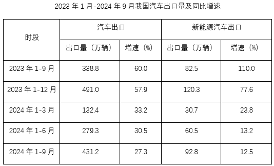

# 目标现期量计算+累计值做差求环比增长量

考点：[[20-考点/资料分析/增长/目标现期量计算+累计值做差求环比增长量|增长 / 目标现期量计算+累计值做差求环比增长量]]
材料：[[15-材料/资料分析/5694350 我国汽车及新能源汽车2021-202|5694350 我国汽车及新能源汽车2021-202]]

**问法模型**：题干出现'若要实现同比增长10%的目标，则第四季度环比须增长约多少万辆'→先用现期=基期×(1+增长率)算全年目标出口量，再用相邻累计时段做差求Q4与Q3的量，相减得环比增长量

## 推理链
1. 第1步：从统计表提取：2023年1-12月新能源汽车出口120.3万辆（2024年的基期）、2024年1-6月60.5万辆、2024年1-9月92.8万辆，表中数值均为累计值
2. 第2步：按目标现期=基期×(1+增长率)，2024年全年新能源出口目标=120.3×(1+10%)=132.33万辆
3. 第3步：累计做差求2024年Q4出口量=全年目标132.33-2024年1-9月累计92.8=39.53万辆
4. 第4步：累计做差求2024年Q3出口量=1-9月累计92.8-1-6月累计60.5=32.3万辆
5. 第5步：环比增长量=Q4-Q3=39.53-32.3=7.23万辆
6. 第6步：与选项对照，7.23对应C项，故正确答案为C

**最快解法**：⚡ 公式法+累计做差：120.3×1.1=132.33（拆成120.3+12.03口算）；132.33-92.8=39.53，92.8-60.5=32.3，39.53-32.3=7.23，尾数0.53-0.3=0.23直接锁定C

## 易错点
- ⚠ 表格数值全是累计值，Q4=全年-1-9月、Q3=1-9月-1-6月必须相邻时段做差，直接把92.8或120.3当季度值使用必错
- ⚠ 目标值的基期是2023年全年120.3万辆（仅在表格出现，文字段未给），不能误用2023年1-9月的82.5或2024年1-9月的92.8作基期
- ⚠ '环比须增长约多少万辆'问的是增长量（Q4对Q3做差），不是增长率，也不是Q4对2023年Q4（37.8万辆）的同比增量；另注意'环比'与'同比'口径勿混

## 母题抽象
> 🧩 当题干出现'若要实现同比增长X%的目标+某季度环比增长量'时，用现期=基期×(1+X%)求全年目标值，再用相邻累计时段做差求目标季度与上季度量，两者相减即环比增量

**同类特征**：若要实现同比增长10%的目标、第四季度出口量、环比须增长约多少万辆、现期=基期×(1+增长率)、累计值做差求单季值、假设条件推算

## 相关题
- [[10-真题/资料分析/增长/4663213 现期量计算（各部分增速相同推整体增速）|4663213]]（山东 2022，相关度1）

---

### 题干
2024年，我国新能源汽车出口量若要实现同比增长10%的目标，则第四季度出口量环比须增长约多少万辆？

### 选项
- A. 8.84
- B. 8.31
- C. 7.23　✅
- D. 7.01

### 官方解析
根据题干“2024年······则第四季度出口量环比须增长约多少万辆”，定位表格材料可得：2023年1-12月我国新能源汽车出口量为120.3万辆；2024年1-6月出口量为60.5万辆；2024年1-9月出口量为92.8万辆。结合题干“2024年，我国新能源汽车出口量若要实现同比增长10%的目标”，根据公式：现期量=基期量×（1+增长率），2024年我国新能源汽车出口量将达到120.3×（1+10%）=132.33万辆，则2024年第四季度出口量=2024年出口量-2024年1-9月出口量=132.33-92.8=39.53万辆。2024年第三季度我国新能源汽车出口量=2024年1-9月出口量-2024年1-6月出口量=92.8-60.5=32.3万辆。根据公式：增长量=现期量-基期量，则2024年第四季度出口量环比增量=2024年第四季度出口量-2024年第三季度出口量=39.53-32.3=7.23万辆。
故正确答案为C。

### 给定材料

        2023年，我国汽车产销量分别为3016.1万辆和3009.4万辆，同比分别增长11.6%和12%，创历史新高，连续15年保持全球第一，汽车出口量首次跃全球第一。

        2022年，我国汽车产销量分别为2702.1万辆和2686.4万辆，其中新能源汽车产销分别为705.8万辆和688.7万辆，同比分别增长96.9%和93.4%，汽车出口311.1万辆，同比增长54.4%，新能源汽车出口67.9万辆，同比增长1.2倍。

        2021年，我国汽车产销量分别为2608.2万辆和2627.5万辆，产销同比分别增长3.4%和3.8%，结束了连续三年的下降趋势。其中新能源汽车销售352.1万辆，同比增长1.6倍，连续7年位居全球第一。汽车出口201.5万辆，同比增长1倍，新能源汽车出口32万辆，同比增长3倍。

