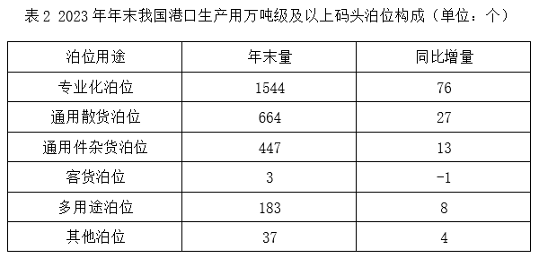

# 增长率比较（增速最快，基期需由'年末数−同比增量'倒推）

考点：[[20-考点/资料分析/增长/增长率比较（增速最快，基期需由'年末数−同比增量'倒推）|增长 / 增长率比较（增速最快，基期需由'年末数−同比增量'倒推）]]
材料：[[15-材料/资料分析/7899892 2023年年末我国港口生产用码头泊位|7899892 2023年年末我国港口生产用码头泊位]]

**问法模型**：题干出现'同比增速最快的是'且材料只给年末数与同比增量 → 对四个吨级档分别求 增量/(年末数−增量)，比较分数大小

## 推理链
1. 第1步：题干限定'我国'+ '万吨级及以上' + 按吨级分档，锁定表1'全国港口'列，提取四档数据：3万吨级以下932/41、3~5（不含）万吨级467/15、5~10（不含）万吨级966/36、10万吨级及以上513/35（年末数/同比增量）
2. 第2步：材料只给同比增量（增长量），须用公式 增长率=增长量/基期量，其中基期量=2023年末数−同比增量
3. 第3步：代入计算：A=41/(932−41)=41/891≈4.6%；B=15/(467−15)=15/452≈3.3%；C=36/(966−36)=36/930≈3.9%；D=35/(513−35)=35/478≈7.3%
4. 第4步：四者中D的7.3%最大，即10万吨级及以上泊位同比增速最快，与选项对照选D

**最快解法**：⚡ 分数比较法（截位直除）：D增量35与A增量41接近，但D基期478远小于A基期891，35/478≈7.3%明显大于41/891≈4.6%；B、C增量仅15、36且基期大（452、930），增速约3.3%、3.9%必然更低，故无需精算全部四项即可锁定D

## 易错点
- ⚠ 把'同比增量'直接当增速比大小（D增量35小于A的41，误以为A最快），增速必须再除以各自基期
- ⚠ 基期量须倒推为'年末数−增量'（如D基期=513−35=478），不能直接用年末数作分母或把增量/年末数当增速
- ⚠ 列口径误取：题干'我国'对应表1'全国港口'列，误取沿海列（D沿海=34/469≈7.2%结论虽同但口径错）或混入文字段22023个/表2用途分类的两套不同口径

## 母题抽象
> 🧩 当题干出现'同比增速最快/最慢'且材料只给现期量与增长量时，先倒推基期=现期−增量，再对各组求'增量/基期'做分数比较（增量相近比基期、基期相近比增量），锁定最大者即为答案

**同类特征**：同比增速最快、2023年年末、万吨级及以上码头泊位、按吨级分档（表1）、材料只给增量未给增速、全国（我国）口径

## 相关题
- [[10-真题/资料分析/增长/2097276 同比增速直接读表比较|2097276]]（四川 2017，相关度1）
- [[10-真题/资料分析/增长/2261975 同比增速（增长率）大小比较|2261975]]（广东 2019，相关度1）
- [[10-真题/资料分析/增长/2741707 增长率（同比增速）比较|2741707]]（山东 2021，相关度1）
- [[10-真题/资料分析/增长/5802088 增长率比较（基期需由现期−增量还原）|5802088]]（浙江 2023，相关度1）
- [[10-真题/资料分析/增长/10204493 同比增速（一般增长率）比较|10204493]]（甘肃 2024，相关度1）

---

### 题干
2023年年末，我国下列各类港口生产用万吨级及以上码头泊位，同比增速最快的是：

### 选项
- A. 3万吨级以下泊位
- B. 3-5（不含）万吨级泊位
- C. 5-10（不含）万吨级泊位
- D. 10万吨级及以上泊位　✅

### 官方解析

根据题干“······同比增速最快的是”，可判定本题为一般增长率问题。定位表1可得2023年年末我国港口生产用万吨级及以上码头中，各类吨级泊位数量及其同比增量。根据公式：增长率，各选项代入数据可得：

A项，；

B项，；

C项，；

D项，。

比较可知，D项同比增速最快。

故正确答案为D。

### 给定材料

        2023年年末，我国港口生产用码头泊位22023个，比上年末增加700个。其中，内河港口生产用码头泊位16433个、增加551个，沿海港口生产用码头泊位5590个、增加149个。

