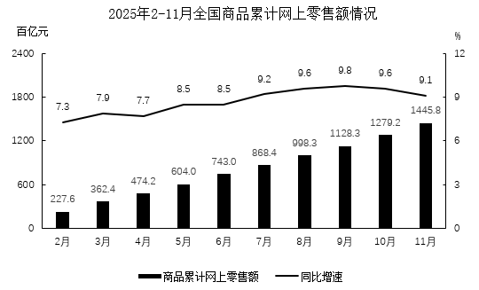
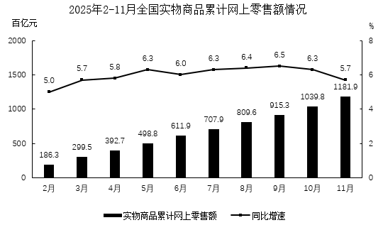

# 增长量计算（累计值相减求当期现期+混合增长率定当期增速）

考点：[[20-考点/资料分析/增长/增长量计算（累计值相减求当期现期+混合增长率定当期增速）|增长 / 增长量计算（累计值相减求当期现期+混合增长率定当期增速）]]
材料：[[15-材料/资料分析/5750235 2025年2-11月全国商品与全国实|5750235 2025年2-11月全国商品与全国实]]

**问法模型**：题干问'某月当期零售额同比增量在哪个范围内'→ 先用本月累计-上月累计求当期现期值，再确定当期增速，套增长量=现期×r/(1+r)定位区间

## 推理链
1. 第1步：从图1提取条件：2025年5月商品累计网上零售额604.0百亿元（1-5月累计增速8.5%），6月累计743.0百亿元（1-6月累计增速8.5%）
2. 第2步：柱状图为'1月至当月'累计值，6月当期现期值=743.0-604.0=139.0百亿元
3. 第3步：由'1-5月+6月=1-6月'的整体-部分关系及混合增长率原理，两个部分与整体增速均为8.5%时，6月当期增速必为8.5%
4. 第4步：套用增长量公式：增长量=现期×r/(1+r)
5. 第5步：代入计算：139.0×8.5%/108.5%≈139.0×0.0783≈10.9百亿元
6. 第6步：10.9百亿元落在10百亿-15百亿元区间，对照选项选C

**最快解法**：⚡ 公式法+百化分：先累计相减得现期139.0百亿元；8.5%≈1/12，增长量≈现期/(n+1)=139.0/13≈10.7（或精确算139×0.085/1.085≈10.9），一步锁定C区间；若直接用743.0计算会得约58百亿而误选D，务必先相减

## 易错点
- ⚠ 把6月累计值743.0直接当现期算增长量（约58百亿，误选D），忽略柱子是累计值、'当期'必须用743.0-604.0=139.0相减获得
- ⚠ 折线读的是累计同比增速而非当期增速，需通过'5月与6月累计增速均为8.5%'推出6月当期增速同为8.5%，若两月累计增速不同则此捷径不成立，须分别除(1+r)换算基期再相减
- ⚠ 单位为'百亿元'而非亿元，选项区间以百亿元表述，注意量级不要差100倍

## 母题抽象
> 🧩 当题干出现'某月当期××同比增量在哪个范围'且材料只给累计柱+累计增速折线时，先相邻月累计相减求当期现期，再看两段累计增速是否相同：相同则当期增速同值，直接套增长量=现期×r/(1+r)验证落区间

**同类特征**：当期网上零售额、同比增量、在以下哪个范围内、累计值需相减求当月、混合增长率推当期增速、增长量=现期×r/(1+r)

## 相关题
- [[10-真题/资料分析/增长/2031184 增长量倍数计算（两主体增长量作比）|2031184]]（北京 2017，相关度2）
- [[10-真题/资料分析/倍数/15833687 现期倍数比较（累计值相减求当期后求倍数）|15833687]]（黑龙江 2026，相关度1）
- [[10-真题/资料分析/增长/15833691 环比增速计算与折线趋势匹配（累计值连环相减化当期值）|15833691]]（黑龙江 2026，相关度1）
- [[10-真题/资料分析/增长/10297067 由同比增速求同比增量（现期×r-(1+r)）并比较多月变化趋势|10297067]]（天津 2025，相关度1）
- [[10-真题/资料分析/增长/12536399 增长量计算与增长量倍数比较（增长量=现期×r-(1+r)）|12536399]]（四川 2024，相关度1）

---

### 题干
2025年6月全国商品当期网上零售额同比增量在以下哪个范围内？

### 选项
- A. 不到5百亿元
- B. 5百亿-10百亿元之间
- C. 10百亿-15百亿元之间　✅
- D. 超过15百亿元

### 官方解析

根据题干“2025年6月······同比增量在以下哪个范围内”，可判定本题为增长量计算问题。定位图1可得：2025年5月全国商品累计网上零售额为604.0百亿元，同比增长8.5%；6月为743.0百亿元，同比增长8.5%。则2025年6月全国商品当期网上零售额为743.0-604.0=139百亿元。

因为1-5月零售额+6月零售额=1-6月累计零售额，满足部分与整体的关系，且1-5月累计增长率与1-6月累计增长率均为8.5%，所以6月的增长率必然也为8.5%（在混合增长率中，若两个部分增长率相同，则整体增长率与部分增长率一致）。

根据公式：增长量，则题干所求百亿元，在C项范围内。

故正确答案为C。

### 给定材料

