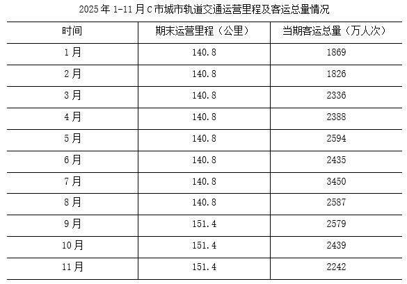
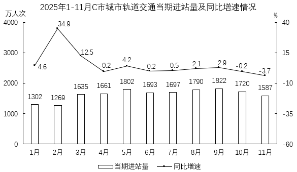

# 基期量计算

考点：[[20-考点/资料分析/增长/基期量计算|增长 / 基期量计算]]
材料：[[15-材料/资料分析/3568448 2025年1-11月C市城市轨道交通|3568448 2025年1-11月C市城市轨道交通]]

**问法模型**：题干问上一年同月（2024年3月）的进站量落在哪个范围 → 用基期量=现期量/(1+同比增速)回推后对照区间

## 推理链
1. 第1步：题干时间为2024年3月，材料统计图为2025年1-11月，判定2025年3月为现期、2024年3月为基期
2. 第2步：从图2定位2025年3月数据——当期进站量1635万人次，同比增速12.5%
3. 第3步：套用基期量公式，基期量=现期量/(1+增长率)=1635/(1+12.5%)
4. 第4步：速算，12.5%=1/8，故1635/(9/8)=1635×8/9≈1453.3万人次
5. 第5步：1453.3落在1400~1500万人次之间，与选项对照，只有C项（1400万~1500万人次）符合

**最快解法**：⚡ 百化分+基期公式：将12.5%化为1/8，1635÷(1+1/8)=1635×8/9≈1453万人次，直接锁定C；亦可截位直除1635/1.125≈1450验证

## 易错点
- ⚠ 时间口径陷阱：题干问2024年3月而材料给2025年3月，若直接把现期1635当作所求会误选D（超过1500）
- ⚠ 基期公式误用：增长率12.5%为正，应除以(1+12.5%)；误用1635×(1-12.5%)≈1428.75属错误模型（虽凑巧仍在C区间，但方向错误）
- ⚠ 双轴图取数：1635是柱状（万人次）数据，勿与折线增速12.5%混淆轴刻度

## 母题抽象
> 🧩 当题干出现'上年同期+范围类选项'特征时，用基期量=现期/(1+增速)，优先百化分（12.5%=1/8、16.7%≈1/6等）速算后对照区间落点

**同类特征**：2024年3月（上年同期）、当期进站量、同比增速12.5%、范围类选项（不到/区间/超过）、基期计算、单图取数（图2）

## 相关题
- [[10-真题/资料分析/增长/20303 基期量计算|20303]]（贵州 2010，相关度3）
- [[10-真题/资料分析/增长/1385893 基期量计算|1385893]]（重庆 2015，相关度2）
- [[10-真题/资料分析/增长/13504658 基期量计算|13504658]]（辽宁 2025，相关度2）
- [[10-真题/资料分析/增长/16593086 基期量计算|16593086]]（新疆 2024，相关度2）
- [[10-真题/资料分析/增长/2033794 基期量计算|2033794]]（江苏 2016，相关度2）

---

### 题干
2024年3月C市城市轨道交通当期进站量在下面哪个范围内？

### 选项
- A. 不到1300万人次
- B. 1300万~1400万人次
- C. 1400万~1500万人次　✅
- D. 超过1500万人次

### 官方解析
根据题干“2024年3月······进站量在下面哪个范围内”，结合材料时间为2025年1-11月，可判定本题为基期计算问题。定位统计图可得：2025年3月，C市城市轨道交通当期进站量1635万人次，同比增速12.5%。根据公式：基期量，则所求为万人次，在C项范围内。
故正确答案为C。

### 给定材料

