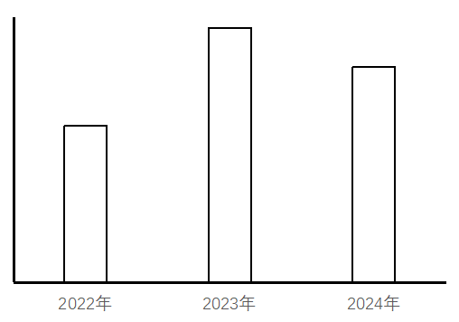

# 增长量计算与比较（同比增量序列与柱状图趋势匹配）

考点：[[20-考点/资料分析/增长/增长量计算与比较（同比增量序列与柱状图趋势匹配）|增长 / 增长量计算与比较（同比增量序列与柱状图趋势匹配）]]
材料：[[15-材料/资料分析/4216251 2021-2024年全国及14个省市|4216251 2021-2024年全国及14个省市]]

**问法模型**：问'柱状图反映哪个省市2022～2024年同比增量变化趋势'→ 用'增量=当年经费-上年经费'对四个选项逐年作差得三点增量序列，再与图中柱形'均为正、先升后降'的高低顺序逐一匹配

## 推理链
1. 第1步：由题干锁定需计算安徽、江西、湖北、湖南四省2022～2024年R&D经费同比增量，其中2022年增量的基期是表内首年2021年（安徽1006.1、江西502.2、湖北1160.2、湖南1028.9亿元）
2. 第2步：公式为同比增量=当年经费-上年经费；读图定形态：三根柱子均位于横轴上方（增量均为正），且呈'2022最低→2023最高→2024居中'的先升后降走势
3. 第3步：先算各选项2022、2023两个增量做首查：安徽1152.5-1006.1=146.4→1264.7-1152.5=112.2，江西558.2-502.2=56.0→604.1-558.2=45.9，湖南1175.3-1028.9=146.4→1283.9-1175.3=108.6，三者2023增量均低于2022增量（首步下降），与图形'先升'不符，排除A、B、D
4. 第4步：湖北2022年增量=1254.7-1160.2=94.5亿元，2023年增量=1408.2-1254.7=153.5亿元，2024年增量=1538.1-1408.2=129.9亿元
5. 第5步：湖北增量序列94.5→153.5→129.9为'先升后降且三柱均为正'，与柱状图趋势完全吻合，对照选项锁定C

**最快解法**：⚡ 趋势首查法+直接作差：先读图锁定形态为'三柱均正、先升后降'，则只需比较各选项2022与2023两个增量——凡2023增量小于2022增量者立即排除（安徽146.4＞112.2、江西56.0＞45.9、湖南146.4＞108.6均排除），唯一首步上升的湖北再补算2024年增量验证（94.5→153.5→129.9），全程6次减法即可锁定C

## 易错点
- ⚠ 把当年经费本身误当'同比增量'：柱状图三根柱对应2022/2023/2024三个'当年-上年'差值，2022年增量的基期是表内首年2021年，漏看2021列则无法作答；同时2021年自身增量在表内无法计算，勿多算
- ⚠ 横向查数易串列串行：表为经费+强度双面板共8个数据列并排，本题只读'R&D经费'面板对应年份列，勿串到强度面板或读错年份列
- ⚠ 安徽与湖南的2022年增量恰巧同为146.4亿元，比较时勿因数值相同而看混行；另注意增量单位为亿元、正负决定柱子在横轴上/下方，本题三柱均为正增量，趋势判断只看相对高低

## 母题抽象
> 🧩 当题干出现'柱状图/折线图反映哪个主体的同比增量变化趋势'时，用'增量=现期-基期'逐年作差构造增量序列，先用首两点的升降方向快速排除多数选项，再用完整序列与图形形态（含正负、高低顺序）验证匹配

**同类特征**：柱状图反映…变化趋势、同比增量、2022～2024年、横轴位置代表增量为0、选项为四个并列省市、需逐年作差构造增量序列

## 相关题
- [[10-真题/资料分析/增长/16069832 同比增量计算与柱状图趋势匹配（增长量比较）|16069832]]（贵州 2026，相关度1）
- [[10-真题/资料分析/增长/10297067 由同比增速求同比增量（现期×r-(1+r)）并比较多月变化趋势|10297067]]（天津 2025，相关度1）
- [[10-真题/资料分析/增长/12536399 增长量计算与增长量倍数比较（增长量=现期×r-(1+r)）|12536399]]（四川 2024，相关度1）
- [[10-真题/资料分析/平均数/12881912 平均数增长量（两期平均数作差求同比增量）|12881912]]（河北 2025，相关度1）
- [[10-真题/资料分析/增长/13504514 同比增长量计算与图形趋势匹配|13504514]]（甘肃 2025，相关度1）

---

### 题干

以下柱状图反映了哪个省市2022～2024年R&amp;D经费同比增量的变化趋势（横轴位置代表增量为0）？

### 选项
- A. 安徽
- B. 江西
- C. 湖北　✅
- D. 湖南

### 官方解析
根据题干“······反映了哪个省市2022-2024年······同比增量的变化趋势”，可判定本题为增长量比较问题。定位统计表可知2021-2024年安徽、江西、湖北、湖南四个省份各年的R&D经费。根据公式：增长量=现期量-基期量，可得选项中各指标同比增量如下：
A项，安徽：2022年，1152.5-1006.1=146.4亿元；2023年，1264.7-1152.5=112.2亿元。2022年同比增量＞2023年同比增量，不符合柱状图变化趋势，排除；
B项，江西：2022年，558.2-502.2=56亿元；2023年，604.1-558.2=45.9亿元。2022年同比增量＞2023年同比增量，不符合柱状图变化趋势，排除；
C项，湖北：2022年，1254.7-1160.2=94.5亿元；2023年，1408.2-1254.7=153.5亿元；2024年，1538.1-1408.2=129.9亿元。2023年同比增量＞2024年同比增量＞2022年同比增量，符合柱状图变化趋势，当选；
D项，湖南：2022年，1175.3-1028.9=146.4亿元；2023年，1283.9-1175.3=108.6亿元。2022年同比增量＞2023年同比增量，不符合柱状图变化趋势，排除。
故正确答案为C。

### 给定材料

