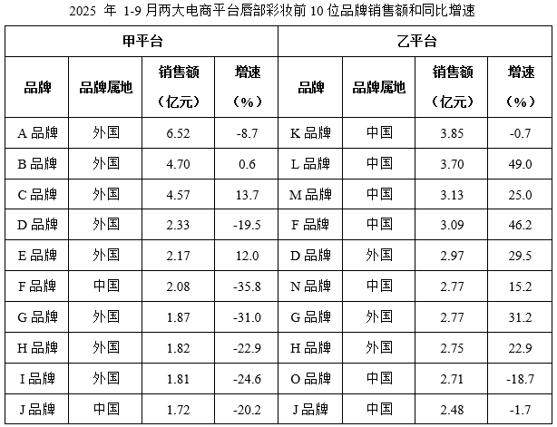

# 同比增长率比较（逐年增速计算并计数年份）

考点：[[20-考点/资料分析/增长/同比增长率比较（逐年增速计算并计数年份）|增长 / 同比增长率比较（逐年增速计算并计数年份）]]
材料：[[15-材料/资料分析/4210262 两大电商平台（甲、乙）2025年1-|4210262 两大电商平台（甲、乙）2025年1-]]

**问法模型**：题干问'2016-2024年间同比增速超过20%的年份有几个' → 对柱状图逐年套用 r=(现期-基期)/基期，与20%阈值比较后数年份。

## 推理链
1. 第1步：从柱状图提取2015-2024年中国唇部彩妆行业市场规模：61.8、71.0、94.2、128.2、167.3、183.5、201.9、232.6、262.8、291.2亿元，2016-2024年共9个年份需逐一核算增速。
2. 第2步：用增长率公式 r=(现期-基期)/基期，判定标准为 r>20%，等价于判定'现期 > 基期×1.2'。
3. 第3步：代入计算前4年：2016年(71.0-61.8)/61.8=9.2/61.8≈14.9%（不满足）；2017年23.2/71.0≈32.7%（满足）；2018年34.0/94.2≈36.1%（满足）；2019年39.1/128.2≈30.5%（满足）。
4. 第4步：核算2020-2024年：2020年16.2/167.3≈9.7%；2021年18.4/183.5≈10.0%；2022年30.7/201.9≈15.2%；2023年30.2/232.6≈13.0%；2024年28.4/262.8≈10.8%，均低于20%不满足。
5. 第5步：超过20%的年份为2017、2018、2019年，共3个，对照选项得C。

**最快解法**：⚡ 阈值判定法（基期放大法）：不算出具体增速，直接比较'现期是否大于基期×1.2'。如2017年71.0×1.2=85.2<94.2满足，2018年94.2×1.2=113.04<128.2满足，2019年128.2×1.2=153.84<167.3满足；而2022年201.9×1.2≈242.3>232.6、2016年61.8×1.2=74.16>71.0等不满足，心算即可排除全部其余年份，得3个。

## 易错点
- ⚠ 时间范围陷阱：只统计2016-2024年共9个增速，2015年因缺2014年数据无同比，不能计入，也不能按'10个年份'惯性去数。
- ⚠ 用增量误代增速：柱状图持续增长、2022-2024年增量均在28~31亿元量级看似很大，但基期已超200亿元，增速仅约13%~15%，若凭增量大小判断会误选更多年份。
- ⚠ 口径混淆：本题只用柱状图'全行业全年市场规模'，勿把表格中两平台前10品牌1-9月销售额（个位数亿元）混入计算。

## 母题抽象
> 🧩 当题干出现'某连续年份区间内同比增速超过(或低于)某阈值的年份有几个'特征时，用'现期 vs 基期×(1+阈值)'的放大判定法逐年代入排除，避免逐年精算增速除法。

**同类特征**：2016-2024年间、同比增速超过20%、年份有几个、行业市场规模、柱状图逐年数据、计数型比较

## 相关题
- [[10-真题/资料分析/增长/5445742 同比增速计算与超阈值年份计数|5445742]]（国考 2023，相关度2）
- [[10-真题/资料分析/增长/2443067 同比增长率读数比较（与固定阈值比对计数）|2443067]]（辽宁 2019，相关度2）
- [[10-真题/资料分析/增长/13504272 一般增长率计算与计数比较（同比增速-5%年份计数）|13504272]]（云南 2025，相关度1）
- [[10-真题/资料分析/增长/2024184 同比增长率比较（超阈值年份计数）|2024184]]（重庆 2016，相关度1）
- [[10-真题/资料分析/比重/2662229 现期比重比较（占比过半判断）|2662229]]（新疆 2020，相关度1）

---

### 题干
2016-2024年间，中国唇部彩妆行业市场规模同比增速超过20%的年份有几个？

### 选项
- A. 1
- B. 2
- C. 3　✅
- D. 4

### 官方解析
根据题干“2016-2024年间······同比增速超过20%的年份有几个”，可判定本题为一般增长率问题。定位统计图可得2015-2024年中国唇部彩妆行业市场规模。根据公式：增长率，可得2016-2024年中国唇部彩妆行业市场规模同比增速分别为：
2016年；
2017年；
2018年；
2019年；
2020年；
2021年；
2022年；
2023年；
2024年。
综上，同比增速超过20%的年份有2017年、2018年、2019年，共3个。
故正确答案为C。
计算提示：同比增速超过20%，即基期量+20%×基期量&lt;现期量。分析可知，2017年：71.0+71.0×20%&lt;94.2，满足；2018年：94.2+94.2×20%&lt;128.2，满足；2019年：128.2+128.2×20%&lt;167.3，满足。其余年份均不满足，故同比增速超过20%的年份有2017年、2018年、2019年，共3个。

### 给定材料

        2025年1-9月，甲、乙平台唇部彩妆销售额分别为63.1亿元和75.3亿元。

