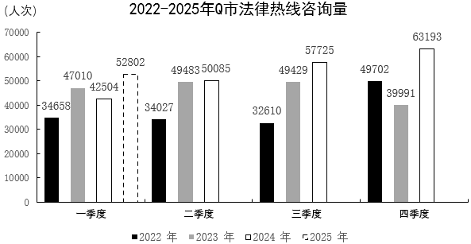

# 环比增长率（跨年相邻期，2025Q1对2024Q4）

考点：[[20-考点/资料分析/增长/环比增长率（跨年相邻期，2025Q1对2024Q4）|增长 / 环比增长率（跨年相邻期，2025Q1对2024Q4）]]
材料：[[15-材料/资料分析/5455839 2022—2025年Q市12348公|5455839 2022—2025年Q市12348公]]

**问法模型**：题干问'2025年第一季度环比增长速度'→以上一相邻期2024年第四季度为基期，用(现期-基期)/基期计算环比增长率

## 推理链
1. 第1步：环比的基期是时间轴上相邻的上一期，2025年第一季度的上一期为2024年第四季度，从统计图第四季度组读2024年白柱=63193人次
2. 第2步：从统计图第一季度组读2025年虚线柱=52802人次（虚线柱是2025年实际数据，非预测）
3. 第3步：代入增长率公式(52802-63193)/63193=-10391/63193≈-16.4%
4. 第4步：与选项对照，-16.44%与计算结果最接近，对应D项，故选D

**最快解法**：⚡ 截位直除+符号排除：分子|52802-63193|=10391，分母取基期63193，截位1039/6319首位商1次位商6得约16.4%；结果为负，在C(-19.68%)与D(-16.44%)中选D（C是把分母误用为现期52802的干扰项）

## 易错点
- ⚠ 环比与同比混淆：2025Q1的环比基期是2024Q4(63193)而非2024Q1(42504)，若误用42504则得+24.23%误选A
- ⚠ 增长率分母必须用基期：若误用现期52802作分母得-19.68%误选C（这正是C项的设置逻辑）
- ⚠ 虚线柱陷阱：图中2025年仅一季度虚线柱是实际数据而非预测值，必须读取52802参与计算；另注意52802<63193，增长率必为负，不能选正项A、B

## 母题抽象
> 🧩 当题干出现'某年第一季度环比增长速度'且材料为分季度柱状图时，用相邻上一期（上一年第四季度）作基期，套(本季-上季)/上季计算，并先判正负再截位直除验证选项

**同类特征**：第一季度、环比增长速度、跨年环比（基期为上年四季度）、柱状图读数（含2025虚线柱）、增长率公式、约为（选项为估算近似值）

## 相关题
- [[10-真题/资料分析/比重/2022296 现期比重比较（超阈值类别计数）|2022296]]（吉林 2016，相关度1）
- [[10-真题/资料分析/增长/2264425 同比增长率计算与比较（折线图趋势判断）|2264425]]（国考 2019，相关度1）
- [[10-真题/资料分析/增长/2387622 增长率计算（跨图表拼接量：部分量=整体量×比重，再求环比增速）|2387622]]（浙江 2019，相关度1）

---

### 题干
2025年第一季度Q市法律热线咨询量环比增长速度约为：

### 选项
- A. 24.23%
- B. 19.50%
- C. -19.68%
- D. -16.44%　✅

### 官方解析

根据题干“2025年第一季度······环比增长速度约为”，可判定本题为一般增长率问题。定位统计图可得：2024年第四季度、2025年第一季度Q市法律热线咨询量分别为63193人次、52802人次。根据公式：增长率，可得2025年第一季度Q市法律热线咨询量环比增长速度，与D项最接近。

故正确答案为D。

### 给定材料

       2025年上半年，Q市12348公共法律服务热线有效接听解答咨询量（以下简称法律热线咨询量）为102428人次。按咨询事项分类统计，前十事项的咨询量合计占法律热线咨询量的85.85%，同比提升0.65个百分点。法律热线咨询量超过1万人次的共四项：咨询量最多的事项是民事诉讼程序，数量为20846人次，同比增长38.3%；其次为经济合同，数量为16819人次；第三名劳动合同与第四名劳动报酬相差无几，分别为10708人次、10682人次。

