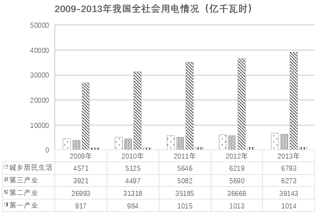

# 同比增长率计算与比较（定性比较高-低）

考点：[[20-考点/资料分析/增长/同比增长率计算与比较（定性比较高-低）|增长 / 同比增长率计算与比较（定性比较高/低）]]
材料：[[15-材料/资料分析/6540513 2009-2013年我国全社会用电情|6540513 2009-2013年我国全社会用电情]]

**问法模型**：题干问'相比城乡居民生活用电量，2010年第一产业用电量的同比增幅较高/较低'→对两个指标分别取2009、2010两期数据套增长率公式（现期-基期)/基期，再比较两分数大小

## 推理链
1. 第1步：题干锁定比较对象为'城乡居民生活'与'第一产业'，年份为2010年（同比即与2009年比）；从表格提取数据：城乡居民生活2009年4571、2010年5125亿千瓦时，第一产业2009年917、2010年984亿千瓦时
2. 第2步：套用同比增长率公式：增长率=（现期值-基期值）/基期值，两指标基期均为2009年
3. 第3步：第一产业同比增幅=（984-917)/917=67/917≈7.3%；城乡居民生活同比增幅=（5125-4571)/4571=554/4571≈12.1%
4. 第4步：比较两分数：554约为67的8倍多，而4571仅约为917的5倍，分子放大幅度大于分母，故554/4571＞67/917，即第一产业增幅较低
5. 第5步：对照选项'较低'，选B

**最快解法**：⚡ 分数性质比较（不必精确算出百分数）：67/917 与 554/4571，后者分子约为前者8.3倍、分母仅约5倍，分子放大更多则后者大，故第一产业增幅较低，直接选B；或截位直除估首位：67/917≈7%+，554/4571≈12%+，一秒定大小

## 易错点
- ⚠ 读图找数陷阱：柱子排列顺序为城乡居民生活、第三产业、第二产业、第一产业，与习惯'一二三产'排序不同，易把城乡居民生活（4571/5125）与第三产业（3921/4497）数据张冠李戴
- ⚠ 增长率算成增长量：若只比较增量（第一产业增67 vs 城乡居民增554）会错判，必须除以各自基期，67/917≈7.3%＞554/4571若是增量比较方向就反了，增长率才是题干所问
- ⚠ 题干只涉及两类指标的两期数据，无需将四大类加总求全社会用电量，勿做多余加总；且精确计算须以下方表格数值为准，不能凭柱状图高度估读

## 母题抽象
> 🧩 当题干出现'相比A，B的某年同比增幅较高/较低'时，分别取A、B相邻两期数据套（现期-基期)/基期，用分数性质（分子分母放大倍数对比）或截位直除快速比较大小，对照定性选项

**同类特征**：相比……的同比增幅、两指标增长率定性比较（较高/较低）、给定年份2010年、基期2009年、柱状图+精确数据表、选项为定性判断无需算出精确百分数、仅需两行两期数据，无需加总求总量

## 相关题
（暂无）

---

### 题干
相比城乡居民生活用电量，2010年第一产业用电量的同比增幅        。

### 选项
- A. 较高
- B. 较低　✅
- C. 是一样的
- D. 无法比较

### 官方解析

根据题干“······2010年······同比增幅”，可判定本题为一般增长率问题。定位统计图可得：2009年、2010年我国城乡居民生活用电量分别为4571亿千瓦时、5125亿千瓦时；2009年、2010年我国第一产业用电量分别为917亿千瓦时、984亿千瓦时。根据公式：增长率，可得2010年我国城乡居民生活用电量的同比增幅，第一产业用电量的同比增幅，故相比城乡居民生活用电量，2010年第一产业用电量的同比增幅较低。

故正确答案为B。

### 给定材料

