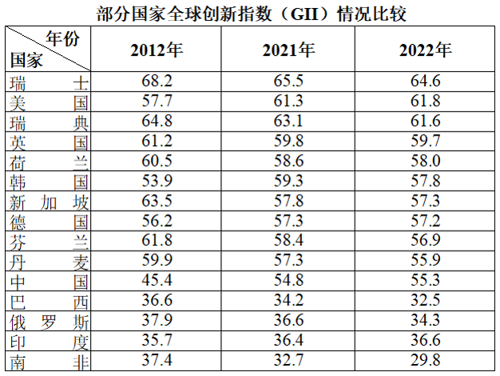

# 增长率比较（首尾年份隔点比较）

考点：[[20-考点/资料分析/增长/增长率比较（首尾年份隔点比较）|增长 / 增长率比较（首尾年份隔点比较）]]
材料：[[15-材料/资料分析/7562466 2012、2021、2022三个年份|7562466 2012、2021、2022三个年份]]

**问法模型**：题干问'相较于2012年，2022年…增长最快'→ 增长率比较模型：增长率=（2022年值−2012年值）÷2012年值，逐年计算后比大小

## 推理链
1. 第1步：由'相较于2012年，2022年增长最快'锁定基期=2012年、现期=2022年，从表中取四选项数据：美国57.7→61.8、中国45.4→55.3、英国61.2→59.7、印度35.7→36.6
2. 第2步：公式 增长率=（现期−基期）÷基期，即增量÷2012年值
3. 第3步：代入计算——美国：4.1/57.7≈7.1%；中国：9.9/45.4≈21.8%；英国：(59.7−61.2)/61.2=−1.5/61.2≈−2.5%（负增长）；印度：0.9/35.7≈2.5%
4. 第4步：比较 21.8%＞7.1%＞2.5%＞−2.5%，中国增速最大，对照选项选B

**最快解法**：⚡ 分子大分母小+截位直除：英国为负增长直接排除；中国增量9.9＞美国4.1且基数45.4＜57.7，分子大分母小，中国必大于美国；印度增量0.9与9.9差约11倍而基数35.7与45.4仅差约1.27倍，中国必大于印度；无需精算即锁定中国（验证：9.9/45.4≈21.8%）

## 易错点
- ⚠ 基期取错：本题基期是2012年而非2021年，若误按'同比'取2021年数据（中国54.8→55.3仅+0.9%）则口径全错
- ⚠ '增长最快'考的是增长率（增量÷基期）而非增量大小；本题中国两项口径均第一（+9.9分、约+21.8%），但概念上须分清
- ⚠ 查表勿串行：表格行按2022年降序排布，'瑞士/瑞典'等相近国名一字之差易取错行；另注意英国2012→2022为负增长（61.2→59.7），是合法比较项而非数据异常
- ⚠ 三个年份非连续（缺2013—2020），本题只比首尾两点即可，切勿试图算年均增长率或假设线性变化

## 母题抽象
> 🧩 当题干出现'相较于某远期基年，现期年…增长最快/增幅最大'且基期、现期为表中两列时，用'增长率=（现期−基期）÷基期'比较；先用增量与基期'分子大分母小'关系排除，负增长项直接淘汰，剩余项截位直除验证

**同类特征**：增长最快、相较于2012年、2022年、首尾两个非连续年份、增长率比较、选项为具体国家名

## 相关题
- [[10-真题/资料分析/增长/2187792 同比增长率比较（增速最快年份判断）|2187792]]（黑龙江 2018，相关度1）
- [[10-真题/资料分析/增长/4658521 增长率（同比降幅）大小比较|4658521]]（四川 2021，相关度1）
- [[10-真题/资料分析/平均数/14355348 平均数公式逆向求人数（人数=资金÷人均年标准）后再作比|14355348]]（浙江 2024，相关度1）
- [[10-真题/资料分析/比重/17900953 现期比重结构判断（饼图-示意图比例匹配）|17900953]]（江苏 2024，相关度1）
- [[10-真题/资料分析/增长/18643713 跨期增长率比较（2024年对2020年4年总增速，先合并价位档再比较）|18643713]]（天津 2026，相关度1）

---

### 题干
表格所列国家中，相较于2012年，2022年全球创新指数增长最快的国家是：

### 选项
- A. 美国
- B. 中国　✅
- C. 英国
- D. 印度

### 官方解析

根据题干“······相较于2012年，2022年······增长最快的国家是”，可判定本题为一般增长率比较问题。定位统计表可得：2012年美国全球创新指数为57.7，2022年为61.8；2012年中国全球创新指数为45.4，2022年为55.3；2012年英国全球创新指数为61.2，2022年为59.7；2012年印度全球创新指数为35.7，2022年为36.6。根据公式：增长率，则相较于2012年，2022年选项中国家全球创新指数同比增速分别为：

美国：；

中国：；

英国：；

印度：。

综上，表格所列国家中，相较于2012年，2022年全球创新指数增长最快的国家是中国。

故正确答案为B。

### 给定材料

