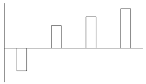
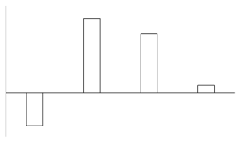
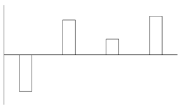

# 同比增量计算与柱状图匹配（增长量比较）

考点：[[20-考点/资料分析/增长/同比增量计算与柱状图匹配（增长量比较）|增长 / 同比增量计算与柱状图匹配（增长量比较）]]
材料：[[15-材料/资料分析/5732287 2017-2022年全国粮食产量总表|5732287 2017-2022年全国粮食产量总表]]

**问法模型**：题干问'柱状图最能准确反映2018-2021年同比增量变化趋势' → 逐年计算增长量=现期-基期，再按正负号与相对大小用排除法匹配图形

## 推理链
1. 第1步：从表格'夏粮产量'列提取数据：2017年14175、2018年13881、2019年14160、2020年14286、2021年14596万吨，注意2018年增量的基期是首行2017年
2. 第2步：所用公式为增长量=现期量-基期量，逐年以前一年作基期
3. 第3步：代入计算：2018年增量=13881-14175=-294万吨，2019年=14160-13881=279万吨，2020年=14286-14160=126万吨，2021年=14596-14286=310万吨
4. 第4步：先按正负排除——2018年增量为负，其柱子应画在横轴下方，排除2018年柱在轴上方的选项
5. 第5步：再按大小排除——2020年增量126万吨小于2019年279万吨和2021年310万吨，排除2020年柱高于或等于2019年柱的选项
6. 第6步：对照四个选项，只有C项同时满足'2018年在轴下方+2020年低于2019和2021'，故正确答案为C

**最快解法**：⚡ 排除法+口算差值：第一步只看正负——2018年13881<14175，增量为-294万吨，柱子必在横轴下方，直接排除轴上方选项；第二步只比大小——2020年增量=14286-14160=126，明显小于2019年的279和2021年的310，两步即锁定C，无需精算全部差值

## 易错点
- ⚠ 基期漏看：2018年增量必须用首行2017年（14175）作基期，漏看表格第一行则首年增量无法计算
- ⚠ 正负号陷阱：2018年增量为-294万吨，柱子应画在横轴下方（横轴代表增量为0），把负增量误画在轴上方会直接选错
- ⚠ 只看走势不看量级：不能凭'先降后升'的定性走势选图，必须验证2020年增量(126)低于2019年(279)，仅看'产量逐年回升'会误选2020年柱高于2019年的图形

## 母题抽象
> 🧩 当题干出现'柱状图反映某指标同比增量变化趋势（横轴代表增量为0）'时，逐年用前一年作基期求增长量，先用正负号排除（负增量柱在轴下方），再比较增量相对大小验证峰谷位置，两步排除即可锁定答案

**同类特征**：柱状图识别、同比增量变化趋势、横轴位置代表增量为0、夏粮产量、2018-2021年、增长量=现期-基期

## 相关题
- [[10-真题/资料分析/增长/16593068 增长量比较（多期同比增量趋势与柱状图匹配）|16593068]]（甘肃 2024，相关度2）
- [[10-真题/资料分析/增长/13504528 增长量比较（图形趋势判断）|13504528]]（云南 2025，相关度2）
- [[10-真题/资料分析/增长/14096261 增长量计算与比较（柱状图趋势匹配）|14096261]]（选调 2025，相关度2）
- [[10-真题/资料分析/增长/16069832 同比增量计算与柱状图趋势匹配（增长量比较）|16069832]]（贵州 2026，相关度1）
- [[10-真题/资料分析/增长/13504514 同比增长量计算与图形趋势匹配|13504514]]（甘肃 2025，相关度1）

---

### 题干
以下柱状图中，最能准确反映2018-2021年全国夏粮产量同比增量变化趋势的是（横轴位置代表增量为0）：

### 选项
- A. 

- B. 

- C. 

　✅
- D. 

### 官方解析
根据题干“······反映2018-2021年······同比增量变化趋势的是······”，可判定本题为增长量比较问题。定位统计表可知：2017-2021年，全国夏粮产量分别为14175万吨、13881万吨、14160万吨、14286万吨、14596万吨。根据公式：增长量=现期量-基期量，可得2018年同比增长量=13881-14175=-294万吨，2019年同比增长量=14160-13881=279万吨，2020年同比增长量=14286-14160=126万吨，2021年同比增长量=14596-14286=310万吨。可知2018年同比增长量为负数，且2020年同比增长量小于2019年和2021年，只有C项符合。
故正确答案为C。

### 给定材料

