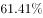
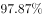
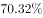
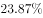

# 同比增长率比较（分行业增速排序）

考点：[[20-考点/资料分析/增长/同比增长率比较（分行业增速排序）|增长 / 同比增长率比较（分行业增速排序）]]
材料：[[15-材料/资料分析/180730 2014年全国市场主体情况：既有期末|180730 2014年全国市场主体情况：既有期末]]

**问法模型**：题干问'四个现代服务业子行业中哪个户数同比增速最快'→定位第三段读取各子行业的'同比增长%'并直接横向比大小取最大者，与各行业户数基数无关、无需任何换算计算

## 推理链
1. 第1步：定位材料第三段，2014年新登记注册现代服务业企业114.10万户，其中四个子行业户数分别为：信息传输、软件和信息技术服务业14.67万户，科学研究和技术服务业26.26万户，文化、体育和娱乐业6.59万户，教育业0.68万户；但四个子行业的'同比增长%'数值在提供文本中均为空白（缺失）
2. 第2步：本题模型为增速直接排序比较——'户数同比增速最快'即四个'同比增长%'中数值最大者，比较对象是增速而非户数、增量和现代服务业整体增速
3. 第3步：依官方解析，四个子行业均实现同比增长，其中信息传输、软件和信息技术服务业的同比增速在四者中最大（具体百分数在提供文本中缺失，排序结论以官方答案为准）
4. 第4步：与选项对照，增速最快者对应D'信息传输、软件和信息技术服务业'，故选D

**最快解法**：⚡ 增速直读比较法（零计算）：定位第三段四个子行业'同比增长%'横向比大小取最大项即得答案；警示——切勿按户数（26.26万户>14.67万户>6.59万户>0.68万户）或增量的大小去排，比较口径只有同比增长%

## 易错点
- ⚠ 把'增速最快'误比为'户数最多/增量最大'：科学研究和技术服务业户数26.26万户居首，极易误选A，但题问的是同比增长%
- ⚠ 误用现代服务业整体（114.10万户）的同比增速、或段1期末存量的增速参与子行业比较，张冠李戴
- ⚠ 提供文本中四个子行业增速数值缺失（空白），须回原文完整数据排序；凭基数大小或主观印象臆断排序必错

## 母题抽象
> 🧩 当题干出现'以下哪个…同比增速最快/最慢'且材料分项给出各'同比增长%'时，用增速直读排序法横向比大小取极值项，切勿用户数基数、增量或整体增速代替分项增速

**同类特征**：同比增速最快、现代服务业新登记注册企业、四个子行业横向比较、只比增速不比户数、定位文字材料第三段、增速数值需从原文直接读取

## 相关题
- [[10-真题/资料分析/增长/2097276 同比增速直接读表比较|2097276]]（四川 2017，相关度1）
- [[10-真题/资料分析/增长/2261975 同比增速（增长率）大小比较|2261975]]（广东 2019，相关度1）
- [[10-真题/资料分析/增长/2741707 增长率（同比增速）比较|2741707]]（山东 2021，相关度1）
- [[10-真题/资料分析/增长/5802088 增长率比较（基期需由现期−增量还原）|5802088]]（浙江 2023，相关度1）
- [[10-真题/资料分析/增长/10204493 同比增速（一般增长率）比较|10204493]]（甘肃 2024，相关度1）

---

### 题干
2014年，以下哪个现代服务业新登记注册企业的户数同比增速最快？

### 选项
- A. 科学研究和技术服务业
- B. 教育业
- C. 文化、体育和娱乐业
- D. 信息传输、软件和信息技术服务业　✅

### 官方解析
定位文字材料第三段，现代服务业新登记注册企业的户数中，科学研究和技术服务业同比增长，教育业同比增长，文化、体育和娱乐业同比增长，信息传输、软件和信息技术服务业同比增长，因此，同比增速最快的是信息传输、软件和信息技术服务业。
故正确答案为D。

### 给定材料

        截至2014年12月底，全国实有各类市场主体6932.22万户，比上年末增长，增速较上年同期增加4.02个百分点；注册资本（金）129.23万亿元，比上年末增长。其中，企业1819.28万户，个体工商户4984.06万户，农民专业合作社128.88万户。

        2014年，全国新登记注册市场主体1292.5万户，比上年同期增加160.97万户；注册资本（金）20.66万亿元，比上年同期增加9.66万亿元。其中，企业365.1万户，个体工商户896.45万户，农民专业合作社30.95万户。

        2014年，新登记注册现代服务业企业114.10万户，同比增长。其中，信息传输、软件和信息技术服务业14.67万户，同比增长；科学研究和技术服务业26.26万户，同比增长；文化、体育和娱乐业6.59万户，同比增长；教育业0.68万户，同比增长。

        2014年，新登记注册外商投资企业3.84万户，同比增长。投资总额2763.31亿美元，同比增长；注册资本1796.39亿美元，同比增长。

> [!warning] 疑点（官方解析可能有误，待人工复核）
> 提供文本中第三段四个子行业的'同比增长%'数值全部缺失（空白），官方解析亦未列出具体百分数，'增速最快'的排序结论无法由给定数据复算验证；本笔记按官方答案采信D（信息传输、软件和信息技术服务业增速最快），仅如实标注数据缺口，不构成对答案本身的质疑
