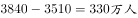
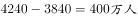
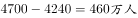
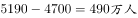
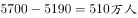
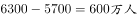
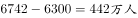
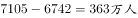

# 增长量比较（同比增长量逐年做差与阈值计数）

考点：[[20-考点/资料分析/增长/增长量比较（同比增长量逐年做差与阈值计数）|增长 / 增长量比较（同比增长量逐年做差与阈值计数）]]
材料：[[15-材料/资料分析/181128 2005—2013年中国科技人力资源|181128 2005—2013年中国科技人力资源]]

**问法模型**：题干问'2006—2013年间有几年较前一年增长超过500万人' → 对总量逐年做差得8个同比增长量，逐一与500万阈值比较后计数

## 推理链
1. 第1步：锁定白色柱'科技人力资源总量'（万人，左轴）：2005年3510、2006年3840、2007年4240、2008年4700、2009年5190、2010年5700、2011年6300、2012年6742、2013年7105
2. 第2步：'较前一年增长'即同比增长量=当年值−前一年值，2006—2013年需做8次差
3. 第3步：逐年做差：2006年3840−3510=330，2007年4240−3840=400，2008年4700−4240=460，2009年5190−4700=490，2010年5700−5190=510，2011年6300−5700=600，2012年6742−6300=442，2013年7105−6742=363
4. 第4步：与500万比较：330、400、460、490、442、363均未超过，仅2010年（510）和2011年（600）超过500万，共2年
5. 第5步：对照选项'2年'为A项，与官方答案A一致

**最快解法**：⚡ 逐年做差+差值口算：相邻年份差依次为330、400、460、490、510、600、442、363，只需扫一眼判定是否过500，仅510、600两个超标，秒定2年（A）；亦可观察柱高差，只有2009→2010和2010→2011两处柱差明显跨过500万刻度

## 易错点
- ⚠ 比较基准错误：'较前一年'是逐年做差（8个增量），不能误当成'较2005年'的累计增量，也不能只抽查部分年份
- ⚠ 双轴读数陷阱：应读白色柱（左轴，万人），勿误用折线'每万人口中科技人力资源数'（右轴，人）做差
- ⚠ 临界值误判：2009年增量为490，与500仅差10，粗心易当成'超过500'；且8个增量需逐一核对，易漏算2012年（442）、2013年（363）导致误计

## 母题抽象
> 🧩 当题干出现'某时段内有几年较前一年增长超过/达到X'的特征时，用相邻两年现期值逐年做差（N个年份数据产生N−1个增量），逐个与阈值比较后计数即可

**同类特征**：2006—2013年间、有几年、较前一年增长、超过500万人、计数型增长量比较、单图白色柱逐年做差

## 相关题
- [[10-真题/资料分析/增长/2136970 增长量计算（逐年增长量与阈值比较计数）|2136970]]（北京 2018，相关度1）
- [[10-真题/资料分析/增长/2188348 两期数值比较（逐期增减判断计数）|2188348]]（江西 2018，相关度1）
- [[10-真题/资料分析/增长/5445931 增长量计算与比较（相邻月末时点做差计数）|5445931]]（国考 2023，相关度1）
- [[10-真题/资料分析/增长/5833651 逐年同比增长率与固定阈值（30%）比较计数|5833651]]（选调 2020，相关度1）
- [[10-真题/资料分析/增长/5101663 增长量比较（量之和逐年同比判定）|5101663]]（云南 2022，相关度1）

---

### 题干
2006—2013年间，有几年的科技人力资源总量较前一年增长超过500万人？

### 选项
- A. 2　✅
- B. 3
- C. 4
- D. 5

### 官方解析

根据题干“有几年···增长超过500万人”，可判定本题为增长量计算问题。定位图形材料可知：2006年增长，2007年增长，2008年增长，2009年增长，2010年增长，2011年增长，2012年增长，2013年增长。只有2010、2011年满足增长大于500万人，故2006—2013年间，有2年的科技人力资源总量较前一年增长超过500万人。

故正确答案为A。

### 给定材料

