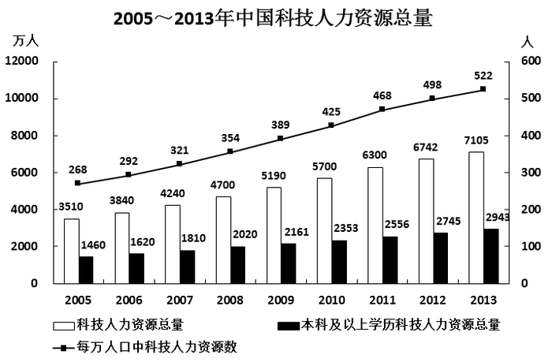

# 年均增长量计算（五年规划期口径）

考点：[[20-考点/资料分析/增长/年均增长量计算（五年规划期口径）|增长 / 年均增长量计算（五年规划期口径）]]
材料：[[15-材料/资料分析/181128 2005—2013年中国科技人力资源|181128 2005—2013年中国科技人力资源]]

**问法模型**：题干出现'十一五(2006—2010)期间平均每年…增加约多少万人'→ 用年均增长量模型：(规划末年2010年末值−规划期前一年2005年末值)÷5年

## 推理链
1. 第1步：锁定指标为黑色柱'本科及以上学历科技人力资源总量'，读得2005年末1460万人、2010年末2353万人（题干明确图中均为年末数据）
2. 第2步：'十一五'规划期为2006—2010共5个年份，按五年规划年均量口径，基期取规划期前一年即2005年末，年份跨度n=5
3. 第3步：代入公式：年均增长量=(2353−1460)÷5=893÷5
4. 第4步：计算得893÷5=178.6≈180万人
5. 第5步：与选项对照，178.6与180最接近，故选B；验证若误除以4得223会偏向C，确认n应取5

**最快解法**：⚡ 截位口算：差值893≈900，900÷5=180，直接锁定B，无需精确计算；同时用'5年跨度'排除除以4的C陷阱

## 易错点
- ⚠ 基期与年份跨度取错：误把2006年末值1620当基期或按2006—2010'4个间隔'除以4，得约223而误选C；五年规划年均增加应以规划期前一年（2005年末1460）为基期、除以5
- ⚠ 指标定位错误：柱线双轴图中误取白色柱总量数据（如5700−4240）或折线'每万人口'数据计算
- ⚠ 选项区分度陷阱：178.6与180、200均较接近，须实际算出差值893再除以5，不能凭感觉在B/C间猜测

## 母题抽象
> 🧩 当题干出现'××五（2006—2010）期间平均每年增加/增长'时，用（规划末年值−规划期前一年值）÷5求年均增长量，并验证结果最接近的选项；若题干为普通年份区间（如2006—2010非规划表述）则需按选项确认分段起点

**同类特征**：十一五（2006—2010）、平均每年、增加约多少万人、本科及以上学历科技人力资源、年末数据、年均增长量

## 相关题
- [[10-真题/资料分析/增长/15419190 年均增长量计算|15419190]]（湖北 2025，相关度1）
- [[10-真题/资料分析/增长/19452634 年均增长量与现期量外推|19452634]]（上海 2026，相关度1）
- [[10-真题/资料分析/增长/2185042 年均增长量计算（基期前移型）|2185042]]（广东 2018，相关度1）
- [[10-真题/资料分析/增长/2725324 年均增长量（同比增量均值）+基期量反推|2725324]]（四川 2020，相关度1）
- [[10-真题/资料分析/增长/2742310 年均增长量计算|2742310]]（北京 2021，相关度1）

---

### 题干
如图中反映的均为年末数据，则“十一五”（2006—2010年）期间平均每年本科及以上学历科技人力资源增加约多少万人？

### 选项
- A. 150
- B. 180　✅
- C. 200
- D. 440

### 官方解析
根据题干“平均每年···增加约多少万人”，可判定本题为年均增长量计算问题。定位图形材料可知：本科及以上学历科技人力资源总量2005年1460万人、2010年2353万人。根据年均增长量=（五年规划基期往前推一年），则“十一五”（2006—2010年）期间平均每年本科及以上学历科技人力资源增加约万人。
故正确答案为B。

### 给定材料

