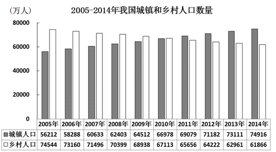

# 年均增长量计算（总人口需两列加总后作差）

考点：[[20-考点/资料分析/增长/年均增长量计算（总人口需两列加总后作差）|增长 / 年均增长量计算（总人口需两列加总后作差）]]
材料：[[15-材料/资料分析/181642 中国2005-2014年城镇与乡村人|181642 中国2005-2014年城镇与乡村人]]

**问法模型**：题干问'十一五期间平均每年约新增多少人口'且选项为量级区间 → 用年均增长量模型（末期总人口−基期总人口）÷5年，基期取2005年末

## 推理链
1. 第1步：从题干提取条件——'所有数据均为年末数据'，'十一五'为2006-2010年，故基期为2005年末、现期为2010年末，年数n=5
2. 第2步：图1无总人口列，需将城镇与乡村人口自行加总：2005年总人口=56212+74544=130756万人
3. 第3步：同法加总2010年：66978+67113=134091万人
4. 第4步：'十一五'五年合计新增=134091−130756=3335万人
5. 第5步：年均增长量=3335÷5=667万人
6. 第6步：667万落在600-700万区间，对照选项，符合C'600多万'

**最快解法**：⚡ 截位直除（首位判断）：先口算总人口差134091−130756=3335万，再3335÷5，首位商6得667万，直接锁定'600多万'选C，无需精算后几位

## 易错点
- ⚠ 基期取错：误把2006年末当基期，正确应为2005年末（十一五新增=2010年末−2005年末），题干'均为年末数据'即为此提示
- ⚠ 漏加乡村人口：图1只有城镇、乡村两列，若误用城镇人口增量(71182区间错、实为66978−56212=10766万)÷5≈2153万会误选D，必须两列加总求总人口
- ⚠ 混淆'年均增长量'与'五年合计'：3335万是五年合计新增，忘记÷5会找不到对应量级；年数取5（2006-2010）而非6

## 母题抽象
> 🧩 当题干出现'某五年规划期（如十一五2006-2010）平均每年新增/增长'且数据为年末值时，用（规划期末年值−规划期前一年值）÷5，基期取期初前一年年末，验证商的首位落在选项量级区间

**同类特征**：'十一五'期间(2006-2010)、平均每年约新增、所有数据均为年末数据、选项为量级区间表述（不到/多少万以上）、总人口需城镇+乡村两列自行加总

## 相关题
（暂无）

---

### 题干
如所有数据均为年末数据，则“十一五”期间（2006-2010年），我国平均每年约新增（    ）人口。

### 选项
- A. 不到500万
- B. 500多万
- C. 600多万　✅
- D. 700万以上

### 官方解析
根据题干“‘十一五’期间，平均每年新增······人口”，结合选项带单位，可判定为年均增长量计算问题。定位柱状图1，2005年的人口总数为（）万人，2010年的总人口为（）万人，则年均增长量，符合C项取值范围。
故正确答案为C。

### 给定材料

 

