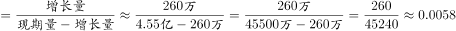
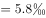

# 已知增长量与现期求增长率

考点：[[20-考点/资料分析/增长/已知增长量与现期求增长率|增长 / 已知增长量与现期求增长率]]
材料：[[15-材料/资料分析/181454 全国水稻生产情况：2013年种植面积|181454 全国水稻生产情况：2013年种植面积]]

**问法模型**：题干问'2013年比2012年增长约（%）'→ 增长率=增长量÷基期，其中基期=现期−增长量，即260多万亩÷(4.55亿−260多万)亩

## 推理链
1. 第1步：题干要求2013年种植面积比2012年的增长率，选项均为百分数；定位文字段'2013年全国水稻种植面积达4.55亿亩，比上年增加260多万亩'
2. 第2步：'增加260多万亩'是同比增减量（增长量），不是增长率；基期（2012年）面积=4.55亿亩−260多万亩≈45500万−260万=45240万亩（约4.524亿亩）
3. 第3步：代入公式 增长率=增长量÷基期=260多万亩÷45240万亩≈260/45240≈0.0057，即约0.6%
4. 第4步：即便粗算用现期作分母，260万÷45500万≈0.57%，结果同为千分之几量级（约0.6%），与选项对照锁定B，故正确答案为B

**最快解法**：⚡ 截位直除+量级判定：统一单位为万亩，260÷45500（或更精确的260÷45240）≈0.57%~0.6%；先确认结果是千分之几（远小于1%），直接匹配对应0.6%左右的选项B，无需精算

## 易错点
- ⚠ 量级陷阱：正确答案约0.6%，选项常混入5.7%、6%、0.06%等干扰项，小数点错一位即错选，务必先估量级再对选项
- ⚠ 把'增加260多万亩'误读为增长率或直接当作增速使用，实际它是增长量，必须除以基期
- ⚠ 单位换算：4.55亿亩=45500万亩，1亿亩=10000万亩；口径上'260多万亩'是约数，粗算即可，不必纠结精确基期

## 母题抽象
> 🧩 当题干出现'现期年比基期年增长约（%）'且材料只给'现期值+比上年增加量'时，用 增长率=增加量÷(现期−增加量)，先截位直除估量级、再对照选项验证

**同类特征**：比……年增长约、选项为百分数、材料仅给现期值与同比增加量、亿亩与万亩单位混用需换算、增长率量级极小（小于1%）

## 相关题
- [[10-真题/资料分析/增长/9629 一般增长率计算（现期需由增量倒推）|9629]]（安徽 2009，相关度1）
- [[10-真题/资料分析/比重/2604234 现期比重计算|2604234]]（广东 2020，相关度1）
- [[10-真题/资料分析/增长/27835 一般增长率计算（已知现期量与增长量求增长率）|27835]]（河北 2012，相关度1）
- [[10-真题/资料分析/平均数/10204497 平均数增长率（均价=值-量的比值增长率）|10204497]]（海南 2024，相关度1）
- [[10-真题/资料分析/增长/12536395 隔年（间隔）增长率|12536395]]（四川 2024，相关度1）

---

### 题干
2013年我国水稻种植面积比2012年增长约（  ）。

### 选项
- A. 

- B. 

　✅
- C. 

- D. 

### 官方解析

根据题干“2013年······比2012年增长······”，结合选项为百分数，可判定本题为一般增长率计算问题。定位文字材料第一段，“2013年全国水稻种植面积达4.55亿亩，比上年增加260多万亩”，则所求增长率。 

故正确答案为B。

### 给定材料

        2013年全国水稻种植面积达4.55亿亩，比上年增加260多万亩。但由于强降雨及洪涝灾害，总产量较上年减少62万吨，总产量为20361万吨。下图反映的是20082012年我国水稻每亩的产值情况及水稻生产的主要成本构成情况。

注：产值合计等于总成本与净利润之和。

