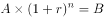
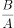
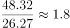
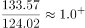
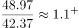
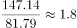
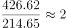
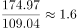
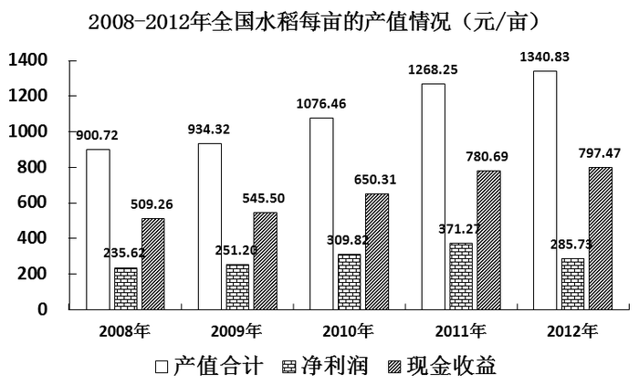
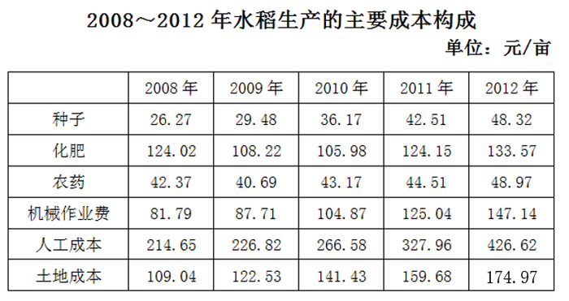

# 年均增长率比较与排序

考点：[[20-考点/资料分析/增长/年均增长率比较与排序|增长 / 年均增长率比较与排序]]
材料：[[15-材料/资料分析/181454 全国水稻生产情况：2013年种植面积|181454 全国水稻生产情况：2013年种植面积]]

**问法模型**：题干问'2008-2012年年均增速从高到低排序、位次与项目对应' → 各项目年份差n相同，年均增速(1+r)^n=末年值/首年值，故只需比较各成本2012/2008的倍数大小即可排序

## 推理链
1. 第1步：从表1提取六项成本的2008年（首年）与2012年（末年）值，年份差n=2012−2008=4，六项n相同
2. 第2步：年均增长率公式(1+r)^n=末年值/首年值，n相同则r的大小只取决于末年/首年的倍数，无需真的开4次方
3. 第3步：求各成本倍数：人工成本426.62/214.65≈1.99、种子48.32/26.27≈1.84、机械作业费147.14/81.79≈1.80、土地成本174.97/109.04≈1.60、农药48.97/42.37≈1.16、化肥133.57/124.02≈1.08
4. 第4步：排序为人工>种子>机械>土地>农药>化肥，即第1人工、第2种子、第3机械、第4土地、第5农药、第6化肥
5. 第5步：与选项对照：A项第1应为人工而非土地，B项种子应排第2而非第3，C项农药应排第5而非第4，只有D项'第6：化肥'（倍数1.08全场最小）对应正确，选D

**最快解法**：⚡ 倍数比较法（年均增速公式法变形）：n相同不必开n次方，直接做六个除法比2012/2008倍数；先快速验证D——化肥133.57/124.02≈1.08为六项中最小，即年均增速排第6，秒选D；再用人工≈1.99（第1）、种子≈1.84（第2）、农药≈1.16（第5）排除A、B、C

## 易错点
- ⚠ 年份差n误取为5（按2012−2008+1计算），规范口径应为n=4；虽本题因各项目n相同、倍数排序结论不变，但单项目算具体年均增速时会算错
- ⚠ 用'2012年−2008年'增量代替倍数排序：虽然本题化肥增量约9.55元/亩也是最小、结论碰巧一致，但增量排序与增速排序并非同一口径，一般情形会出错
- ⚠ 选项是'位次—项目'对应关系，必须排全六项名次才能逐一排除：只算个别项、或把种子误当第3（实际第2，第3是机械）、农药误当第4（实际第5，第4是土地）就会误选B或C

## 母题抽象
> 🧩 当题干出现'某时段年均增速/年均增长率从高到低排序'特征时，各项目年份差n相同，用'末年值/首年值'倍数直接比较排序，不必开n次方，验证最小或最大项即可定位答案

**同类特征**：2008-2012年年均增速、从高到低排序、位次与项目对应、主要成本、六项成本、统计表多年数据

## 相关题
- [[10-真题/资料分析/平均数/2184619 现期平均数比较（收入÷企业数排序）|2184619]]（选调 2018，相关度1）
- [[10-真题/资料分析/平均数/2578802 现期平均数计算与分类排序（分组算术平均）|2578802]]（四川 2020，相关度1）
- [[10-真题/资料分析/平均数/2136494 现期平均数比较（平均每个法人单位从业人员数从高到低排序）|2136494]]（河南 2017，相关度1）
- [[10-真题/资料分析/平均数/2604298 基期平均数（基期量）大小比较——四大区域月均收入2018年排序|2604298]]（广东 2020，相关度1）
- [[10-真题/资料分析/增长/1797916 基期量计算与排序（环比基期比较）|1797916]]（黑龙江 2016，相关度1）

---

### 题干
将水稻生产的主要成本按2008-2012年年均增速从高到低排序，下列位次与项目对应正确的是（    ）。

### 选项
- A. 第1：土地
- B. 第3：种子
- C. 第4：农药
- D. 第6：化肥　✅

### 官方解析

根据题干“2008-2012年年均增速从高到低······”，可判定本题为年均增长率的比较问题。根据年均增长率公式，因年份差n相同，则要想比较r的大小，只需比较的大小即可。定位表格，分别为：种子、化肥、农药、机械作业费、人工成本、土地成本，综上可得，化肥的值最小，即其年均增速最小。

故正确答案为D。

### 给定材料

        2013年全国水稻种植面积达4.55亿亩，比上年增加260多万亩。但由于强降雨及洪涝灾害，总产量较上年减少62万吨，总产量为20361万吨。下图反映的是20082012年我国水稻每亩的产值情况及水稻生产的主要成本构成情况。

注：产值合计等于总成本与净利润之和。

