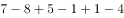

# 基期量计算与加总（现期量−增长量求合计）

考点：[[20-考点/资料分析/增长/基期量计算与加总（现期量−增长量求合计）|增长 / 基期量计算与加总（现期量−增长量求合计）]]
材料：[[15-材料/资料分析/182048 第三次全国经济普查（现期2013年末|182048 第三次全国经济普查（现期2013年末]]

**问法模型**：题干问'2008年末（基期）普查对象三类主体数量合计' → 对每类主体用'基期=现期−增长量'求2008年末值后加总（或先加总现期与增量再作差）

## 推理链
1. 第1步：由材料第一段确定普查对象=法人单位+产业活动单位+有证照个体经营户三类，且三者口径互不重叠、须全部计入；2013年末分别有1085.7、1303.5、3279.1万个
2. 第2步：三类主体较2008年末分别增加375.8、417.1、405.4万个，故基期(2008年末)合计=现期(2013年末)合计−增量合计
3. 第3步：现期合计1085.7+1303.5+3279.1=5668.3万个，增量合计375.8+417.1+405.4=1198.3万个（分项验证：709.9+886.4+2873.7）
4. 第4步：5668.3−1198.3=4470.0万个，尾数为0，对照选项仅C（4470.0万）尾数为0，故选C

**最快解法**：⚡ 尾数法：先加总现期5668.3与增量1198.3，两数尾数均为.3，相减尾数必为.0；四个选项中只有C（4470.0万）尾数为0，直接锁定C，无需完整竖式计算（分项尾数验证：0.9+0.4+0.7=2.0，尾数同为0）

## 易错点
- ⚠ 漏项陷阱：普查对象是三类主体（法人单位+产业活动单位+有证照个体经营户），漏算产业活动单位或有证照个体经营户必错；若只用法人口径1085.7−375.8=709.9万会严重偏小
- ⚠ 增减方向搞反：把'比2008年末增加375.8万个'当成基期值往上加，会错选B（4845.8=4470.0+375.8）或D（5262.9=4470.0+375.8+417.1，仅减了个体户增量）
- ⚠ 单位与时间口径：数量均为'万个'、选项不带'个'字需按万为单位比较；现期为2013年末、基期为2008年末，勿用'提高/下降若干个百分点'（第3段占比变化）参与本题加减

## 母题抽象
> 🧩 当题干出现'若干年前（基期）某几类主体数量合计'特征时，用'基期=现期−增长量'逐类还原后加总，若选项尾数各异优先用尾数法先排除锁定答案

**同类特征**：基期合计、2008年末、普查对象数量合计、现期量−增长量、三类主体加总、选项尾数可判定

## 相关题
（暂无）

---

### 题干
2008年末，列入上述资料所示的普查对象的数量合计为（  ）。

### 选项
- A. 4072.1万
- B. 4845.8万
- C. 4470.0万　✅
- D. 5262.9万

### 官方解析

定位文字材料第一段可得，“普查对象是在我国境内从事第二产业和第三产业的全部法人单位，产业活动单位和有证照个体经营户”，“2013年末，全国共有从事第二产业和第三产业的法人单位1085.7万个，比2008年末增加375.8万个，产业活动单位1303.5万个，增加417.1万个，有证照个体经营户3279.1万个，增加405.4万个”。故2008年普查对象数量合计为，计算尾数，尾数为0。

故正确答案为C。

### 给定材料

        根据《国务院关于开展第三次全国经济普查的通知》(国发〔2012〕60号)要求，我国进行了第三次全国经济普查，这次普查的标准时点为2013年12月31日，普查时期资料为2013年年度资料，普查对象是在我国境内从事第二产业和第三产业的全部法人单位、产业活动单位和有证照个体经营户，相关调查显示，2013年末，全国共有从事第二产业和第三产业的法人单位1085.7万个，比2008年末(2008年是第二次全国经济普查年份，下同)增加375.8万个；产业活动单位1303.5万个，增加417.1万个；有证照个体经营户3279.1万个，增加405.4万个。

        从行业角度看，2013年末，在第二产业和第三产业的法人单位中，位居前三位的行业是：批发和零售业281.1万个，占25.9%；制造业225.3万个，占20.7%；公共管理社会保障和社会组织152万个，占14%。在第二产业和第三产业的有证照个体经营户中，位居前三位的行业是：批发和零售业1642.7万个，交通运输仓储和邮政业878.6万个，住宿和餐饮业240.8万个。

        从单位性质看，2013年末，在第二产业和第三产业的法人单位中，企业法人单位占75.6%，比2008年末提高了5.7个百分点；机关事业法人单位占9.6%，比2008年末下降了3.9个百分点；社会团体和其他法人占14.8%，比2008年末下降了1.8个百分点。

        从登记注册类型看，2013年末，在第二产业和第三产业企业法人单位中，内资企业法人、外商投资企业法人和港澳台商投资企业法人分别为800.6万个、10.6万个和9.7万个。在内资企业法人中，国有企业法人占全部企业法人单位的1.4%，私营企业法人占全部企业法人单位的68.3%。

