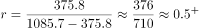
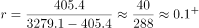
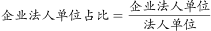
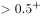
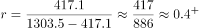

# 增长率比较（部分-整体两期比重口诀辅助）

考点：[[20-考点/资料分析/增长/增长率比较（部分-整体两期比重口诀辅助）|增长 / 增长率比较（部分-整体两期比重口诀辅助）]]
材料：[[15-材料/资料分析/182048 第三次全国经济普查（现期2013年末|182048 第三次全国经济普查（现期2013年末]]

**问法模型**：题干出现'与第二次经济普查相比……增长最快的是'→ 对各普查对象分别求增长率（增长率=增长量/基期量）再比较大小；对只给比重变化的类别用'比重上升⇒部分增速>整体增速'口诀定位增速区间

## 推理链
1. 第1步：从第一段提取三个可直接计算的对象数据：法人单位现期1085.7万个、增量375.8万个；产业活动单位现期1303.5万个、增量417.1万个；有证照个体经营户现期3279.1万个、增量405.4万个；从第三段提取C项条件：企业法人单位占法人单位75.6%，比2008年末提高5.7个百分点
2. 第2步：一般增长率公式 r=增长量/(现期量−增长量)，分母为2008年末基期存量；C项材料未给企业法人现期与增量，改用两期比重比较口诀'部分增长率高于整体增长率，比重上升'，或跨段拼合先算基期、现期存量再求增速
3. 第3步：代入截位直除：A项法人单位=375.8/(1085.7−375.8)=375.8/709.9≈52.9%；B项个体经营户=405.4/(3279.1−405.4)=405.4/2873.7≈14.1%；D项产业活动单位=417.1/(1303.5−417.1)=417.1/886.4≈47.1%
4. 第4步：C项口诀判定：企业法人占法人单位的比重由2008年末的75.6%−5.7%=69.9%升至2013年末的75.6%，比重上升，故企业法人增速必高于整体法人单位增速52.9%（精算验证：基期709.9×69.9%≈496.2万个，现期1085.7×75.6%≈820.8万个，增速≈324.6/496.2≈65.4%）
5. 第5步：比较四项增速65.4%(C)>52.9%(A)>47.1%(D)>14.1%(B)，增长最快的是企业法人单位数，对照选项选C

**最快解法**：⚡ 两期比重口诀+截位直除：先用截位直除算A≈52.9%、D≈47.1%、B≈14.1%，淘汰B、D且锁定当前最大值A≈52.9%；C项只需看比重变化——企业法人占比提高5.7个百分点⇒其增速必大于整体法人单位增速52.9%，无需精算即锁定C（若需验证：基期709.9×69.9%≈496万，现期1085.7×75.6%≈821万，增速≈65.4%）

## 易错点
- ⚠ '增长最快'比的是增长率而非增长量：若误比增量，法人单位增量375.8万个最大，极易误选A；四个对象基数悬殊（个体经营户3279.1万vs企业法人约821万），必须统一化为增速比较
- ⚠ C项数据跨段分散：企业法人增速需由第三段'占75.6%、提高5.7个百分点'结合第一段法人单位总量拼合而得，漏看比重变化条件会直接漏算C而误选A
- ⚠ 基期量=现期量−增长量，分母须用2008年末存量（如709.9万个），误用现期量1085.7万作分母会得≈34.6%扭曲比较；另'提高5.7个百分点'是占比变化（百分点），不是增速，不能直接代入增长率公式

## 母题抽象
> 🧩 当题干出现'增长最快/增速最大'且某类别只给'占比及其百分点变化'时，先用增长量/(现期−增长量)算出可比项增速，再用'比重上升⇒部分增速>整体增速'口诀锁定该未给数项的增速必超过已算最大值，即可不精算判定答案

**同类特征**：与第二次全国经济普查（2008年末）相比、增长最快的是、多个普查对象并列比较（法人单位/产业活动单位/个体经营户/企业法人）、部分对象仅给比重及百分点变化而非增量、时点存量数据（2013年末vs2008年末）、需跨段拼合数据

## 相关题
（暂无）

---

### 题干
与第二次全国经济普查时相比，第三次经济普查时，下列普查对象数量增长最快的是（  ）。

### 选项
- A. 第二产业和第三产业法人单位数
- B. 第二产业和第三产业有证照个体经营户数
- C. 第二产业和第三产业企业法人单位数　✅
- D. 第二产业和第三产业活动单位数

### 官方解析

根据题干所求“增长最快的是”，可判定本题为一般增长率比较问题。定位材料可得各普查对象现期量与增长量，由增长率，分别代入数据可得各项增长率。

A项：定位文字材料第一段可得，2013年末，第二产业和第三产业的法人单位1085.7万个，比2008年末增加375.8万个。故所求增长率；

B项：定位文字材料第一段可得，有证照个体经营户3279.1万个，增加405.4万个。故所求增长率；

C项：定位文字材料第三段可得，2013年末第二产业和第三产业的法人单位中，企业法人单位占，比2008年末提高了5.7个百分点。根据两期比重比较口诀“部分增长率高于整体增长率，比重上升”，,2013年末企业法人单位数占法人单位数的比重比2008年末提高了5.7个百分点，则企业法人单位数的增长率必然高于法人单位数的增长率，所求增长率；

D项：定位文字材料第一段可得，产业活动单位1303.5万个，增加417.1万个。故所求增长率。 

比较可知增长最快的是第二产业和第三产业企业法人单位数。

故正确答案为C。

### 给定材料

        根据《国务院关于开展第三次全国经济普查的通知》(国发〔2012〕60号)要求，我国进行了第三次全国经济普查，这次普查的标准时点为2013年12月31日，普查时期资料为2013年年度资料，普查对象是在我国境内从事第二产业和第三产业的全部法人单位、产业活动单位和有证照个体经营户，相关调查显示，2013年末，全国共有从事第二产业和第三产业的法人单位1085.7万个，比2008年末(2008年是第二次全国经济普查年份，下同)增加375.8万个；产业活动单位1303.5万个，增加417.1万个；有证照个体经营户3279.1万个，增加405.4万个。

        从行业角度看，2013年末，在第二产业和第三产业的法人单位中，位居前三位的行业是：批发和零售业281.1万个，占25.9%；制造业225.3万个，占20.7%；公共管理社会保障和社会组织152万个，占14%。在第二产业和第三产业的有证照个体经营户中，位居前三位的行业是：批发和零售业1642.7万个，交通运输仓储和邮政业878.6万个，住宿和餐饮业240.8万个。

        从单位性质看，2013年末，在第二产业和第三产业的法人单位中，企业法人单位占75.6%，比2008年末提高了5.7个百分点；机关事业法人单位占9.6%，比2008年末下降了3.9个百分点；社会团体和其他法人占14.8%，比2008年末下降了1.8个百分点。

        从登记注册类型看，2013年末，在第二产业和第三产业企业法人单位中，内资企业法人、外商投资企业法人和港澳台商投资企业法人分别为800.6万个、10.6万个和9.7万个。在内资企业法人中，国有企业法人占全部企业法人单位的1.4%，私营企业法人占全部企业法人单位的68.3%。

