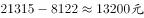
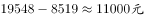
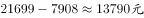
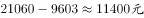

# 增长量比较

考点：[[20-考点/资料分析/增长/增长量比较|增长 / 增长量比较]]
材料：[[15-材料/资料分析/182050 以分组柱状图呈现2001、2007、|182050 以分组柱状图呈现2001、2007、]]

**问法模型**：题干出现'2007年和2001年相比…增加值最大的是'→ 采用增长量模型：增加值=2007年数值-2001年数值（现期-基期），对四个选项省份逐项作差取最大

## 推理链
1. 第1步：题干限定比较山西、湖北、安徽、湖南四省，从柱状图按图例取白色柱（2007年）与灰色柱（2001年）数值：山西8122/21315、湖北8519/19548、安徽7908/21699、湖南9603/21060
2. 第2步：增加值=现期值-基期值，即2007年平均工资-2001年平均工资（作差模型，非作商）
3. 第3步：代入计算：山西21315-8122=13193；湖北19548-8519=11029；安徽21699-7908=13791；湖南21060-9603=11457
4. 第4步：比较差值13791＞13193＞11457＞11029，安徽增加值最大，对应选项C，与官方答案一致

**最快解法**：⚡ 极值锁定法（免全算）：增长量=2007年-2001年，四省中安徽2007年数值最大（21699）且2001年数值最小（7908），现期最大、基期最小者增长量必最大，直接锁定C；仅需验证一个次大者山西21315-8122=13193＜13791即可

## 易错点
- ⚠ 三色柱易读串：必须按图例取白色柱（2007年）与灰色柱（2001年），误取斜纹柱（2013年）数据（如47806、40407）即全题错
- ⚠ 模型混淆：本题考'增加值'=增长量作差，兄弟题考'增长率'作商；柱子高（现期值大）不等于增加值大，更不等于增长率高，不可凭柱高目测判断
- ⚠ 近似值抄错：安徽2001年7908与河南7916仅差8，安徽基期最低恰是锁定答案的关键，抄错基期值即误判

## 母题抽象
> 🧩 当题干出现'某期与某期相比，增加值/增长量最大（小）的主体是'时，用'现期-基期'逐项作差比较；速判技巧：若某主体现期值最大且基期值最小，其增长量必最大，可免逐项计算直接锁定，再用一组作差验证

**同类特征**：两期相比（2007 vs 2001）、增加值最大、省份主体比较、增长量比较、分组柱状图按图例取数、选项限定四省

## 相关题
- [[10-真题/资料分析/增长/2144598 增长量比较|2144598]]（选调 2018，相关度3）
- [[10-真题/资料分析/增长/465283 增长量比较|465283]]（江苏 2014，相关度3）
- [[10-真题/资料分析/增长/15121335 增长量比较|15121335]]（江苏 2024，相关度3）
- [[10-真题/资料分析/增长/18643862 增长量比较|18643862]]（四川 2026，相关度3）
- [[10-真题/资料分析/增长/2187833 增长量比较|2187833]]（山东 2018，相关度3）

---

### 题干
以下省份中，2007年和2001年相比城镇单位就业人员平均工资增加值最大的是（  ）。

### 选项
- A. 山西
- B. 湖北
- C. 安徽　✅
- D. 湖南

### 官方解析

根据题干所求“增加值最大的是”，可判定本题为增长量比较问题。定位柱状图材料数据可得2007年与2001年各省平均工资。则增加值分别为山西：；湖北：；安徽：；湖南：，比较可知增加值最大的是安徽。

故正确答案为C。

### 给定材料

