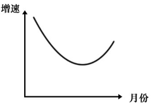

# 环比增长率计算与曲线走势匹配

考点：[[20-考点/资料分析/增长/环比增长率计算与曲线走势匹配|增长 / 环比增长率计算与曲线走势匹配]]
材料：[[15-材料/资料分析/6925894 2023年我国新能源汽车产销总体情况|6925894 2023年我国新能源汽车产销总体情况]]

**问法模型**：题干要求选出能反映'2023年8~12月国内销量环比增速变化'的曲线图 → 用相邻月当月值逐月计算环比增长率（本月−上月)/上月，再按'走势形状+首尾高低'匹配选项

## 推理链
1. 第1步：从表格提取7~12月国内销量当月值：67.9、75.6、80.8、83.2、92.9、108.0万辆（环比基期是上月，故必须取到7月）
2. 第2步：公式：环比增长率=(本月−上月)/上月×100%；材料只给同比列，环比必须自行用相邻月当月值计算
3. 第3步：8月=7.7/67.9≈11.3%；9月=5.2/75.6≈6.9%；10月=2.4/80.8≈3.0%；11月=9.7/83.2≈11.7%；12月=15.1/92.9≈16.3%
4. 第4步：走势为11.3%→6.9%→3.0%→11.7%→16.3%，即先连续下降（8~10月）后连续上升（10~12月），排除走势不符的B、D
5. 第5步：再比首尾：8月约11.3%＜12月约16.3%，曲线起点应低于终点，排除A，锁定C

**最快解法**：⚡ 定性+首尾速判：不精算全部环比，先看分子（增量）7.7→5.2→2.4递减而分母（基数）递增，环比必连降；再看增量2.4→9.7→15.1递增，环比转升，走势'先降后升'排除B、D；再估首尾两个分数：7.7/67.9≈11%＜15.1/92.9≈16%，起点低于终点排除A，直接选C

## 易错点
- ⚠ 把表格中现成的'同比增长'列当成环比使用——材料只给同比，环比须用相邻月当月值另算
- ⚠ 漏掉7月：8月环比的基期是7月（67.9），若只取8~12月数据则第一个点算不出或算错
- ⚠ 只排除走势不比首尾高低：A项可能同为'先降后升'但起点高于终点，须用8月≈11.3%＜12月≈16.3%二次筛选

## 母题抽象
> 🧩 当题干出现'某月区间环比增速变化/匹配曲线图'特征时，用相邻月当月值套(本月−上月)/上月逐月求环比，先按走势升降排除选项，再比较首月与末月环比大小定曲线起终点，两步锁定答案

**同类特征**：8~12月（逐月区间）、国内销量、环比增速、曲线图/走势匹配、需用上月当月值作基期

## 相关题
- [[10-真题/资料分析/增长/15833691 环比增速计算与折线趋势匹配（累计值连环相减化当期值）|15833691]]（黑龙江 2026，相关度1）
- [[10-真题/资料分析/增长/10204609 环比增长率计算与比较（累计值差分求当期值＋折线图走势判定）|10204609]]（辽宁 2024，相关度1）
- [[10-真题/资料分析/增长/15833698 环比增速计算与折线趋势图匹配|15833698]]（黑龙江 2026，相关度1）
- [[10-真题/资料分析/增长/2188379 年增长速度（环比增长率）比较|2188379]]（江西 2018，相关度1）
- [[10-真题/资料分析/增长/2264417 基期量反推+环比增长率（图外基期两步链式计算）|2264417]]（国考 2019，相关度1）

---

### 题干
以下哪张曲线图能准确反映2023年8~12月新能源汽车国内销量环比增速变化情况？

### 选项
- A. 

- B. 

- C. 

　✅
- D. 

### 官方解析
根据题干“······2023年8~12月······环比增速变化情况”，可判定本题为一般增长率问题。定位表格可知2023年7~12月各月我国新能源汽车的国内销量。根据公式：增长率，则2023年8~12月各月我国新能源汽车国内销量环比增速分别为：
8月，；
9月，；
10月，；
11月，；
12月，。
比较可知，2023年8~12月环比增速呈先下降后上升的趋势，排除B、D两项；由于8月环比增速＜12月环比增速，即曲线图的起点应低于终点，排除A项。
故正确答案为C。

### 给定材料

        根据中国汽车工业协会统计，2023年我国新能源汽车保持快速增长，产销量再创历史新高。新能源汽车产销分别完成958.7万辆和949.5万辆，同比分别增长35.8%和37.9%，市场占有率达到31.6%。

