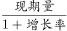
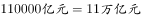

# 基期量计算（基期与现期换算）

考点：[[20-考点/资料分析/增长/基期量计算（基期与现期换算）|增长 / 基期量计算（基期与现期换算）]]
材料：[[15-材料/资料分析/182458 2015年1-3月全国国有企业经营与|182458 2015年1-3月全国国有企业经营与]]

**问法模型**：题干时间（2014年1-3月）早于材料现期（2015年1-3月）且问'最接近' → 用基期公式：基期量=现期量÷(1+增长率)，截位直除后换算单位与选项量级对照。

## 推理链
1. 第1步：题干时间2014年1-3月早于材料现期2015年1-3月，判定为基期量计算题，求上年同期营业总收入。
2. 第2步：定位材料第1段取现期值：2015年1-3月国有企业营业总收入103155.5亿元，同比'下降□%'（文本增速空白，由官方答案B反推增速约-6.2%，即约下降6%），并用中央63191.3+地方39964.2=103155.5验算取数无误。
3. 第3步：代入基期公式：基期量=现期量÷(1+增长率)，增速为负，即103155.5÷(1-6%)。
4. 第4步：截位直除/百化分速算：103155.5÷0.94≈109740亿元（或6%≈1/16，基期≈103155.5×16/15≈110033亿元），两者均≈11万亿元。
5. 第5步：单位换算：约109740亿元≈10.97万亿元，与B项11万亿元仅差约0.03万亿元。
6. 第6步：与选项对照：A（10.5万亿）差约0.47、C（11.5万亿）差约0.53、D（12万亿）差约1.03万亿元，偏差均远大于B，故最接近的是B（11万亿元）。

**最快解法**：⚡ 基期公式+截位直除：现期103155.5亿元≈10.32万亿元，同比下降约6%，除以(1-6%)=0.94得≈10.97万亿元≈11万亿元，直选B；若增速缺失，可由选项B反推增速≈(103155.5-110000)/110000≈-6%，验证'下降'口径一致。

## 易错点
- ⚠ 增速数值陷阱：材料文本中所有同比增速均显示为空白（'同比下降□%'），官方解析公式分母亦被省略，作答必须回原图核补增速，严禁凭印象填数。
- ⚠ 基期/现期方向混淆：同比'下降'时基期量应大于现期量，须除以(1-6%)，不能错乘(1-6%)或错除(1+6%)。
- ⚠ 单位量级陷阱：103155.5亿元≈10.3万亿元（7位数长数字），选项以'万亿元'为单位，未换算直接比较或将亿读错位会选错。

## 母题抽象
> 🧩 当题干出现'上年同期/2014年…最接近'而材料给出本期累计值和同比增速时，用基期公式=现期÷(1+增速)（下降取负、增长取正），截位直除后按选项单位换算量级对照选最接近项。

**同类特征**：题干时间早于材料现期（2014年1-3月）、基期量设问、'最接近'型近似选项、同比累计口径（1-3月流量）、亿元与万亿元单位换算、国有企业营业总收入

## 相关题
- [[10-真题/资料分析/比重/16437531 基期比重（'恢复至同期比例'反推基期值+全年值求占比）|16437531]]（山东 2024，相关度1）
- [[10-真题/资料分析/增长/2448425 基期量反推+多期累计求和|2448425]]（国考 2020，相关度1）
- [[10-真题/资料分析/其他/4637156 多期当期值求和（“十三五”五年规划期总规模）|4637156]]（国考 2022，相关度1）
- [[10-真题/资料分析/增长/10204593 基期量计算（现期量÷(1+增长率)，先选现期最大行业再反推基期）|10204593]]（黑龙江 2024，相关度1）
- [[10-真题/资料分析/平均数/2184641 现期平均数计算（部分÷比重反推整体+月均+亿元→万亿元单位换算）|2184641]]（选调 2018，相关度1）

---

### 题干
2014年1-3月，国有企业营业总收入最接近：

### 选项
- A. 10.5万亿元
- B. 11万亿元　✅
- C. 11.5万亿元
- D. 12万亿元

### 官方解析

根据题干中“2014年1~3月”，可以判断本题为基期计算问题。定位文字材料第一段，2015年1~3月，国有企业营业总收入103155.5亿元，同比下降。代入基期公式：=。

故正确答案为B。

### 给定材料

根据以下资料，回答下列问题。

        2015年1-3月，国有企业营业总收入103155.5亿元，同比下降。其中，中央企业收入63191.3亿元，同比下降。地方国有企业收入39964.2亿元，同比下降。

        1-3月，国有企业营业总成本100345.5亿元，同比下降，其中销售费用、管理费用和财务费用同比分别下降、增长和增长。其中，中央企业成本60216.5亿元，同比下降；地方国有企业成本40129亿元，同比下降。

        1-3月，国有企业利润总额4997.3亿元，同比下降。国有企业应交税金9383亿元，同比增长。

        3月末，国有企业资产总额1054875.4亿元，同比增长；负债总额685766.3亿元，同比增长；所有者权益合计369109.1亿元，同比增长。其中，中央企业资产总额554658.3亿元，同比增长；负债总额363304亿元，同比增长；所有者权益为191354.4亿元，同比增长。地方国有企业资产总额500217.1亿元，同比增长；负债总额322462.3亿元，同比增长；所有者权益为177754.7亿元，同比增长。

> [!warning] 疑点（官方解析可能有误，待人工复核）
> 材料文本所有同比增速为空白（'同比下降□%'），官方解析中基期公式的数值亦被省略（'公式：=。'），无法从给定文本直接核实精确增速；依官方答案B反推增速约为-6.2%（约下降6%），与'下降'表述一致，建议回原图核补该增速后复核计算过程。

<!-- CODEX-ANSWER-REVIEW:BEGIN -->
### 本次独立复核

**复核状态：** `confirmed`（独立复算确认答案）

**计分答案：** B（可计分）

**复核解析：**

2015年一季度国有及国有控股企业营业总收入为103155.5亿元，同比下降6%。反推上年同期为103155.5÷0.94≈109739.9亿元，即约10.97万亿元；按选项精度取整约11万亿元，选B。

**相关信息：**

资料分析—基期量；同比下降6%时基期=现期/(1−6%)。

**题源依据：** [固定版本原题](https://github.com/Mentat-Uran/kaogongzhentizhengliu/blob/84ab93d4b64b61d897bece8a1c0a5bab06b4feb2/10-%E7%9C%9F%E9%A2%98/%E8%B5%84%E6%96%99%E5%88%86%E6%9E%90/%E5%A2%9E%E9%95%BF/1796340%20%E5%9F%BA%E6%9C%9F%E9%87%8F%E8%AE%A1%E7%AE%97%EF%BC%88%E5%9F%BA%E6%9C%9F%E4%B8%8E%E7%8E%B0%E6%9C%9F%E6%8D%A2%E7%AE%97%EF%BC%89.md)；固定内容 commit `84ab93d4b64b61d897bece8a1c0a5bab06b4feb2`，Markdown blob `6dcfca1e55b2f9605fc31380fcd1f2915ff85afd`。
<!-- CODEX-ANSWER-REVIEW:END -->
