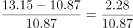
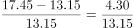
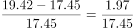
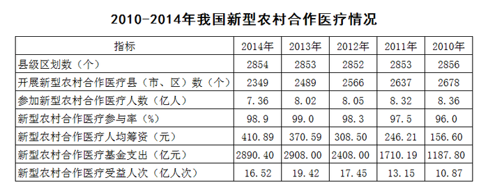

# 同比增长率比较（逐年增速取最大）

考点：[[20-考点/资料分析/增长/同比增长率比较（逐年增速取最大）|增长 / 同比增长率比较（逐年增速取最大）]]
材料：[[15-材料/资料分析/182480 2010—2014年我国新型农村合作|182480 2010—2014年我国新型农村合作]]

**问法模型**：题干问'2011—2014年受益人次增长率最高的是哪一年'→逐年以右邻列（上一年）为基期套'增长率=（当年−上年）/上年'，比较四个同比增速取最大

## 推理链
1. 第1步：从表格'受益人次（亿人次）'行取数：2014年16.52、2013年19.42、2012年17.45、2011年13.15、2010年10.87；表格年份倒序，求同比的基期为右邻一列
2. 第2步：公式：同比增长率=（当年值−上年值）/上年值，逐年列式
3. 第3步：代入：2011年=（13.15−10.87）/10.87=2.28/10.87≈21.0%；2012年=（17.45−13.15）/13.15=4.30/13.15≈32.7%；2013年=（19.42−17.45）/17.45=1.97/17.45≈11.3%；2014年=（16.52−19.42）/19.42=−2.90/19.42≈−14.9%
4. 第4步：2014年分子为负、同比下降，直接排除D
5. 第5步：剩余三项直除比较首位：A（2011年）2.28/10.87首位商2，B（2012年）4.30/13.15首位商3，C（2013年）1.97/17.45首位商1
6. 第6步：B项（2012年，约32.7%）增速最高，与选项对照选B

**最快解法**：⚡ 直除法（首位商比较）：先排除负增长的2014年，再对增量/上年值直除取首位——2011年2.28/10.87首位商2、2012年4.30/13.15首位商3、2013年1.97/17.45首位商1，首位3最大即2012年，锁定B

## 易错点
- ⚠ 表格年份倒序（2014在左、2010在右），求同比时基期是右邻一列，方向看反会把2014年的下降误算成增长
- ⚠ 2014年受益人次16.52低于2013年19.42，同比为负增长，应先排除而非参与比较
- ⚠ 勿取错行：'受益人次（亿人次）'与'参加人数（亿人）'口径不同；且2011年（约21%）与2013年（约11%）、2012年（约32.7%）需精确直除，不可粗估混淆

## 母题抽象
> 🧩 当题干出现'某连续年份区间内某指标增长率最高的年份'特征时，先用负增长（现期<基期）排除法筛掉下降年份，再逐年套（现期−基期）/基期，用首位直除比较即得答案

**同类特征**：2011—2014年连续年份区间、增长率最高、受益人次、同比增速比较、选择年份的选项形式、同表多行指标中定位单行数据

## 相关题
- [[10-真题/资料分析/增长/14403675 同比增长率比较（逐年增速取最大）|14403675]]（山东 2025，相关度2）
- [[10-真题/资料分析/增长/1503707 增长量与增长率双比较|1503707]]（山西 2015，相关度1）
- [[10-真题/资料分析/增长/10204589 增长率比较（逐年同比增速比较）|10204589]]（河北 2024，相关度1）
- [[10-真题/资料分析/增长/2050944 增长率计算与比较（逐年同比增速找最小）|2050944]]（江西 2017，相关度1）
- [[10-真题/资料分析/比重/2264434 两期比重比较（比重升降判定）|2264434]]（国考 2019，相关度1）

---

### 题干
2011—2014年，新型农村合作医疗受益人次增长率最高的是（    ）年。

### 选项
- A. 2011
- B. 2012　✅
- C. 2013
- D. 2014

### 官方解析

由“增长率最高的是”可知，本题为一般增长率的比较问题。定位表格可得2010-2014年新型农村合作医疗受益人次的具体值，则各项增速约为：

A项：；B项：；C项：；D项同比下降，排除。直除可得，A项首位商2，B项首位商3，C项首位商1，则B项最大。

故正确答案为B。

### 给定材料

根据下列资料，回答91~95题：

        2010—2014年我国新型农村合作医疗情况

