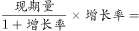
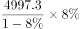
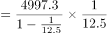
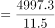

# 增长量计算（同比下降求同比减少量，基期换算型）

考点：[[20-考点/资料分析/增长/增长量计算（同比下降求同比减少量，基期换算型）|增长 / 增长量计算（同比下降求同比减少量，基期换算型）]]
材料：[[15-材料/资料分析/182458 2015年1-3月全国国有企业经营与|182458 2015年1-3月全国国有企业经营与]]

**问法模型**：题干问'同比减少了多少亿元'且材料给出'现期量4997.3亿元＋同比下降8%'→套增长量公式 现期×r/(1+r)，r为负时减少量=现期×|r|/(1-|r|)

## 推理链
1. 第1步：定位材料第三段，2015年1-3月国有企业利润总额4997.3亿元，同比下降8%（文本中'□%'缺失，按官方解析'直除首两位为43'口径核补为8%，作答前须回原图确认）
2. 第2步：增长量=现期×r/(1+r)；因同比下降即r=-8%，同比减少量=4997.3×8%/(1-8%)=4997.3×8/92
3. 第3步：代入计算：4997.3×8/92≈434.5亿元；交叉验证：百化分8%≈1/12.5，减少量=4997.3÷(12.5-1)=4997.3÷11.5≈434.5，两法结果自洽
4. 第4步：与选项对照：A项434.5与计算结果一致；B391.8、C445.7、D370.2均不满足，锁定A

**最快解法**：⚡ 百化分：下降8%≈1/12.5，负增长时减少量=现期÷(n-1)=4997.3÷11.5，截位直除首两位'43'直接锁定A(434.5)，无需精算全过程

## 易错点
- ⚠ 增速核补陷阱：本材料文本中所有'同比下降□%'数值缺失，严禁凭印象臆填，须回原图核补；本题应为'下降8%'（与官方解析首两位43、答案434.5自洽），并注意区分'下降8%'与'下降到8%'
- ⚠ 符号与方向：利润同比下降，'减少多少亿元'应取正值；若机械套增长量=现期×r/(1+r)会得负值，或误把4997.3×8%≈400直接当减少量（混淆基期/现期口径），均会失分
- ⚠ 分母(1-|r|)陷阱：下降时分母是1-8%=0.92，若误用1+8%得4997.3×8/108≈370.2，恰好是D项设置的坑

## 母题抽象
> 🧩 当题干出现'同比增加/减少了多少（绝对量）'且材料只给'现期量＋同比增速r'时，用增长量=现期×r/(1+r)；增速为下降则改套减少量=现期×|r|/(1-|r|)，百化分|r|≈1/n后按'现期÷(n-1)（下降）或÷(n+1)（增长）'速算，再截位直除对照选项

**同类特征**：同比减少了多少亿元、利润总额（1-3月累计流量）、现期量与同比增速均已给出、增长量计算、负增长取减少量为正、基期换算型

## 相关题
- [[10-真题/资料分析/增长/2144733 增长量计算（增长量=现期×r-(1+r)）|2144733]]（新疆 2017，相关度2）
- [[10-真题/资料分析/增长/7159 增长量计算|7159]]（北京 2009，相关度1）
- [[10-真题/资料分析/增长/2571729 增长量计算——每增长1个百分点对应的增量（基期量×1%）|2571729]]（山东 2020，相关度1）
- [[10-真题/资料分析/增长/3018839 增长量计算（负增长情形：基期减少量）|3018839]]（广东 2021，相关度1）
- [[10-真题/资料分析/增长/10204654 增长量计算（已知现期与同比下降率求下降量）|10204654]]（安徽 2024，相关度1）

---

### 题干
2015年1-3月，国有企业利润总额同比减少了多少亿元？

### 选项
- A. 434.5　✅
- B. 391.8
- C. 445.7
- D. 370.2

### 官方解析

由题干“同比减少多少亿元”可知，本题为增长量计算问题。定位材料第三段可得，2015年1-3月国有企业利润总额4997.3亿元，同比下降，则2015年1-3月国有企业利润总额同比减少：，直除首两位为43，只有A项满足。

故正确答案为A。

### 给定材料

根据以下资料，回答下列问题。

        2015年1-3月，国有企业营业总收入103155.5亿元，同比下降。其中，中央企业收入63191.3亿元，同比下降。地方国有企业收入39964.2亿元，同比下降。

        1-3月，国有企业营业总成本100345.5亿元，同比下降，其中销售费用、管理费用和财务费用同比分别下降、增长和增长。其中，中央企业成本60216.5亿元，同比下降；地方国有企业成本40129亿元，同比下降。

        1-3月，国有企业利润总额4997.3亿元，同比下降。国有企业应交税金9383亿元，同比增长。

        3月末，国有企业资产总额1054875.4亿元，同比增长；负债总额685766.3亿元，同比增长；所有者权益合计369109.1亿元，同比增长。其中，中央企业资产总额554658.3亿元，同比增长；负债总额363304亿元，同比增长；所有者权益为191354.4亿元，同比增长。地方国有企业资产总额500217.1亿元，同比增长；负债总额322462.3亿元，同比增长；所有者权益为177754.7亿元，同比增长。

> [!warning] 疑点（官方解析可能有误，待人工复核）
> 材料文本中利润总额'同比下降□%'的增速数值缺失，本笔记依官方解析反推核补为下降8%（4997.3×8/92≈434.5，与'直除首两位为43'及答案A完全自洽）；官方答案本身无误，仅提示作答前须回原图核补该百分数。

<!-- CODEX-ANSWER-REVIEW:BEGIN -->
### 本次独立复核

**复核状态：** `confirmed`（独立复算确认答案）

**计分答案：** A（可计分）

**复核解析：**

原公式图 formula-9cf2b96c0c5f472e.png 显示同比下降8%。同比减少量=现期量×下降率/(1−下降率)=4997.3×0.08/0.92≈434.55亿元，与A项434.5亿元一致。

**相关信息：**

负增长时，减少量不能直接用现期×降幅；应以基期量为比例基数。基期=现期/(1−降幅)。

**题源依据：** [固定版本原题](https://github.com/Mentat-Uran/kaogongzhentizhengliu/blob/84ab93d4b64b61d897bece8a1c0a5bab06b4feb2/10-%E7%9C%9F%E9%A2%98/%E8%B5%84%E6%96%99%E5%88%86%E6%9E%90/%E5%A2%9E%E9%95%BF/1797850%20%E5%A2%9E%E9%95%BF%E9%87%8F%E8%AE%A1%E7%AE%97%EF%BC%88%E5%90%8C%E6%AF%94%E4%B8%8B%E9%99%8D%E6%B1%82%E5%90%8C%E6%AF%94%E5%87%8F%E5%B0%91%E9%87%8F%EF%BC%8C%E5%9F%BA%E6%9C%9F%E6%8D%A2%E7%AE%97%E5%9E%8B%EF%BC%89.md)；固定内容 commit `84ab93d4b64b61d897bece8a1c0a5bab06b4feb2`，Markdown blob `1a775e3342b29a7e9cc2c2bc990b1acc383236b3`。
<!-- CODEX-ANSWER-REVIEW:END -->
