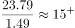
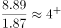
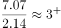
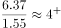
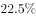
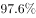
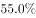
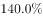
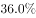
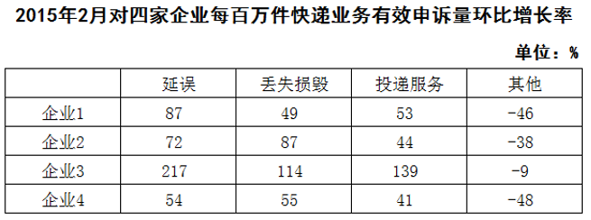

# 基期量计算与排序（环比基期比较）

考点：[[20-考点/资料分析/增长/基期量计算与排序（环比基期比较）|增长 / 基期量计算与排序（环比基期比较）]]
材料：[[15-材料/资料分析/182656 2015年2月我国快递业务量与业务收|182656 2015年2月我国快递业务量与业务收]]

**问法模型**：题干要求按'2015年1月'（上月基期）的丢失损毁每百万件有效申诉量从高到低排序，而图1只给2月现期值、图2给环比增速 → 应采用'基期量=现期量÷(1+环比增长率)'逐一反推后再排序比较。

## 推理链
1. 第1步：定位图1'丢失损毁'列，得2015年2月现期值：企业1为23.79件、企业2为8.89件、企业3为7.07件、企业4为6.37件。
2. 第2步：定位图2'丢失损毁'列，得四企业环比增长率：企业1为49%、企业2为87%、企业3为114%、企业4为55%。
3. 第3步：基期量公式：2015年1月值=2015年2月值÷(1+环比增长率)。
4. 第4步：代入计算：企业1=23.79÷1.49≈16.0，企业2=8.89÷1.87≈4.8，企业3=7.07÷2.14≈3.3，企业4=6.37÷1.55≈4.1。
5. 第5步：从高到低排序：企业1(≈16.0)＞企业2(≈4.8)＞企业4(≈4.1)＞企业3(≈3.3)，其中企业3现期虽高于企业4，但因增速114%最大被反超。
6. 第6步：与选项对照，只有D项'企业1，企业2，企业4，企业3'符合，故选D。

**最快解法**：⚡ 截位直除+量级比较：企业1的23.79÷1.49≈16远超其余三家，先锁定首位是企业1（排除A、C）；再比较企业2与企业4：交叉验证6.37×1.87≈11.9＜8.89×1.55≈13.8，故企业2基期＞企业4基期；企业3的7.07÷2.14≈3.3明显最小，直接锁定D。

## 易错点
- ⚠ 时间口径陷阱：题干要的是'2015年1月'基期值，若直接用图1的2月现期值排序（企业1＞企业2＞企业3＞企业4）会误选B。
- ⚠ 反推方向陷阱：企业3现期值7.07高于企业4的6.37，但其环比增速114%为四者最大，基期被'压缩'最多，反推后反被企业4超过；若把增长率方向搞反（误用现期×(1+r)或÷(1−r)）会得出相反的错误排序。
- ⚠ 读图口径陷阱：图1柱高仅作直观示意，精确读数以下方数据表为准；且该指标是'每百万件'强度相对数，本题只在强度指标内部排序，无需各企业业务量份额，不能拿申诉总量混淆比较。

## 母题抽象
> 🧩 当题干要求'上月/上年同期各主体某指标'排序时，用'基期量=现期÷(1+增长率)'逐一反推再比较；现期值大但增速大的主体基期可能被反超，须逐项计算验证，不能按现期排序直接选。

**同类特征**：2015年1月（基期时间点）、每百万件快递业务丢失损毁有效申诉量、从高到低排序、环比增长率反推基期、跨图表拼合（图1现期值+图2增速）、基期量比较

## 相关题
- [[10-真题/资料分析/平均数/2184619 现期平均数比较（收入÷企业数排序）|2184619]]（选调 2018，相关度1）
- [[10-真题/资料分析/平均数/2578802 现期平均数计算与分类排序（分组算术平均）|2578802]]（四川 2020，相关度1）
- [[10-真题/资料分析/增长/2388069 基期量比较（现期量-(1+增速)取最大）|2388069]]（河北 2019，相关度1）
- [[10-真题/资料分析/增长/1758944 年均增长率比较与排序|1758944]]（上海 2016，相关度1）
- [[10-真题/资料分析/增长/1796168 基期量比较（1-11月累计−11月当月差值+基期换算）|1796168]]（贵州 2016，相关度1）

---

### 题干
将4家企业按2015年1月每百万件快递业务丢失损毁的有效申诉量从高到低排序，正确的是：

### 选项
- A. 企业2，企业1，企业3，企业4
- B. 企业1，企业2，企业3，企业4
- C. 企业2，企业1，企业4，企业3
- D. 企业1，企业2，企业4，企业3　✅

### 官方解析

由题干“2015年1月由高到低排序”判断本题为环比基期比较问题，定位第一张表格可得四个企业2015年2月每百万件快递业务丢失损毁有效申诉量现期值，定位第二张表格可得四个企业的环比增速，故企业1、2、3、4的环比基期分别为、、、，可得企业1最高，企业3最低，只有D项满足。

故正确答案为D。

### 给定材料

        2015年2月，我国快递业务量完成8.2亿件，同比增长；业务收入完成136.0亿元，同比增长。消费者对快递业务进行的申诉中，有效申诉（确定企业责任的）占总申诉量的，为消费者挽回经济损失229.8万元。

        2015年2月，全国每百万件快递业务中，有效申诉量为23.4件，对企业1的每百万件有效申诉量为75.13件，环比增长，对企业2的每百万件有效申诉量为32.56件，环比增长，对企业3的每百万件有效申诉量为31.86件，环比增长，对企业4的每百万件有效申诉量为17.81件，环比增长。

> [!warning] 疑点（官方解析可能有误，待人工复核）
> 官方解析中四个基期数值在给定文本中缺失显示，但按'现期÷(1+环比增速)'计算（约16.0/4.8/3.3/4.1）与官方答案D完全一致，不影响答案，无需存疑。
