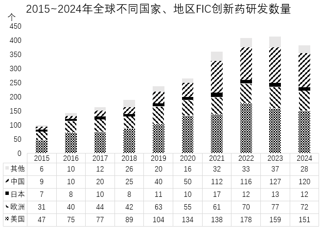

# 分段加总后的一般增长率比较

考点：[[20-考点/资料分析/增长/分段加总后的一般增长率比较|增长 / 分段加总后的一般增长率比较]]
材料：[[15-材料/资料分析/5076930 2015~2024年全球FIC创新药|5076930 2015~2024年全球FIC创新药]]

**问法模型**：题干出现'2020~2024年相比前一个5年增速最快'→ 先将现期（2020~2024）与基期（2015~2019）各自5年数值加总，再比较'现期和/基期和−1'的大小，比值最大者增速最快

## 推理链
1. 第1步：题干限定除'其他'外的中国、日本、欧洲、美国4个地区，且要求两段各5年加总后比增速，不能拿单年值计算
2. 第2步：增长率=现期量/基期量−1；比较增长率大小可等价转化为直接比较'现期5年和÷基期5年和'的比值
3. 第3步：查表加总——中国2015~2019=9+10+20+25+40=104，2020~2024=50+112+116+127+120=525，比值525/104≈5.05
4. 第4步：同法加总——日本44→64（64/44≈1.45），欧洲220→335（335/220≈1.52），美国392→760（760/392≈1.94）
5. 第5步：中国比值≈5.05远大于其余三者（均<2），即中国增速≈404.5%为四地最高
6. 第6步：对照选项，增速最快为中国，锁定A

**最快解法**：⚡ 量级判断（截位思想）：只算'现期5年和÷基期5年和'——中国525/104已突破5倍，而美国760/392、欧洲335/220均不足2倍、日本64/44不足1.5倍，无需算出具体增长率即可直接锁定中国A

## 易错点
- ⚠ 用首尾单年值（如2024年÷2019年或2020年÷2015年）直接算增长率，未按题意对两个5年分别加总
- ⚠ 将'其他'系列计入比较对象，或受图例顺序（其他→中国→日本→欧洲→美国）影响读数行列错位
- ⚠ 5年加总的算术错误（如中国2020~2024漏加2020年的50），会导致本题及同组加总类小题连错

## 母题抽象
> 🧩 当题干出现'某几个年份之和相比前一个等长时段增长（增速）最快/最慢'时，先按相同长度区间分段加总出现期和与基期和，再直接比较现期/基期比值，比值最大者即增速最快，不必算出百分比

**同类特征**：2020~2024年、相比前一个5年、增速最快、除'其他'的4个国家和地区、5年分段加总、一般增长率比较

## 相关题
- [[10-真题/资料分析/增长/10297321 同比增速计算与比较（增长率比较）|10297321]]（浙江 2025，相关度2）
- [[10-真题/资料分析/增长/13319340 一般增长率比较（同比增速最快年份判定）|13319340]]（江苏 2025，相关度2）
- [[10-真题/资料分析/综合/1752650 增速排序+单位数加总（查表排序求和）|1752650]]（北京 2016，相关度1）
- [[10-真题/资料分析/增长/2195847 增长率比较（增长倍数与绝对增量的口径统一）|2195847]]（黑龙江 2018，相关度1）
- [[10-真题/资料分析/增长/2377075 增长率比较（同比增速逐年计算）|2377075]]（选调 2019，相关度1）

---

### 题干
表中除“其他”的4个国家和地区中，2020~2024年FIC创新药研发数量相比前一个5年增速最快的是：

### 选项
- A. 中国　✅
- B. 日本
- C. 欧洲
- D. 美国

### 官方解析
根据题干“······增速最快”，可判定本题为一般增长率问题。定位统计图可得中国、日本、欧洲、美国各年FIC创新药研发数量。根据公式：增长率，则比较增长率大小，可以直接比较，现期量为2020-2024年FIC创新药研发数量之和，基期量为2015-2019年FIC创新药研发数量之和，选项各国列式如下： 
中国： ；
日本：；
欧洲：；
美国：。
比较可知，2020~2024年FIC创新药研发数量相比前一个5年增速最快的是中国。
故正确答案为A。

### 给定材料

        FIC创新药是指通过全新作用机制实现疾病治疗的突破性药物，具有全球首创性和高临床价值，代表医药研发的最高水平。

