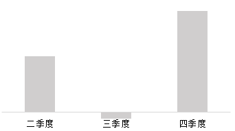

# 增长量比较（环比增量序列与图形趋势匹配）

考点：[[20-考点/资料分析/增长/增长量比较（环比增量序列与图形趋势匹配）|增长 / 增长量比较（环比增量序列与图形趋势匹配）]]
材料：[[15-材料/资料分析/4538749 2023年全国部分商业银行（大型、股|4538749 2023年全国部分商业银行（大型、股]]

**问法模型**：题干问'柱状图反映哪项指标环比增量的变化趋势（横轴位置表示增量为0）'→ 对每个选项计算相邻季度末金额之差得到环比增量序列，与图形中正负分布（横轴0上下穿越）逐项对照排除

## 推理链
1. 第1步：题干要求匹配2023年后三个季度（二、三、四季度）的环比增量变化趋势，且'横轴位置表示增量为0'，暗示增量序列须出现负值（低于横轴）才能呈现0上下分布
2. 第2步：材料金额为各季度末时点存量（万亿元），环比增量=本季度末金额−上季度末金额，直接作差，与同比增速无关
3. 第3步：A项大型商业银行总资产：二季度171.53−166.42=5.11，三季度173.26−171.53=1.73>0，增量全程为正，排除
4. 第4步：B项大型商业银行总负债：二季度158.45−153.3=5.15，三季度159.78−158.45=1.33>0，增量全程为正，排除
5. 第5步：C项股份制商业银行总负债：二季度64.01−63.37=0.64，三季度63.94−64.01=−0.07（全表唯一环比下降），四季度65.1−63.94=1.16，增量呈正→负→正，与横轴0上下穿越的图形趋势一致
6. 第6步：D项城市商业银行总资产：二季度53.33−52.03=1.3，三季度54.28−53.33=0.95>0，增量全程为正，排除；故选C

**最快解法**：⚡ 零点定位排除法：横轴0意味着序列中必有负增量（环比下降），不必逐项精算——快速扫表找'本季<上季'的单元格，全表仅股份制商业银行总负债三季度63.94<二季度64.01一处，直接锁定C

## 易错点
- ⚠ 同比当环比：表中增速全部是同比（与上年同期比），环比增量绝不能用增速推算或增速作差，只能用相邻季度末金额相减
- ⚠ 看串行：每家银行四行数据（资产金额/资产增速/负债金额/负债增速）密集混排，股份制负债三季度63.94与二季度64.01极接近，易误读成63.94>64.01或串到资产行
- ⚠ 跳季度漏负号：若只算二、四季度增量而略过三季度，会漏掉−0.07这一唯一负值特征，误把全程为正的A/B/D当答案

## 母题抽象
> 🧩 当题干出现'柱状图反映…环比增量变化趋势'且明确'横轴位置表示增量为0'时，先在表中找唯一环比下降（本季末<上季末）的单元格锁定候选，再用相邻期末余额作差验证正负交替趋势

**同类特征**：柱状图反映…变化趋势、环比增量、横轴位置表示增量为0、后三季度、指标匹配排除、季度末时点数作差

## 相关题
- [[10-真题/资料分析/增长/18643857 环比增长量计算与增量序列图形匹配（增长量比较）|18643857]]（四川 2026，相关度2）
- [[10-真题/资料分析/增长/19526452 环比增长量计算与图形形态匹配（反推指标型增长量比较）|19526452]]（国考 2026，相关度2）
- [[10-真题/资料分析/增长/19283747 增长量计算与比较（同比增量趋势匹配图形）|19283747]]（国考 2025，相关度1）
- [[10-真题/资料分析/增长/19526226 同比增量计算与图形匹配（增长量比较-排除法）|19526226]]（国考 2026，相关度1）
- [[10-真题/资料分析/增长/15833799 增长量计算与比较（同比增量序列与柱状图趋势匹配）|15833799]]（贵州 2026，相关度1）

---

### 题干

以下柱状图反映了2023年后三季度全国商业银行哪项指标环比增量的变化趋势（横轴位置表示增量为0）？

### 选项
- A. 大型商业银行总资产
- B. 大型商业银行总负债
- C. 股份制商业银行总负债　✅
- D. 城市商业银行总资产

### 官方解析
根据题干“······环比增量的变化趋势······”，可判定本题为增长量比较问题。定位表格材料可得2023年全国每个季度不同商业银行资产负债的数据。根据公式：增长量=现期量-基期量，可得：
A项：二季度：171.53-166.42=5.11万亿元；三季度：173.26-171.53&gt;0。与柱状图趋势不同，排除；
B项：二季度：158.45-153.3=5.15万亿元；三季度：159.78-158.45&gt;0。与柱状图趋势不同，排除；
C项：二季度：64.01-63.37=0.64万亿元；三季度：63.94-64.01=-0.07万亿元；四季度：65.1-63.94=1.16万亿元。与柱状图趋势相同，当选；
D项：二季度：53.33-52.03=1.3万亿元；三季度：54.28-53.33&gt;0。与柱状图趋势不同，排除。
故正确答案为C。

### 给定材料

