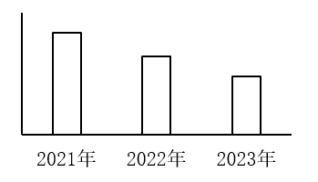

# 同比增量计算与趋势比较（增量=现期-基期，逐年相减后与柱状图形态匹配）

考点：[[20-考点/资料分析/增长/同比增量计算与趋势比较（增量=现期-基期，逐年相减后与柱状图形态匹配）|增长 / 同比增量计算与趋势比较（增量=现期-基期，逐年相减后与柱状图形态匹配）]]
材料：[[15-材料/资料分析/3617387 2020—2023年Z省律师行业与基|3617387 2020—2023年Z省律师行业与基]]

**问法模型**：题干问'柱状图反映2021、2022、2023年哪一指标的同比增量变化趋势（横轴位置表示增量为0）'→ 对各候选指标逐年做 增量=当年值-上年值，得每年一个增量，再按'符号为正+大小递变关系'与图形形态逐一匹配排除。

## 推理链
1. 第1步：从统计表按行提取四个选项指标2020—2023年数值：律师事务所总数1636/1705/1755/1826家；律师人数27302/30889/36938/41924人；村（社区）法律顾问数26153/24951/24705/23652家；法律顾问数（不含村、社区）72739/89450/102251/111811家
2. 第2步：规则为同比增长量=现期量-基期量，相邻两年相减，2021—2023年各得3个增量（2020年无增量）
3. 第3步：A项律师事务所总数增量：1705-1636=69、1755-1705=50、1826-1755=71家，呈先降后升（2022年50＜2023年71），与图形趋势不符，排除
4. 第4步：B项律师人数增量：30889-27302=3587、36938-30889=6049、41924-36938=4986人，呈先升后降（2021年3587＜2022年6049），不符合，排除
5. 第5步：C项村（社区）法律顾问数2021年增量=24951-26153=-1202家＜0，而图中横轴表示增量为0、柱子均在横轴上方（2021年增量为正），符号矛盾，排除
6. 第6步：D项法律顾问数（不含村、社区）增量：89450-72739=16711、102251-89450=12801、111811-102251=9560家，均为正且逐年递减（16711＞12801＞9560），与柱状图趋势吻合，当选

**最快解法**：⚡ 排除法+高位截算增量：先用C项2021年增量为负（24951-26153≈-1200）秒杀排除；再对A项口算增量69→50→71（波动）、B项3.6千→6.0千→5.0千（先升后降），均与图形'逐年递减'形态不符；D项按万位截算8.9-7.3≈1.7万、10.2-8.9≈1.3万、11.2-10.2≈0.96万，正增量逐年递减，直接锁定D。

## 易错点
- ⚠ 两行'法律顾问数'易串行：'不含村、社区'逐年递增、'村（社区）'逐年递减且2021年增量即为负，若看错行会把C误判为符合或把D漏掉
- ⚠ 增量趋势需三个年份全算齐再比对：只算一年的增量无法区分A（先降后升）、B（先升后降）、D（逐年递减）三种不同形态，易因只算一年而误选A或B
- ⚠ 时间与口径陷阱：2021—2023年只有3个同比增量（2020年无增量），勿把2020年数值当增量；'横轴位置表示增量为0'提示图中柱子全为正增量，可据此先排除增量为负的指标；本题是'家/人'级数据相减，与业务量'万件'无关，勿跨行混取

## 母题抽象
> 🧩 当题干出现'柱状图反映哪一指标的（同比）增量变化趋势、横轴表示增量为0'时，用'增量=现期-基期'对每个候选指标逐年相减，先用'增量为负/符号不符'快速排除，再按正增量间的递增、递减或波动关系与图形形态匹配验证。

**同类特征**：柱状图反映哪一指标、同比增量变化趋势、横轴位置表示增量为0、2021、2022和2023年、增长量=现期量-基期量、多指标逐年相减后形态匹配

## 相关题
- [[10-真题/资料分析/增长/19526226 同比增量计算与图形匹配（增长量比较-排除法）|19526226]]（国考 2026，相关度2）
- [[10-真题/资料分析/增长/4663220 增长量计算与排序（相邻两年相减+折线趋势判断）|4663220]]（山东 2022，相关度2）
- [[10-真题/资料分析/增长/16593068 增长量比较（多期同比增量趋势与柱状图匹配）|16593068]]（甘肃 2024，相关度1）
- [[10-真题/资料分析/增长/19283747 增长量计算与比较（同比增量趋势匹配图形）|19283747]]（国考 2025，相关度1）
- [[10-真题/资料分析/增长/13504528 增长量比较（图形趋势判断）|13504528]]（云南 2025，相关度1）

---

### 题干

以下柱状图反映了2021、2022和2023年Z省律师、基层法律服务工作哪一指标的同比增量变化趋势（横轴位置表示增量为0）？

### 选项
- A. 律师事务所总数
- B. 律师人数
- C. 村（社区）法律顾问数
- D. 法律顾问数（不含村、社区）　✅

### 官方解析

根据题干“以下柱状图反映了2021、2022和2023年······同比增量变化趋势（横轴位置表示增量为0）”，可判定本题为增长量比较问题。定位统计表可得2020-2023年Z省律师事务所总数、律师人数、村（社区）法律顾问数、法律顾问数（不含村、社区）。根据公式：增长量=现期量-基期量，可得2021-2023年各指标同比增长量：

A项，律师事务所总数：2022年，1755-1705=50家；2023年，1826-1755=71家。2022年同比增长量＜2023年同比增长量，不符合柱状图变化趋势，排除；

B项，律师人数：2021年，30889-27302=人；2022年，36938-30889=人。2021年同比增长量＜2022年同比增长量，不符合柱状图变化趋势，排除；

C项，村（社区）法律顾问数：2021年（24951家）＜2020年（26153家），同比增长量＜0，而柱状图（横轴位置表示增量为0）中2021年同比增长量＞0，不符合，排除；

D项，法律顾问数（不含村、社区）：2021年，89450-72739=家；2022年，102251-89450=家；2023年，111811-102251=家。2021年同比增长量＞2022年同比增长量＞2023年同比增长量，符合柱状图变化趋势，当选。

故正确答案为D。

### 给定材料

> [!warning] 疑点（官方解析可能有误，待人工复核）
> 官方解析B项写作'30889-27302=人、36938-30889=人'、D项三处增量均未写出具体数值（完整应为3587、6049、4986人；16711、12801、9560家），系解析排版漏数，不影响方向判断与答案D的正确性。

<!-- CODEX-ANSWER-REVIEW:BEGIN -->
### 本次独立复核

**复核状态：** `resolved`（答案与解析已核定）

**计分答案：** D（可计分）

**复核解析：**

同比增量按本年值减上年值。D“法律顾问数（不含村、社区）”2021—2023年的增量分别为89450−72739=16711、102251−89450=12801、111811−102251=9560，均为正且逐年减小，与题图三根柱由高到低且均在零线上方一致。A前两年增量50、71上升；B前两年3587、6049上升；C首年为负，均不符。

**相关信息：**

法律顾问数口径明确不包括村（社区）法律顾问；增量单位为人/家，以表项单位为准。

**题源依据：** [固定版本原题](https://github.com/Mentat-Uran/kaogongzhentizhengliu/blob/84ab93d4b64b61d897bece8a1c0a5bab06b4feb2/10-%E7%9C%9F%E9%A2%98/%E8%B5%84%E6%96%99%E5%88%86%E6%9E%90/%E5%A2%9E%E9%95%BF/19283764%20%E5%90%8C%E6%AF%94%E5%A2%9E%E9%87%8F%E8%AE%A1%E7%AE%97%E4%B8%8E%E8%B6%8B%E5%8A%BF%E6%AF%94%E8%BE%83%EF%BC%88%E5%A2%9E%E9%87%8F%3D%E7%8E%B0%E6%9C%9F-%E5%9F%BA%E6%9C%9F%EF%BC%8C%E9%80%90%E5%B9%B4%E7%9B%B8%E5%87%8F%E5%90%8E%E4%B8%8E%E6%9F%B1%E7%8A%B6%E5%9B%BE%E5%BD%A2%E6%80%81%E5%8C%B9%E9%85%8D%EF%BC%89.md)；固定内容 commit `84ab93d4b64b61d897bece8a1c0a5bab06b4feb2`，Markdown blob `6b933b670c365e301254163632591a9ad6274d3e`。
<!-- CODEX-ANSWER-REVIEW:END -->
