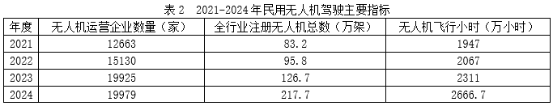

# 年均增长率比较

考点：[[20-考点/资料分析/增长/年均增长率比较|增长 / 年均增长率比较]]
材料：[[15-材料/资料分析/7011537 2021-2024年我国低空经济两大|7011537 2021-2024年我国低空经济两大]]

**问法模型**：题干出现'2021-2024年期间……年均增长速度最快'→用年均增长率模型(1+r)^3=末值/初值，各指标年份间隔n相同，直接比较末值/初值倍数，倍数最大者增速最快

## 推理链
1. 第1步：定位表1、表2，提取四个选项指标的基期2021年与现期2024年数据：通航企业599→760家、通航在册航空器3018→3232架、无人机运营企业12663→19979家、注册无人机83.2→217.7万架
2. 第2步：年均增长率公式(1+r)^n=现期值/基期值，2021→2024年份差n=3对四项指标相同，故只需比较各指标'2024值÷2021值'的倍数大小
3. 第3步：计算倍数：A为760/599≈1.27倍，B为3232/3018≈1.07倍，C为19979/12663≈1.58倍，D为217.7/83.2≈2.62倍
4. 第4步：D的倍数2.62远大于其余三项（对应年均增速约37.8%，C约16.4%、A约8.3%、B约2.3%），故年均增长速度最快的是全行业注册无人机总数，选D

**最快解法**：⚡ 倍数比较法（公式法简化）：n相同免开三次方，直接截位直除比较'2024值÷2021值'——D为217.7/83.2≈2.6倍、C为19979/12663≈1.6倍、A为760/599≈1.27倍、B为3232/3018≈1.07倍，倍数最大的D即年均增速最快

## 易错点
- ⚠ 跨表单位量级陷阱：注册无人机以'万架'计、通航在册航空器以'架'计，比较的是各自与自身基期的倍数关系，绝不能因C项企业数19979家绝对数值大而误判其增速最快
- ⚠ 误用绝对增量或总量判断'速度'：应比较相对倍数，B项现期绝对量3232架最大但倍数仅1.07反而最慢
- ⚠ 年份间隔口径：2021→2024年均增长的间隔为3年（若求具体增速需开1/3次方），本题因只需横向比较倍数而不受影响，但求具体数值时按4年处理会出错

## 母题抽象
> 🧩 当题干出现'某期间……年均增长速度/年均增速最快（比较类）'且各指标基期、现期年份间隔相同时，直接比较'现期值÷基期值'倍数，倍数最大者年均增速最快，无需开n次方

**同类特征**：年均增长速度最快、2021-2024年期间、跨表1表2多指标比较、年均增长率比较、'下列各项指标中'选最快

## 相关题
- [[10-真题/资料分析/增长/2030132 年均增长率比较|2030132]]（四川 2016，相关度3）
- [[10-真题/资料分析/增长/2172277 年均增长率比较|2172277]]（江苏 2018，相关度2）
- [[10-真题/资料分析/增长/2024190 年均增长率（平均增速）比较|2024190]]（重庆 2016，相关度1）
- [[10-真题/资料分析/增长/4817782 年均增长率比较（年均增速排序）|4817782]]（四川 2022，相关度1）
- [[10-真题/资料分析/增长/13504295 年均增长率比较（以2014年为基准，n相同比现期-基期倍数）|13504295]]（甘肃 2025，相关度1）

---

### 题干
2021-2024年期间，下列各项指标中，年均增长速度最快的是        。

### 选项
- A. 传统通用航空企业数量
- B. 通用航空在册航空器总数
- C. 无人机运营企业数量
- D. 全行业注册无人机总数　✅

### 官方解析
根据题干“2021-2024年期间······年均增长速度最快的是”，可判定本题为年均增长率问题。定位表1和表2可知选项各指标2021年和2024年数据。根据年均增长率公式：，当年份差n相同时，直接比较即可。传统通用航空企业数量：；通用航空在册航空器总数：；无人机运营企业数量：；全行业注册无人机总数：。比较可知，2021-2024年期间，选项各指标年均增长速度最快的是全行业注册无人机总数。
故正确答案为D。

### 给定材料

        低空经济依托低空空域，以通用航空和民用无人驾驶航空为主体，涵盖载人飞行、货运配送和专业作业等活动。产业链包括研发制造、运营服务、空域管理和基础设施等环节。近年来，在政策推动和应用需求增长的作用下，我国低空经济呈现快速发展态势。

