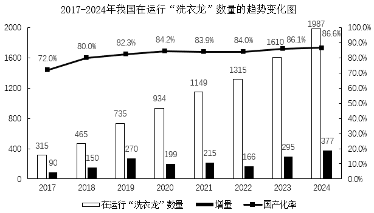

# 现期量计算（基期量×(1+同比增速)）

考点：[[20-考点/资料分析/增长/现期量计算（基期量×(1+同比增速)）|增长 / 现期量计算（基期量×(1+同比增速)）]]
材料：[[15-材料/资料分析/6023796 2023-2024年我国洗涤行业生活|6023796 2023-2024年我国洗涤行业生活]]

**问法模型**：题干问'2024年……年营业收入约为……亿元'且材料现期为2024年、表格只给2023年绝对值与2024年增速 → 用现期量=基期量×(1+r)一步乘法换算

## 推理链
1. 第1步：题干求2024年公纺洗涤服务的年营业收入，材料现期为2024年，但表格无2024年收入绝对值，只有2023年数值和2024年同比增速
2. 第2步：定位统计表'公纺洗涤服务'的合计行：2023年营业收入653.0亿元、2024年营收同比增长5.0%
3. 第3步：所用公式：现期量=基期量×(1+同比增速)
4. 第4步：代入计算：653.0×(1+5.0%)=653.0×1.05=653.0+32.65=685.65亿元
5. 第5步：与选项对照：685.65≈686，对应D选项，故选D

**最快解法**：⚡ 加半成速算：653×5%≈32.7（即653÷20），653+32.7≈685.7≈686，口算一步锁定D，无需精确竖式

## 易错点
- ⚠ 增速年份口径混淆：表格公纺合计行的5.0%是2024年对2023年的增速（本题用），文字段的30.7%是2023年对2022年的增速，若误用30.7%会得约853亿、无选项可匹配
- ⚠ 表格行层级/串行陷阱：须用公纺洗涤服务'合计'行（653.0、5.0%），勿错用子板块行（酒店272.3增速6.9%、医用273.4增速1.9%）或生活衣物小计（637.6、6.6%）
- ⚠ 列名陷阱：表格第4列是'2024年营收同比增长(%)'而非2024年收入或占比，2024年占比50.2%不能当增速代入；此外A选项643≈653−10，诱导把'增长'误当'减少'方向

## 母题抽象
> 🧩 当材料只给基期年绝对量与现期年同比增速、现期绝对量缺失时，问'现期年约为多少'，直接用现期量=基期量×(1+r)一步乘法，代入前先核对增速的年份口径与所在行层级，结果与最接近选项对照

**同类特征**：所问年份=材料现期年份（2024）、'年营业收入约为……亿元'求绝对值、表格仅有基期绝对值+现期同比增速、无现期绝对值、单一领域合计行（公纺洗涤服务653.0、5.0%）、现期量=基期量×(1+r)模型、选项为约数、差距适中（643/648/680/686）

## 相关题
（暂无）

---

### 题干
2024年公纺洗涤服务的年营业收入约为        亿元。

### 选项
- A. 643
- B. 648
- C. 680
- D. 686　✅

### 官方解析
根据题干“2024年······营业收入约为······”，结合材料时间为2024年，可判定本题为现期计算问题。定位统计表可得：2023年公纺洗涤服务的年营业收入为653.0亿元，2024年营业收入同比增长5.0%，根据公式：现期量=基期量×（1+r），则2024年公纺洗涤服务的年营业收入为亿元。
故正确答案为D。

### 给定材料

        随着服务消费需求的快速增长，我国洗涤行业延续发展态势。综合调研行业企业的经营情况，2023年我国生活衣物洗染服务的年营业收入达到637.6亿元，同比增长10.0%，占全行业年营业收入的49.4%；公纺洗涤服务的年营业收入达到653.0亿元，同比增长30.7%，占全行业年营业收入的50.6%。

        洗涤设备以隧道式连续洗衣机组（俗称“洗衣龙”）为代表，近8年我国在运行“洗衣龙”数量的趋势变化如图所示。

