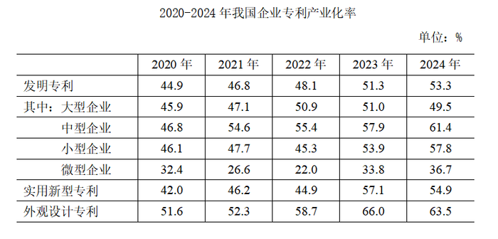
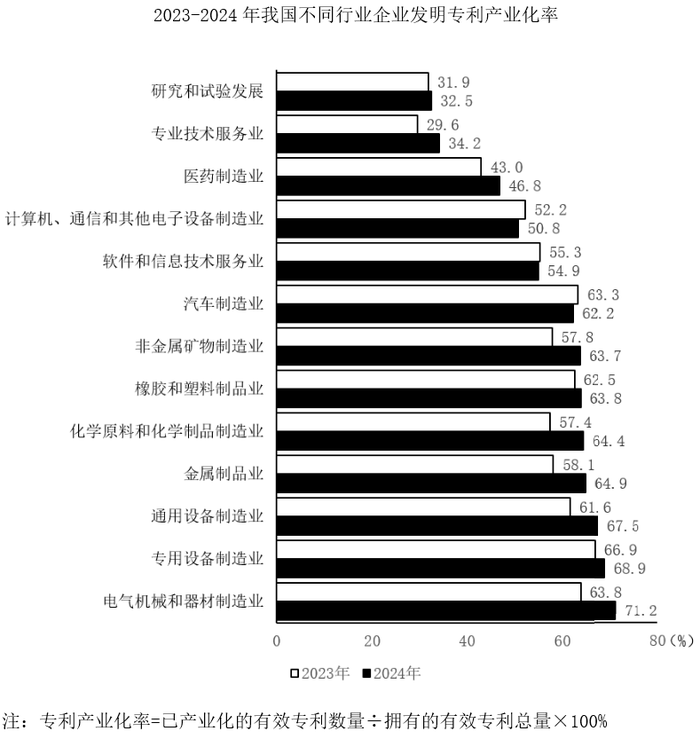

# 增长量比较（两期率差值筛选，百分点口径）

考点：[[20-考点/资料分析/增长/增长量比较（两期率差值筛选，百分点口径）|增长 / 增长量比较（两期率差值筛选，百分点口径）]]
材料：[[15-材料/资料分析/4367578 2024年我国企业发明专利产业化情况|4367578 2024年我国企业发明专利产业化情况]]

**问法模型**：题干'2024年……同比增量超过3个百分点的有几个'→ 逐行业用2024年产业化率减2023年产业化率，计数差值>3个百分点的个数

## 推理链
1. 第1步：定位条形图《2023~2024年我国不同行业企业发明专利产业化率》，白条为2023年、黑条为2024年，共13个行业，附注口径：产业化率=已产业化有效专利÷拥有有效专利总量×100%
2. 第2步：增量=现期量-基期量，此处为2024年率-2023年率，单位为'个百分点'而非%
3. 第3步：先剔除3个同比不增的行业：计算机通信电子(52.2→50.8)、软件信息技术(55.3→54.9)、汽车制造(63.3→62.2)，剩10个待算差值
4. 第4步：逐项做差：研究和试验发展32.5-31.9=0.6、专业技术服务业34.2-29.6=4.6、医药制造业46.8-43.0=3.8、非金属矿物制造63.7-57.8=5.9、橡胶塑料63.8-62.5=1.3、化学原料制品64.4-57.4=7.0、金属制品64.9-58.1=6.8、通用设备67.5-61.6=5.9、专用设备68.9-66.9=2.0、电气机械器材71.2-63.8=7.4
5. 第5步：筛选差值>3个百分点的行业：专业技术服务业4.6、医药制造业3.8、非金属矿物制造5.9、化学原料制品7.0、金属制品6.8、通用设备5.9、电气机械器材7.4，共7个；0.6、1.3、2.0三个不达标
6. 第6步：计数结果为7，与选项C对应，与官方答案一致

**最快解法**：⚡ 逐项做差筛选法+先排负增长：先用'2024黑条是否高于2023白条'肉眼排除计算机通信电子、软件信息技术、汽车制造3个下降行业，剩余10个心算两率差值，只保留>3个百分点的项（注意医药3.8属'超过3'要保留，专用设备2.0排除），数出7个即C

## 易错点
- ⚠ 单位口径：产业化率的增量是'个百分点'，不能当作%计算或表述；且'超过3个百分点'是严格大于，需逐个精算差值而非估读条形长短
- ⚠ 图例误读陷阱：白条=2023年在前、黑条=2024年在后，若看反则全部差值符号颠倒，符合项会变成'下降超3个百分点'的另一批行业
- ⚠ 行业按类别排列而非按数值排序，且部分行业2023年值大于2024年值（三个负增长行业），必须逐条核对读数，凭条形长短或惯性'逐年上升'假设会漏判误判；另注意不可混用统计表（分专利类型/企业规模的专利产业化率）数据

## 母题抽象
> 🧩 当题干出现'两期对比图中，现期较基期增量/降幅超过X个百分点的有几个'时，用逐项做差计数法：先肉眼剔除反向变动项，再对剩余项精算差值，按严格大于X筛选计数

**同类特征**：13个行业（条形图分组计数）、2024年…同比增量、超过3个百分点、有几个（计数问法）、两期对比条形图（2023白/2024黑）、率类指标的百分点差

## 相关题
（暂无）

---

### 题干
资料所列13个行业中，2024年企业发明专利产业化率同比增量超过3个百分点的有几个？

### 选项
- A. 5
- B. 6
- C. 7　✅
- D. 8

### 官方解析
根据题干“2024年······同比增量超过······有几个”，可判定本题为增长量计算问题。定位统计图可知2023年及2024年我国不同行业企业发明专利产业化率。根据公式：增长量=现期量-基期量，本题所求企业发明专利产业化率的增长量，2024年企业发明专利产业化率相当于现期量，2023年企业发明专利产业化率相当于基期量，故2024年各行业企业发明专利产业化率的同比增量如下：
研究和试验发展：32.5%-31.9%=0.6个百分点，不符合；
专业技术服务业：34.2%-29.6%=4.6个百分点，符合；
医药制造业：46.8%-43.0%=3.8个百分点，符合；
计算机、通信和其他电子设备制造业：50.8%&lt;52.2%，即同比减少，不符合；
软件和信息技术服务业：54.9%&lt;55.3%，即同比减少，不符合；
汽车制造业：62.2%&lt;63.3%，即同比减少，不符合；
非金属矿物制造业：63.7%-57.8%=5.9个百分点，符合；
橡胶和塑料制品业：63.8%-62.5%=1.3个百分点，不符合；
化学原料和化学制品制造业：64.4%-57.4%=7.0个百分点，符合；
金属制品业：64.9%-58.1%=6.8个百分点，符合；
通用设备制造业：67.5%-61.6%=5.9个百分点，符合；
专用设备制造业：68.9%-66.9%=2.0个百分点，不符合；
电气机械和器材制造业：71.2%-63.8%=7.4个百分点，符合。
综上，资料所列13个行业中，2024年企业发明专利产业化率同比增量超过3个百分点的有7个。
故正确答案为C。

### 给定材料

        2024年，我国企业发明专利产业化平均收益（平均每件已产业化的有效专利产生的收益）为869.5万元/件，较上年增长4.8％。其中，战略性新兴产业和未来产业领域的企业发明专利产业化平均收益分别为939.1万元/件和1132.7万元/件。分企业规模看，中型企业发明专利产业化平均收益最高，为991.9万元/件，其次为大型企业和小型企业，分别为953.9万元/件和752.4万元/件，微型企业相对最低，为260.1万元/件。

