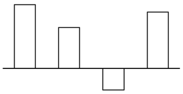
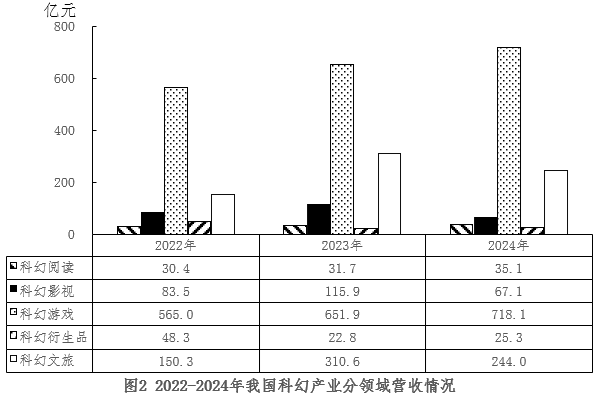

# 同比增量计算与图形匹配（增长量比较-排除法）

考点：[[20-考点/资料分析/增长/同比增量计算与图形匹配（增长量比较-排除法）|增长 / 同比增量计算与图形匹配（增长量比较/排除法）]]
材料：[[15-材料/资料分析/6951594 我国科幻产业2016~2024年总营|6951594 我国科幻产业2016~2024年总营]]

**问法模型**：题干给出一张'同比增量'柱状图（横轴位置表示增量为0），问其对应哪一时间段的逐年增量 → 对各选项区间逐年套用'增长量=现期量-基期量'，用增量的正负位置与量级匹配图形

## 推理链
1. 第1步：从图1提取各年营收（亿元）：2016年100.0、2017年140.0、2018年456.4、2019年658.7、2020年551.1、2021年829.6、2022年877.5、2023年1132.9、2024年1089.6；同比下降年份仅2020年（551.1<658.7）和2024年（1089.6<1132.9），即同比增量为负的只有这两年
2. 第2步：所用公式为增长量=现期量-基期量；题干图形特征：负增量柱（横轴下方）出现在第3位，第1、2、4位增量为正
3. 第3步：用负增量的位置排除：B项2020~2023年第1年增量即2020年=551.1-658.7=-107.6（负）与图形首柱为正矛盾；C项2019~2022年第2年增量即2020年=-107.6（负）与图形第2柱为正矛盾；A项2021~2024年第4年增量即2024年=1089.6-1132.9=-43.3（负）与图形第4柱为正矛盾
4. 第4步：验证D项2018~2021年：2018年=456.4-140.0=316.4、2019年=658.7-456.4=202.3、2020年=551.1-658.7=-107.6、2021年=829.6-551.1=278.5，增量序列为正、正、负、正，负柱恰在第3位
5. 第5步：D项增量符号分布（+、+、-、+）与题干图形完全吻合，且量级关系（首柱316.4最高、第2柱202.3、第4柱278.5）也与图形一致，故选D

**最快解法**：⚡ 排除法+符号验证：先由图1标出仅有的两个负增量年份（2020年、2024年，因2020、2024营收低于上年），再看选项中负增量落在区间第几位——A项2024年在第4位、B项2020年在第1位、C项2020年在第2位，均与图形'第3柱为负'不符，直接排除；D项2020年增量恰在第3位（551.1-658.7=-107.6），无需精算其余增量即可锁定D

## 易错点
- ⚠ 负增量年份漏判：2020年（551.1<658.7）和2024年（1089.6<1132.9）营收同比下降、增量为负，若只看柱形高度上升趋势而忽略这两个下降年份，无法用符号排除选项
- ⚠ 区间首年增量漏算：2018~2021这类区间中，首年（如2018年）的增量=456.4-140.0=316.4也需计算，勿误以为首年没有增量或误用2016年作基期
- ⚠ 混淆'增量'与'增速/营收额'：题干图纵轴是同比增量（亿元差值）而非营收额或增长率，勿把图1营收柱形直接与题干增量图比对

## 母题抽象
> 🧩 当题干出现'同比增量柱状图+横轴位置表示增量为0+求对应时间段'特征时，先从材料标出所有负增量年份（现期<基期的年份），再看各选项区间内负增量落在第几位，用正负分布+首年增量符号即可排除锁定答案

**同类特征**：同比增量的变化情况、横轴位置表示增量为0、柱状图匹配时间段、增长量=现期量-基期量、四年区间选项排除、增量正负交替

## 相关题
- [[10-真题/资料分析/增长/19283764 同比增量计算与趋势比较（增量=现期-基期，逐年相减后与柱状图形态匹配）|19283764]]（国考 2025，相关度2）
- [[10-真题/资料分析/增长/19283747 增长量计算与比较（同比增量趋势匹配图形）|19283747]]（国考 2025，相关度1）
- [[10-真题/资料分析/增长/16592987 增长量计算与比较（排序+增量趋势判断）|16592987]]（河北 2024，相关度1）
- [[10-真题/资料分析/增长/18643849 增长量比较（环比增量序列与图形趋势匹配）|18643849]]（四川 2026，相关度1）
- [[10-真题/资料分析/增长/18643857 环比增长量计算与增量序列图形匹配（增长量比较）|18643857]]（四川 2026，相关度1）

---

### 题干

以下柱状图反映了哪一时间段内，我国科幻产业营收额同比增量的变化情况（横轴位置表示增量为0）？

### 选项
- A. 2021~2024年
- B. 2020~2023年
- C. 2019~2022年
- D. 2018~2021年　✅

### 官方解析
根据题干“······我国科幻产业营收额同比增量的变化情况······”，可判定本题为增长量比较问题。定位图1可知2017~2024年我国科幻产业各年度营收额，根据公式：增长量=现期量-基期量，则选项中各年份增长量分别为：
A项：2021年，829.6-551.1=278.5亿元；2022年，877.5-829.6=47.9亿元；2023年，1132.9-877.5=255.4亿元，题干图中第三年增长量为负，排除。
B项：2020年，551.1-658.7=-107.6亿元，题干图中第一年增长量为正，排除。
C项：2019年，658.7-456.4=202.3亿元；2020年，551.1-658.7=-107.6亿元，题干图中第二年增长量为正，排除。
D项：2018年，456.4-140.0=316.4亿元；2019年，658.7-456.4=202.3亿元；2020年，551.1-658.7=-107.6亿元；2021年，829.6-551.1=278.5亿元，符合题干图形的变化情况，当选。
故正确答案为D。

### 给定材料

      科幻产业包括科幻阅读、科幻影视、科幻游戏、科幻衍生品、科幻文旅五大领域。2024年，我国科幻产业总营收1089.6亿元。

> [!warning] 疑点（官方解析可能有误，待人工复核）
> 官方解析A项仅列出2021~2023三个增量的计算且称'第三年增长量为负'，但A区间2021~2024应含4个增量，负增量实际出现在第4年（2024年=1089.6-1132.9=-43.3亿元）；此为解析表述序号疏漏，不影响排除A的结论，正确答案仍为D

<!-- CODEX-ANSWER-REVIEW:BEGIN -->
### 本次独立复核

**复核状态：** `resolved`（答案与解析已核定）

**计分答案：** D（可计分）

**复核解析：**

图1给出营收额（亿元）：2017—2024年为140.0、456.4、658.7、551.1、829.6、877.5、1132.9、1089.6。各选项区间的同比增量为：A(2021—24)=278.5、47.9、255.4、-43.3；B(2020—23)=-107.6、278.5、47.9、255.4；C(2019—22)=202.3、-107.6、278.5、47.9；D(2018—21)=316.4、202.3、-107.6、278.5。题图形态是大正、较小正、负、较大正，仅D匹配。原解析对A说“第三年为负”是序数笔误：实际负增量在第4年；该点不改变排除结论。

**相关信息：**

同比增量=本年营收额－上年营收额，单位亿元；横轴为零，柱在零线上下表示正负。

**题源依据：** [固定版本原题](https://github.com/Mentat-Uran/kaogongzhentizhengliu/blob/84ab93d4b64b61d897bece8a1c0a5bab06b4feb2/10-%E7%9C%9F%E9%A2%98/%E8%B5%84%E6%96%99%E5%88%86%E6%9E%90/%E5%A2%9E%E9%95%BF/19526226%20%E5%90%8C%E6%AF%94%E5%A2%9E%E9%87%8F%E8%AE%A1%E7%AE%97%E4%B8%8E%E5%9B%BE%E5%BD%A2%E5%8C%B9%E9%85%8D%EF%BC%88%E5%A2%9E%E9%95%BF%E9%87%8F%E6%AF%94%E8%BE%83-%E6%8E%92%E9%99%A4%E6%B3%95%EF%BC%89.md)；固定内容 commit `84ab93d4b64b61d897bece8a1c0a5bab06b4feb2`，Markdown blob `c4e40cdfa34369fa6ba8db3d3b3258618a7ca5cc`。
<!-- CODEX-ANSWER-REVIEW:END -->
