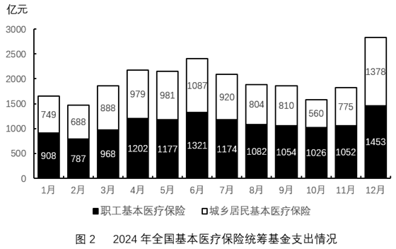

# 环比增长量计算与图形形态匹配（反推指标型增长量比较）

考点：[[20-考点/资料分析/增长/环比增长量计算与图形形态匹配（反推指标型增长量比较）|增长 / 环比增长量计算与图形形态匹配（反推指标型增长量比较）]]
材料：[[15-材料/资料分析/4790884 2024年全国基本医疗保险统筹基金按|4790884 2024年全国基本医疗保险统筹基金按]]

**问法模型**：题干给出一张'横轴位置表示增量为0'的未知指标柱状图，要求反推其对应哪个指标的环比增量序列 → 对四个选项分别按'环比增量=本月值−上月值'计算9~12月增量（需8月作基期），再用正负符号与柱长比例与图形形态逐一匹配。

## 推理链
1. 第1步：环比的基期是上月，故需提取8~12月数据——图1职工收入1424/1479/1503/1430/1618、图1居民收入415/1094/1395/1089/1305，图2职工支出1082/1054/1026/1052/1453、图2居民支出804/810/560/775/1378。
2. 第2步：公式：环比增量=现期月值−上月值，9月增量的基期为8月值。
3. 第3步：B项职工支出9月增量=1054−1082=−28<0，与图中首月增量为正矛盾，排除；D项居民支出10月增量=560−810=−250<0，与图中第二根柱在横轴上方矛盾，排除。
4. 第4步：A项职工收入增量9月+55、10月+24、11月−73，|−73|>|+55|，但图中第三根柱（负）短于第一根柱（正），形态不符，排除。
5. 第5步：C项居民收入增量9月=1094−415=+679、10月=1395−1094=+301、11月=1089−1395=−306、12月=1305−1089=+216，呈'正大—正小—负—正'且|负增量|306<正增量679，与图中形态完全吻合，当选C。

**最快解法**：⚡ 差分+符号排除法：先算首月（9月）增量符号，职工支出1054−1082<0秒杀B，居民支出虽9月+6但10月560−810<0秒杀D；再在A、C间比增量绝对值——居民收入增量679/301/−306/216柱长悬殊且第三柱短于第一柱，职工收入+55/−73的负增量反而比正增量长，与图矛盾，故选C。

## 易错点
- ⚠ 环比增量的基期是上月，9月增量的基期是8月（居民收入415），若只提取9~12月数据则无法算首月增量。
- ⚠ 图1与图2版式仅'收入/支出'一字之差，本题需同时用到两图的白段（居民段），易拿错图或误用职工段、全国合计段。
- ⚠ 形态匹配不能只看正负交替，还要比柱长（增量绝对值）：A项也是'+、+、−、+'交替，但|11月−73|>|9月+55|与图中'第三柱短于第一柱'矛盾，只验符号会误选A。

## 母题抽象
> 🧩 当题干出现'柱状图反映…哪一指标的环比增量变化（横轴位置表示增量为0）'的反推特征时，先补齐上月作基期，对四个候选序列求9~12月环比增量，先用首月/次月增量符号排除，再用'负增量柱长是否短于首个正增量'等柱长比例验证，与图形正负与长短形态完全一致者即为答案。

**同类特征**：环比增量、横轴位置表示增量为0、哪一指标（反推型）、9～12月、柱状图形态匹配、统筹基金分项（职工/居民×收入/支出）

## 相关题
- [[10-真题/资料分析/增长/18643849 增长量比较（环比增量序列与图形趋势匹配）|18643849]]（四川 2026，相关度2）
- [[10-真题/资料分析/增长/18643857 环比增长量计算与增量序列图形匹配（增长量比较）|18643857]]（四川 2026，相关度2）
- [[10-真题/资料分析/增长/19283747 增长量计算与比较（同比增量趋势匹配图形）|19283747]]（国考 2025，相关度1）
- [[10-真题/资料分析/增长/19526226 同比增量计算与图形匹配（增长量比较-排除法）|19526226]]（国考 2026，相关度1）
- [[10-真题/资料分析/增长/19283764 同比增量计算与趋势比较（增量=现期-基期，逐年相减后与柱状图形态匹配）|19283764]]（国考 2025，相关度1）

---

### 题干

以下柱状图反映了2024年9～12月，全国基本医疗保险统筹基金哪一指标的环比增量变化情况（横轴位置表示增量为0）？

### 选项
- A. 职工基本医疗保险统筹基金收入
- B. 职工基本医疗保险统筹基金支出
- C. 城乡居民基本医疗保险统筹基金收入　✅
- D. 城乡居民基本医疗保险统筹基金支出

### 官方解析
根据题干“······环比增量变化情况······”，可判定本题为增长量比较问题。定位统计图可得2024年8-12月全国基本医疗保险统筹基金的收支情况。根据公式：增长量=现期量-基期量，可得选项中各指标环比增量如下：
A项，职工基本医疗保险统筹基金收入2024年9月环比增量=1479-1424=55亿元，10月环比增量=1503-1479=24亿元，11月环比增量=1430-1503=-73亿元，由于|11月环比增量|&gt;|9月环比增量|，而柱状图（横轴位置代表增量为0）中第三个月柱体长度&lt;第一个月柱体长度，不符合柱状图变化趋势，排除；
B项，职工基本医疗保险统筹基金支出2024年9月环比增量=1054-1082&lt;0，而柱状图中第一个月的环比增量&gt;0，不符合柱状图变化趋势，排除；
C项，城乡居民基本医疗保险统筹基金收入2024年9月环比增量=1094-415=679亿元，10月环比增量=1395-1094=301亿元，11月环比增量=1089-1395=-306亿元，12月环比增量=1305-1089=216亿元，符合柱状图变化趋势，当选；
D项，城乡居民基本医疗保险统筹基金支出2024年9月环比增量=810-804=6亿元，10月环比增量=560-810=-250亿元，而柱状图中第二个月的环比增量&gt;0，不符合柱状图变化趋势，排除。
故正确答案为C。

### 给定材料

