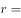
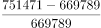
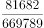
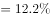

# 同比增长率计算

考点：[[20-考点/资料分析/增长/同比增长率计算|增长 / 同比增长率计算]]
材料：[[15-材料/资料分析/184700 2015年第1季度至2016年第1季|184700 2015年第1季度至2016年第1季]]

**问法模型**：'2016年第1季度，正常类贷款同比增长率约为'→ 同比增长率=(现期值−上年同期基期值)÷基期值，从表1'正常类'行取两列数据一步除法

## 推理链
1. 第1步：题干锁定'商业银行''正常类贷款''2016年第1季度''同比增长率'，从表1'正常类贷款'行取数：现期2016年第1季度为751471亿元
2. 第2步：同比基期是上年同期即2015年第1季度；注意表1时间轴倒序（最左为2016Q1、最右为2015Q1），基期669789亿元在最右列
3. 第3步：套用增长率公式：同比增长率=(现期−基期)÷基期=(751471−669789)÷669789=81682÷669789
4. 第4步：截位直除估算：81682÷669789≈8.17÷67.0≈12.2%（亦可对照1/8=12.5%：669789×12.5%≈83724>81682，故略小于12.5%）
5. 第5步：将约12.2%与选项对照，对应D项，故正确答案为D

**最快解法**：⚡ 截位直除法：先做差81682，再截位81682/669789≈8.17/67，首位商'1'得12%左右，精算一位小数得约12.2%，直接锁定D；勿需精确计算到百分位

## 易错点
- ⚠ 时间轴倒序陷阱：同比基期2015年第1季度在表格最右列，易误取相邻的2015年第4季度719756亿元作基期，错算出约4.4%的环比式结果
- ⚠ 同比与环比混淆：'同比'必须对2015Q1，若拿2015Q4对比则成了环比口径
- ⚠ 行选取错误：表1有正常类、关注类、不良贷款余额三行，本题只取'正常类'行，误用关注类(31953对24826，约28.8%)或不良余额行会得到完全不同的数值

## 母题抽象
> 🧩 当题干出现'某季度，某指标同比增长率约为'且表格时间倒序排列时，先在最右列找到上年同期基期值，用(现期−基期)÷基期，再以截位直除（或对照1/8、1/9等常用百分数）快速对照选项

**同类特征**：同比增长率、2016年第1季度、正常类贷款、商业银行、表格时间轴倒序、现期与基期均已直接给出

## 相关题
- [[10-真题/资料分析/增长/12881986 同比增长率计算|12881986]]（广东 2025，相关度2）
- [[10-真题/资料分析/增长/23299 增长率计算之百分点换算（跨期增速倒推）|23299]]（安徽 2012，相关度1）
- [[10-真题/资料分析/增长/2456363 基期量计算|2456363]]（浙江 2020，相关度1）
- [[10-真题/资料分析/增长/4695874 同比增长率计算（分量增速，一般增长率）|4695874]]（选调 2018，相关度1）
- [[10-真题/资料分析/增长/10204440 一般增长率计算与趋势图匹配（同比增长率逐年比较）|10204440]]（广东 2024，相关度1）

---

### 题干
2016年第1季度，商业银行正常类贷款同比增长率约为：

### 选项
- A. 

- B. 

- C. 

- D. 

　✅

### 官方解析

由题干“同比增长率”可知为增长率计算问题，题中给出了2016年第1季度和2015年第1季度的数据，给出了现期和基期为一般增长率计算问题。利用求解即可。定位图表可知，2016年第一季度，正常类贷款为751471亿元，2015年第一季度，正常类贷款为669789亿元。增长率计算。

故正确答案为D。

### 给定材料

 

