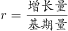
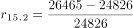
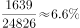
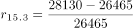
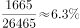
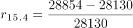
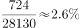
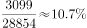

# 环比增长率比较（多区间增速大小比较）

考点：[[20-考点/资料分析/增长/环比增长率比较（多区间增速大小比较）|增长 / 环比增长率比较（多区间增速大小比较）]]
材料：[[15-材料/资料分析/184700 2015年第1季度至2016年第1季|184700 2015年第1季度至2016年第1季]]

**问法模型**：题干出现'2015年第2季度至2016年第1季度……环比增长最快的是'→ 对四个相邻季度区间分别套用环比增长率=（本季-上季）/上季，比较四个分数的大小

## 推理链
1. 第1步：定位表1'关注类贷款'行（倒序列）：2016Q1为31953、2015Q4为28854、2015Q3为28130、2015Q2为26465、2015Q1为24826（亿元），按时间正序为24826→26465→28130→28854→31953
2. 第2步：环比增长率公式：r=（本季度值−上季度值）/上季度值，需对2015Q2、2015Q3、2015Q4、2016Q1四个季度逐对做差计算
3. 第3步：代入计算：2015Q2：1639/24826≈6.6%；2015Q3：1665/26465≈6.3%；2015Q4：724/28130≈2.6%；2016Q1：3099/28854≈10.7%
4. 第4步：比较四个增速：10.7%＞6.6%＞6.3%＞2.6%，2016年第1季度环比增速最大，与选项A对应，故选A

**最快解法**：⚡ 截位直除+分数比较：先扫增量，2016Q1增量3099远超其他区间（1639、1665、724），而其基期28854与另两区间基期（24826、26465）量级相当，故3099/28854≈10%+必为最大，直接锁定A；无需精算其余三个（均不到7%）

## 易错点
- ⚠ 时间轴倒序陷阱：表1左列是2016年第1季度（最新），同比基期2015Q1在最右列，若按'左旧右新'惯性读数，环比方向和数值配对全部拿反
- ⚠ '增长最快'≠'增量最大'：2015Q3的增量1665略大于2015Q2的增量1639，但2015Q3基期更大，其增速（6.3%）反而低于2015Q2（6.6%），直接按增量排序会错判
- ⚠ 环比与同比基期混淆：环比的基期是相邻上一季度（各区间基期均不同），若统一错用2015Q1做基期则变成同比口径，结果全错

## 母题抽象
> 🧩 当题干出现'某时段内环比增长最快/最慢的是哪一（季/月/年）'时，取出该指标各期时点数据，逐相邻区间套（本期−上期）/上期做分数比较，用截位直除判断大小，并验证'增量最大'与'增速最快'是否一致（基期不同时不一致）

**同类特征**：环比增长最快、关注类贷款、跨多个相邻季度的区间比较、表1时点余额数据、时间轴倒序排列、比较的是增长率而非增量

## 相关题
（暂无）

---

### 题干
2015年第2季度至2016年第1季度，商业银行关注类贷款环比增长最快的是：

### 选项
- A. 2016年第1季度　✅
- B. 2015年第4季度
- C. 2015年第3季度
- D. 2015年第2季度

### 官方解析

由题干“环比增长最快的是”可知为增长率比较问题，题中给出了2015年第1季度到2016年第1季度的数据，为一般增长率比较问题。利用= 表示出增长率，进行比较即可。定位图表可知，2015年第1季度到2016年第1季度关注类贷款数据分别为：24826，26465，28130，28854，31953。则2015年第2季度到2016年第1季度增长率=分别为：=，=，=，=。

故正确答案为A。

### 给定材料

 

