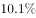

# 同比增速比较（直接读数比较）

考点：[[20-考点/资料分析/增长/同比增速比较（直接读数比较）|增长 / 同比增速比较（直接读数比较）]]
材料：[[15-材料/资料分析/184882 2016年8月及1-8月累计全国一般|184882 2016年8月及1-8月累计全国一般]]

**问法模型**：题干问'以下同比增速最快的是'→ 无需任何计算，在材料中定位四个主体对应的'同比增速'读数，同一口径下直接比大小

## 推理链
1. 第1步：锁定四个选项在材料中的位置及现期值——8月全国9894亿元（第1段首句）、8月中央4797亿元（第1段）、1-8月累计全国110178亿元（第2段首句）、1-8月累计中央49711亿元（第2段），各处'同比增长'后的百分数原文留空，需从图片读取
2. 第2步：本题为增速读数比较题，不涉及公式与计算，只需在'同比'口径下比较四个百分数大小
3. 第3步：读数时剔除干扰口径——8月中央'同口径下降'及1-8月中央、地方的'同口径增长'数值均不参与比较，只取各句'同比增速'后的数值
4. 第4步：逐项比较四个同比增速，2016年1-8月累计全国一般公共预算收入的同比增速为四者中最大
5. 第5步：对照选项，'1-8月累计全国'对应B项，故选B

**最快解法**：⚡ 定位读数比较法：四个增速分别藏在第1、2段首句及'其中'分句中，逐一圈出'同比'后的百分数（跳过所有'同口径'数值），直接比大小取最大者，全程零计算，为本组题送分题

## 易错点
- ⚠ 双口径混排陷阱：中央、地方均并列给出'同比增速'与'同口径增速'，且8月中央同口径为下降（负值），题干只问同比增速，若误拿同口径降幅比较会错误判断D项
- ⚠ 主体与时间维度交叉混淆：四个选项横跨'全国/中央'与'8月当月/1-8月累计'两个维度，定位时须逐项核对段落与主语，勿把'1-8月累计中央增速'误当成'全国累计增速'
- ⚠ 材料各处增速数值空缺、须从图片读取；若图不可辨，只能依据官方结论定性作答，切勿凭现期值大小或臆造数值代入计算

## 母题抽象
> 🧩 当题干出现'以下增速最快/最慢的是'且选项主体在材料中均有现成增速读数时，用'定位读数+直接比较'法，比之前先剔除'同口径'等干扰口径，并逐项核对主体（全国/中央/地方）与时间（当月/累计）维度

**同类特征**：同比增速最快、四选项增速均可从材料直接读出、全国/中央与当月/累计双维交叉、纯读数比较、无需计算、'同口径'数值为干扰项

## 相关题
- [[10-真题/资料分析/增长/2097276 同比增速直接读表比较|2097276]]（四川 2017，相关度1）
- [[10-真题/资料分析/增长/2261975 同比增速（增长率）大小比较|2261975]]（广东 2019，相关度1）
- [[10-真题/资料分析/增长/2741707 增长率（同比增速）比较|2741707]]（山东 2021，相关度1）
- [[10-真题/资料分析/增长/5802088 增长率比较（基期需由现期−增量还原）|5802088]]（浙江 2023，相关度1）
- [[10-真题/资料分析/增长/10204493 同比增速（一般增长率）比较|10204493]]（甘肃 2024，相关度1）

---

### 题干
以下同比增速最快的是：

### 选项
- A. 2016年8月份全国一般公共预算收入同比增速
- B. 2016年1-8月累计全国一般公共预算收入同比增速　✅
- C. 2016年1-8月累计中央一般公共预算收入同比增速
- D. 2016年8月份中央一般公共预算收入同比增速

### 官方解析

定位文字材料可知，2016年8月份全国一般公共预算收入同比增速；2016年1-8月累计全国一般公共预算收入同比增速；2016年1-8月累计中央一般公共预算收入同比增速；2016年8月份中央一般公共预算收入同比增速。增速最快的为2016年1-8月累计全国一般公共预算收入。

故正确答案为B。

### 给定材料

        2016年8月份，全国一般公共预算收入9894亿元，同比增长。其中，中央一般公共预算收入4797亿元，同比增长，同口径下降；地方一般公共预算本级收入5097亿元，同比增长1%，同口径增长。全国一般公共预算收入中的税收收入7680亿元，同比增长，非税收入2214亿元，同比增长。

        2016年1-8月累计，全国一般公共预算收入110178亿元，同比增长。其中，中央一般公共预算收入49711亿元，同比增长，同口径增长；地方一般公共预算本级收入60467亿元，同比增长，同口径增长。全国一般公共预算收入中的税收收入92637亿元，同比增长。

> [!warning] 疑点（官方解析可能有误，待人工复核）
> 材料原文与官方解析中各同比增速的百分数均空缺（需依赖图片附件读取），无法用给定文本定量复核四个增速的具体数值与大小关系；按材料导读要求如实标注，官方结论'B项增速最快'未被质疑，答案B照录
