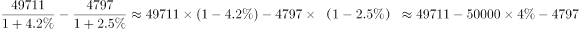
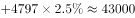

# 基期量计算——基期和差（基期累计−基期当月，跨段拼接）

考点：[[20-考点/资料分析/增长/基期量计算——基期和差（基期累计−基期当月，跨段拼接）|增长 / 基期量计算——基期和差（基期累计−基期当月，跨段拼接）]]
材料：[[15-材料/资料分析/184882 2016年8月及1-8月累计全国一般|184882 2016年8月及1-8月累计全国一般]]

**问法模型**：题干求'2015年1-7月'基期值，而材料只给出'2016年8月'与'2016年1-8月累计'两段现期值 → 基期和差模型：基期1-7月=现期累计/(1+累计增速)−现期当月/(1+当月增速)。

## 推理链
1. 第1步：题干时间'2015年1-7月'在材料中无直接数据，须按'1-7月=1-8月−8月'拼接；从材料提取中央口径数据——2016年1-8月中央累计49711亿元、2016年8月中央4797亿元（勿误用全国值9894/110178），各自同比增速取图中数值：累计约+4.5%、8月约+2.2%。
2. 第2步：基期量公式：基期=现期/(1+同比增速)，故2015年1-7月中央=49711/(1+4.5%)−4797/(1+2.2%)。
3. 第3步：截位直除：49711/1.045≈47570亿元，4797/1.022≈4694亿元。
4. 第4步：相减：47570−4694≈42876亿元≈4.29万亿元。
5. 第5步：粗验上界：现期直接相减49711−4797=44914亿元≈4.49万亿元，增速为正则基期必小于该值，可先排除B(4.8万亿)与C(4.5万亿)。
6. 第6步：与选项对照：4.29万亿元距D(4.3万亿元)仅约0.01万亿，明显近于A(4.2万亿，差约0.09万亿)，故选D。

**最快解法**：⚡ 基期和差+截位直除：先粗算现期差锁区间——49711−4797=44914亿≈4.5万亿，基期必小于4.5万亿，秒排除B、C；再截位直除49711/1.045≈4.76万亿、4797/1.022≈0.47万亿，相减≈4.29万亿→D。

## 易错点
- ⚠ 跨段遗漏：只用第2段算出49711/(1+4.5%)≈4.76万亿就误选B(4.8万亿)，忘减2015年8月基期约0.47万亿。
- ⚠ 现期当基期：直接用49711−4797=44914亿≈4.5万亿误选C，未各自除以(1+增速)还原到2015年。
- ⚠ 口径与读数陷阱：误用'同口径'增速（8月中央同口径为下降、方向相反）会使基期量算大约4.37万亿引入偏差；且原文'同比增长 '后百分数空缺，两个增速必须从图中准确读取，读错数值直接影响A/D取舍。

## 母题抽象
> 🧩 当题干所求基期时段=材料两段现期时段之差（如'2015年1-7月'='1-8月'减'8月'）时，用基期和差公式：基期差=现期大段/(1+大段增速)−现期小段/(1+小段增速)，先算现期差锁定上界排除明显选项，再截位直除两基期量相减定答案。

**同类特征**：求上一年部分时段的基期值（2015年1-7月）、材料仅有累计段与当月段（1-8月、8月）、需跨段拼接'累计−当月'、基期和差/差值模型、两段各配一个同比增速、分别除(1+g)、选项单位为万亿元、需亿元换算

## 相关题
（暂无）

---

### 题干
2015年1-7月，中央一般公共预算收入约为：

### 选项
- A. 4.2万亿元
- B. 4.8万亿元
- C. 4.5万亿元
- D. 4.3万亿元　✅

### 官方解析

由题干“2015年1-7月，中央一般公共预算收入”，同时材料给出了2016年8月和1-8月中央一般公共预算收入，据此可知本题为基期和差问题。定位材料可知，2016年8月中央一般公共预算收入为4797亿元，同比增长；2016年1-8月累计中央一般公共预算收入49711亿元，同比增长。由基期计算公式可得，2015年1-7月中央一般公共预算收入约为亿元。

故正确答案为D。

### 给定材料

        2016年8月份，全国一般公共预算收入9894亿元，同比增长。其中，中央一般公共预算收入4797亿元，同比增长，同口径下降；地方一般公共预算本级收入5097亿元，同比增长1%，同口径增长。全国一般公共预算收入中的税收收入7680亿元，同比增长，非税收入2214亿元，同比增长。

        2016年1-8月累计，全国一般公共预算收入110178亿元，同比增长。其中，中央一般公共预算收入49711亿元，同比增长，同口径增长；地方一般公共预算本级收入60467亿元，同比增长，同口径增长。全国一般公共预算收入中的税收收入92637亿元，同比增长。

> [!warning] 疑点（官方解析可能有误，待人工复核）
> 原文与官方解析中两处增速数值均空缺（'同比增长 '后无数字），定量计算依赖原图：按图读取8月中央同比约+2.2%、1-8月中央累计同比约+4.5%，代入得约42876亿元≈4.3万亿元，与官方答案D一致；若图不可辨，仅能凭现期差44914亿≈4.5万亿锁定上界并排除B，A/D的最终取舍需图中增速数值。

<!-- CODEX-ANSWER-REVIEW:BEGIN -->
### 本次独立复核

**复核状态：** `resolved`（答案与解析已核定）

**计分答案：** D（可计分）

**复核解析：**

财政部公告给出2016年8月中央一般公共预算收入4797亿元、同比增长2.5%，1—8月累计49711亿元、同比增长4.2%。反推2015年1—8月累计49711÷1.042≈47707.29亿元；反推2015年8月收入4797÷1.025=4680亿元；因此2015年1—7月约47707.29−4680=43027.29亿元，即4.30万亿元，选D。

**相关信息：**

资料分析—累计基期减单月基期还原累计区间；财政收入以亿元计算。

**题源依据：** [固定版本原题](https://github.com/Mentat-Uran/kaogongzhentizhengliu/blob/84ab93d4b64b61d897bece8a1c0a5bab06b4feb2/10-%E7%9C%9F%E9%A2%98/%E8%B5%84%E6%96%99%E5%88%86%E6%9E%90/%E5%A2%9E%E9%95%BF/2021896%20%E5%9F%BA%E6%9C%9F%E9%87%8F%E8%AE%A1%E7%AE%97%E2%80%94%E2%80%94%E5%9F%BA%E6%9C%9F%E5%92%8C%E5%B7%AE%EF%BC%88%E5%9F%BA%E6%9C%9F%E7%B4%AF%E8%AE%A1%E2%88%92%E5%9F%BA%E6%9C%9F%E5%BD%93%E6%9C%88%EF%BC%8C%E8%B7%A8%E6%AE%B5%E6%8B%BC%E6%8E%A5%EF%BC%89.md)；固定内容 commit `84ab93d4b64b61d897bece8a1c0a5bab06b4feb2`，Markdown blob `8d5796e7b452e904384117362124260cddb66e89`。
<!-- CODEX-ANSWER-REVIEW:END -->
