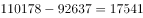
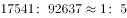

# 混合增长率（整体-部分关系，线段法-十字交叉反求部分增速）

考点：[[20-考点/资料分析/增长/混合增长率（整体-部分关系，线段法-十字交叉反求部分增速）|增长 / 混合增长率（整体-部分关系，线段法/十字交叉反求部分增速）]]
材料：[[15-材料/资料分析/184882 2016年8月及1-8月累计全国一般|184882 2016年8月及1-8月累计全国一般]]

**问法模型**：题干求材料未直接给出的'非税收入'同比增减且选项为'增长/下降+百分数'→先按'税收+非税=全国'减法派生非税现期量，再用混合增长率线段法反求部分增速，先定方向再比数值。

## 推理链
1. 第1步：定位材料第2段（1-8月累计）：全国一般公共预算收入110178亿元、同比增长6%，其中税收收入92637亿元、同比增长7.3%；非税收入累计值及其增速均未直接给出。
2. 第2步：利用层级恒等关系'税收+非税=全国'，派生非税收入现期量=110178−92637=17541亿元。
3. 第3步：依据混合增长率规则，整体增速6%必介于税收7.3%与非税增速之间，两段距离与基期量成反比（用现期量近似代替基期量）。
4. 第4步：税收:非税≈92637:17541≈5:1；税收增速距整体1.3个百分点（7.3%−6%），设非税增速距整体为x，则x:1.3%=5:1，得x=6.5%。
5. 第5步：非税增速=6%−6.5%=−0.5%，即同比下降约0.5%（方向为下降，先排除'增长'的A、D）。
6. 第6步：与选项对照，'下降'且数值最接近0.5%的为C项。

**最快解法**：⚡ 混合增长率+线段法（十字交叉）：①减法派生非税=110178−92637=17541亿元；②量比92637:17541≈5:1；③整体6%距税收7.3%差1.3个百分点，非税距离=5×1.3%=6.5个百分点，故非税增速=6%−6.5%=−0.5%；考场技巧：先凭'量大的部分（税收7.3%）高于整体6%，且量比约5:1远超4.6:1'直接锁定'下降'排除A、D，数值粗算即可锁定C，不必精算。

## 易错点
- ⚠ 非税累计值材料未直接给出，必须先做减法110178−92637=17541亿元派生，直接回原文找数会扑空（属'隐含派生指标'阅读陷阱）。
- ⚠ 方向误判：整体增速偏向基期量大的部分（税收），税收7.3%>整体6%，非税增速必远低于6%；因量比约5:1，非税距离达6.5个百分点，增速为负，不能凭直觉认为非税也在'增长'。
- ⚠ 口径与近似陷阱：本题用常规'同比'口径，勿误取中央/地方的'同口径'增速数据；现期量代基期量、量比粗化为5:1均属近似（按精确基期量验算约−0.4%），只需与选项'最接近'即可，勿纠结小数点出入；另注意用1-8月累计口径，勿混用8月当月数据。

## 母题抽象
> 🧩 当题干问某未直接给出的'部分'的同比增减、选项为'增长/下降+百分数'时：先用恒等式减法派生该部分现期量，再用混合增长率线段法（距离与量成反比）反求增速——先凭'整体增速偏向量大一侧'定方向排除一半选项，再粗算数值与选项比对。

**同类特征**：主体'非税收入'累计值材料未直接给出，需减法派生（110178−92637=17541）、问'同比'增减，选项为'增长/下降+百分数'两两配对结构、整体与另一部分增速已知：全国110178亿元(+6%)、税收92637亿元(+7.3%)、混合增长率（十字交叉/线段法）模型、先定'下降'方向排除增长项，再粗算数值、1-8月累计口径，与8月当月数据严格区分

## 相关题
（暂无）

---

### 题干
2016年1-8月累计，全国一般公共预算收入中非税收入同比：

### 选项
- A. 
增长

- B. 
下降

- C. 
下降
　✅
- D. 
增长 

### 官方解析

由题干“全国一般公共预算收入中非税收入同比”，同时选项为百分数，可知本题为混合增长率计算问题。定位材料可知，2016年1-8月累计，全国一般公共预算收入110178，同比增长6%；税收收入92637，同比增长7.3%。非税收入为。由混合增长率公式可知，一般用现期量近似代替基期量，量之比为，距离之比为x：（7.3%-6%）=x：1.3%，距离与量成反比，则5：1= x：1.3%，x=6.5%，6%-6.5%=-0.5%，故同比下降0.5%，与C项最接近。

故正确答案为C。

### 给定材料

        2016年8月份，全国一般公共预算收入9894亿元，同比增长。其中，中央一般公共预算收入4797亿元，同比增长，同口径下降；地方一般公共预算本级收入5097亿元，同比增长1%，同口径增长。全国一般公共预算收入中的税收收入7680亿元，同比增长，非税收入2214亿元，同比增长。

        2016年1-8月累计，全国一般公共预算收入110178亿元，同比增长。其中，中央一般公共预算收入49711亿元，同比增长，同口径增长；地方一般公共预算本级收入60467亿元，同比增长，同口径增长。全国一般公共预算收入中的税收收入92637亿元，同比增长。

