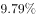
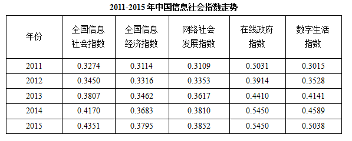

# 增长率计算（两期指数间'提高了几倍'）

考点：[[20-考点/资料分析/增长/增长率计算（两期指数间'提高了几倍'）|增长 / 增长率计算（两期指数间'提高了几倍'）]]
材料：[[15-材料/资料分析/184886 依据《中国信息社会发展报告2015》|184886 依据《中国信息社会发展报告2015》]]

**问法模型**：题干'2015年与2011年相比……提高了近'且选项为无单位的倍数 → 采用增长率模型（现期−基期）/基期，'提高了x倍'即增长率数值为x

## 推理链
1. 第1步：从表格定位数字生活指数两期数据：基期2011年为0.3015，现期2015年为0.5038
2. 第2步：题干'提高了x倍'对应增长率公式：增长率=(现期−基期)/基期
3. 第3步：代入计算：(0.5038−0.3015)/0.3015=0.2023/0.3015≈0.67，即提高约67%
4. 第4步：与选项对照：0.67与B项'0.7倍'最接近；若误用现期/基期=0.5038/0.3015≈1.67则对应C项1.7倍，但那是'是……的几倍'的口径，不符题意
5. 第5步：确认选B（0.7倍），与官方答案一致

**最快解法**：⚡ 截位直除（百化分）：分子0.2023≈0.2，分母0.3015≈0.3，即0.2/0.3=2/3≈0.67≈0.7倍；考场可先心算0.5038/0.3015≈1.67，再减1得0.67，秒选B

## 易错点
- ⚠ '提高了x倍'与'是x倍'混淆：0.5038/0.3015≈1.67是倍数关系（对应C项1.7倍的陷阱），'提高'必须再减1得0.67，误判会错选C
- ⚠ '提高了近'的口径判断：两期差值为0.2023≈0.2，但选项中无0.2，结合选项只能按增长率口径（0.2023/0.3015≈67%≈0.7倍）作答
- ⚠ 基期现期方向：2011为基期、2015为现期，若分子分母颠倒会算出负值或错误倍数；同时注意指数为0~1的无量纲小数，差值0.2023是绝对差（百分点量级），不能当百分比再二次换算

## 母题抽象
> 🧩 当题干出现'现期与基期相比，某指标提高了/增长了x倍'且选项为倍数时，用(现期−基期)/基期求增长率并就近匹配选项；若问'是……的几倍'才用现期/基期，两者恒差1，须先辨析问法口径再动笔

**同类特征**：2015年与2011年相比、提高了近、数字生活指数、选项为倍数且无单位、两期间隔多年（首尾年份）

## 相关题
（暂无）

---

### 题干
2015年与2011年相比，我国数字生活指数提高了近：

### 选项
- A. 1.5倍
- B. 0.7倍　✅
- C. 1.7倍
- D. 0.5倍

### 官方解析
由题干“提高了”且选项无单位可知，本题考查增长率计算问题。定位表格，2015年数字生活指数为0.5038，2011年数字生活指数为0.3015。依据增长率计算公式，，与B项最接近。
故正确答案为B。

### 给定材料

        国家信息中心近日发布的《中国信息社会发展报告2015》显示，2015年全国信息社会指数达到0.4351。从四个重点领域看，数字生活发展最快，2015年全国数字生活指数达到0.5038，同比增长。

