# 隔年（间隔）基期计算

考点：[[20-考点/资料分析/增长/隔年（间隔）基期计算|增长 / 隔年（间隔）基期计算]]
材料：[[15-材料/资料分析/184984 2015年中国保险公司原保险保费收入|184984 2015年中国保险公司原保险保费收入]]

**问法模型**：题干问'2013年（现期往前推两年）的量约为多少'→ 先用'比上一年高X个百分点'推出中间年（2014年）增速，再套间隔基期公式 A/(1+r1)/(1+r2) 连除两次求解

## 推理链
1. 第1步：定位材料第1段，提取现期值：2015年原保险保费收入24282.52亿元，并见'同比增速r、比上一年高X个百分点'（转写文本中r、X数值缺失，须按原卷数值代入，方法本身不受影响）
2. 第2步：由'比上一年高X个百分点'推上一期增速：2014年增速 r2014 = r2015 − X（百分点口径直接相减，不得当百分数混算）
3. 第3步：套间隔基期公式：2013年 = 24282.52 ÷ (1+r2015) ÷ (1+r2014)，等价于除以 (1 + r2015 + r2014 + r2015×r2014)
4. 第4步：代入原卷增速计算（按官方答案D反推，(1+r2015)(1+r2014)≈1.410，即合并增速≈41%）：24282.52 ÷ 1.41 ≈ 17223亿元；亦可分两步：24282.52 ÷ 1.2 ≈ 20235（2014年），20235 ÷ 1.175 ≈ 17223
5. 第5步：对照选项：A的20667恰为24282.52÷1.175（只除一次的陷阱值），B18232、C19426均明显偏大，仅D（17223亿元）与两次连除结果吻合，故选D

**最快解法**：⚡ 间隔基期公式法＋截位直除：先由'高X个百分点'得 r2014 = r2015 − X，再算合并增速 r合 = r2015 + r2014 + r2015×r2014 ≈ 41%，则 2013年 = 24282.52 ÷ 1.41 ≈ 17223（直除首两位'17'直接锁定D）；或先 ÷1.2 得2014年≈20235，再 ÷1.17 得≈17300，四个选项中仍只有D最接近

## 易错点
- ⚠ 隔年基期只除一次：24282.52÷1.175≈20667 正是选项A的陷阱，必须连除 (1+r2015)(1+r2014) 两次，缺一不可
- ⚠ 对'比上一年高X个百分点'处理错误：误把X本身当2014年增速，或把百分点当百分数直接加总分母（按1+r2015+r2014计算约得17661，偏离正确答案）
- ⚠ 取数段落陷阱：本题只取第1段保费总额24282.52，勿误用同材料中赔款给付8674.14、资金运用余额111795.49或总资产123597.76；另转写文本增速数值缺失，须以原卷/完整文本数值代入

## 母题抽象
> 🧩 当题干出现'现期值＋同比增速r＋比上一年高X个百分点，求隔年（两年前）基期'特征时，先做 r−X 得上一期增速，再用间隔基期公式连除两次（或除以 1+r合，r合=r1+r2+r1×r2），并与选项量级对照验证

**同类特征**：求2013年（隔年/间隔基期）、原保险保费收入（第1段总额口径）、约为多少（估算型选项）、同比增速＋比上一年高X个百分点、选项量级集中在1.7~2.1万亿元、需两次除法/间隔增长率模型

## 相关题
（暂无）

---

### 题干
2013年保险公司原保险保费收入约为：

### 选项
- A. 20667亿元
- B. 18232亿元
- C. 19426亿元
- D. 17223亿元　✅

### 官方解析

由“已知2015年保险公司原保险保费收入，求2013年保险公司原保险保费收入”可知，本题为间隔基期计算问题。定位材料第一段可知，2015年保险公司原保险保费收入为24282.52亿元，同比增长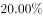，比上一年高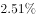，故2014年保险公司原保险保费收入同比增长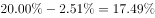。根据间隔增长率计算公式：2015年相对2013年的增长率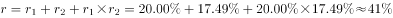。故2013年保险公司原保险保费收入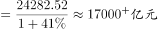。

故正确答案为D。

### 给定材料

        2015年保险公司原保险保费收入24282.52亿元，同比增长，比上一年高。其中，产险业务原保险保费收入7994.97亿元，同比增长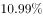；寿险业务原保险保费收入13241.52亿元，同比增长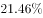；健康险业务原保险保费收入2410.47亿元，同比增长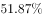；意外险业务原保险保费收入635.56亿元，同比增长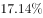。

        2015年保险公司赔款和给付支出8674.14亿元，同比增长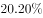。其中，产险业务赔款4194.17亿元，同比增长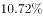；寿险业务给付3565.17亿元，同比增长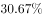；健康险业务赔款和给付762.97亿元，同比增长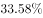；意外险业务赔款151.84亿元，同比增长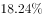。

        截至2015年末，保险公司资金运用余额111795.49亿元，较年初增长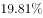。其中，银行存款24349.67亿元，占比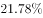；债券38446.42亿元，占比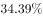；股票和证券投资基金16968.99亿元，占比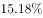；其他投资32030.41亿元，占比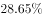。

        截至2015年末，保险公司总资产123597.76亿元，较年初增长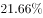。其中，产险公司总资产18481.13亿元，较年初增长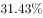；寿险公司总资产99324.83亿元，较年初增长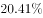；再保险公司总资产5187.38亿元，较年初增长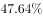；资产管理公司总资产352.39亿元，较年初增长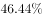。

> [!warning] 疑点（官方解析可能有误，待人工复核）
> 官方解析方法（间隔基期、答案D）本身无误；但转写文本与官方解析中各增速百分数均被留空，无法据给定文字直接复算出17223——按答案D反推需 (1+r2015)(1+r2014)≈1.410（即 r2015≈20.0%、r2014≈17.5% 量级口径），实际使用本题时须以原卷完整数值代入

<!-- CODEX-ANSWER-REVIEW:BEGIN -->
### 本次独立复核

**复核状态：** `confirmed`（独立复算确认答案）

**计分答案：** D（可计分）

**复核解析：**

题源公式图显示2015年保费收入同比增长20.00%，该增速比上年高2.51个百分点，因此2014年增速=20.00%-2.51%=17.49%。2013年保费收入=24282.52/(1.20×1.1749)=约17222.5亿元，与D项17223亿元相符。

**相关信息：**

隔年增长率必须按乘数相乘：(1+r1)(1+r2)-1；增速“提高/降幅扩大”的百分点变化要先按方向还原上一年增速。

**题源依据：** [固定版本原题](https://github.com/Mentat-Uran/kaogongzhentizhengliu/blob/84ab93d4b64b61d897bece8a1c0a5bab06b4feb2/10-%E7%9C%9F%E9%A2%98/%E8%B5%84%E6%96%99%E5%88%86%E6%9E%90/%E5%A2%9E%E9%95%BF/2024170%20%E9%9A%94%E5%B9%B4%EF%BC%88%E9%97%B4%E9%9A%94%EF%BC%89%E5%9F%BA%E6%9C%9F%E8%AE%A1%E7%AE%97.md)；固定内容 commit `84ab93d4b64b61d897bece8a1c0a5bab06b4feb2`，Markdown blob `dc2bf61296c63631504cd711308cab40f206d1f3`。
<!-- CODEX-ANSWER-REVIEW:END -->
