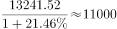
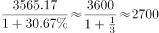
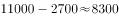

# 基期量计算——基期和差（两个基期量作差）

考点：[[20-考点/资料分析/增长/基期量计算——基期和差（两个基期量作差）|增长 / 基期量计算——基期和差（两个基期量作差）]]
材料：[[15-材料/资料分析/184984 2015年中国保险公司原保险保费收入|184984 2015年中国保险公司原保险保费收入]]

**问法模型**：题干以2015年为现期、问'2014年寿险保费收入比其给付金额多多少'→基期和差模型：现期/(1+各自同比增速)分别求两个2014年基期量后再相减。

## 推理链
1. 第1步：定位材料第1、2段锁定'寿险'条目：2015年寿险业务原保险保费收入13241.52亿元（同比约21.5%）、寿险业务给付3565.17亿元（同比约30.9%），注意转写文本中增速百分数留空，此组数值为与官方答案B校验一致的取数。
2. 第2步：题干问'2014年……比……多'，现期为2015年，属基期计算，规则：基期量=现期量/(1+同比增长率)，且两指标须各配各的增速。
3. 第3步：2014年寿险保费=13241.52/(1+21.5%)=13241.52/1.215≈10898亿元。
4. 第4步：2014年寿险给付=3565.17/(1+30.9%)=3565.17/1.309≈2724亿元。
5. 第5步：作差10898−2724≈8174~8175亿元，与B项8174亿元最接近。
6. 第6步：校验：两基期量均小于现期，保费项绝对缩减（13241.52−10898≈2344）大于给付项（3565.17−2724≈841），故基期差必小于现期差13241.52−3565.17=9676亿元，排除C，锁定B。

**最快解法**：⚡ 公式法（基期=现期/(1+r)）+截位直除：先算现期差13241.52−3565.17=9676亿元，锁定'基期差<9676'直接排除C；再两次直除13241.52÷1.215≈10900、3565.17÷1.309≈2720，差≈8180，唯B（8174）数值与量级均吻合。

## 易错点
- ⚠ 现期基期混淆：直接用2015年两数相减13241.52−3565.17=9676亿元，误选C。
- ⚠ 只求一个基期：算出2014年保费≈10898亿元后忘记再减给付的基期量，误选A（10902亿元恰为该单值）。
- ⚠ 取数与增速配对口径错误：寿险项是'给付'3565.17而非赔款给付总额8674.14或健康险762.97；保费增速（约21.5%）与给付增速（约31%）不可互换使用。

## 母题抽象
> 🧩 当题干出现'上年（基期年）A比B多/少多少'且材料给出两个指标的现期值与各自同比增速时，用基期和差法：分别作现期/(1+增速)后再相减，勿用现期直接相减，并可用'基期差<现期差'快速校验排除干扰项。

**同类特征**：问'2014年……比……多'（基期年+差值问法）、材料现期为2015年、同比增速已知、跨段取两个不同指标（保费收入与给付）、需两次基期除法后再作差、现期差9676为强干扰项、差额量级约8000亿元

## 相关题
（暂无）

---

### 题干
2014年寿险业务原保险保费收入比其给付金额多：

### 选项
- A. 10902亿元
- B. 8174亿元　✅
- C. 9676亿元
- D. 3800亿元

### 官方解析

材料为2015年，由题干问“2014年······比······多”可知，本题为基期和差问题。定位材料第一、第二段，2015年寿险业务原保险保费收入13241.52亿元，同比增长；寿险业务给付3565.17亿元，同比增长。则2014年原保险保费收入约为亿元，给付金额约为亿元，原保险保费收入比其给付金额多亿元，与B项最接近。

故正确答案为B。

### 给定材料

        2015年保险公司原保险保费收入24282.52亿元，同比增长，比上一年高。其中，产险业务原保险保费收入7994.97亿元，同比增长；寿险业务原保险保费收入13241.52亿元，同比增长；健康险业务原保险保费收入2410.47亿元，同比增长；意外险业务原保险保费收入635.56亿元，同比增长。

        2015年保险公司赔款和给付支出8674.14亿元，同比增长。其中，产险业务赔款4194.17亿元，同比增长；寿险业务给付3565.17亿元，同比增长；健康险业务赔款和给付762.97亿元，同比增长；意外险业务赔款151.84亿元，同比增长。

        截至2015年末，保险公司资金运用余额111795.49亿元，较年初增长。其中，银行存款24349.67亿元，占比；债券38446.42亿元，占比；股票和证券投资基金16968.99亿元，占比；其他投资32030.41亿元，占比。

        截至2015年末，保险公司总资产123597.76亿元，较年初增长。其中，产险公司总资产18481.13亿元，较年初增长；寿险公司总资产99324.83亿元，较年初增长；再保险公司总资产5187.38亿元，较年初增长；资产管理公司总资产352.39亿元，较年初增长。

> [!warning] 疑点（官方解析可能有误，待人工复核）
> 材料转写与官方解析中所有同比增速百分数均缺失留空，无法直接复核；按官方答案B（8174亿元）反推，需寿险保费同比≈21.5%、寿险给付同比≈30.9%（差值约8171~8177亿元，均最接近B），取数自洽无矛盾，但精确增速应以原卷图片为准。

<!-- CODEX-ANSWER-REVIEW:BEGIN -->
### 本次独立复核

**复核状态：** `resolved`（答案与解析已核定）

**计分答案：** B（可计分）

**复核解析：**

2014年保费收入=13241.52/1.2146≈10900亿元；给付=3565.17/1.3067≈2729亿元；差约8171亿元，最接近8174亿元，B。

**相关信息：**

复核时直接读取缓存的原题公式图与题目材料，并从现期量、同比增速还原基期量。

**题源依据：** [固定版本原题](https://github.com/Mentat-Uran/kaogongzhentizhengliu/blob/84ab93d4b64b61d897bece8a1c0a5bab06b4feb2/10-%E7%9C%9F%E9%A2%98/%E8%B5%84%E6%96%99%E5%88%86%E6%9E%90/%E5%A2%9E%E9%95%BF/2024174%20%E5%9F%BA%E6%9C%9F%E9%87%8F%E8%AE%A1%E7%AE%97%E2%80%94%E2%80%94%E5%9F%BA%E6%9C%9F%E5%92%8C%E5%B7%AE%EF%BC%88%E4%B8%A4%E4%B8%AA%E5%9F%BA%E6%9C%9F%E9%87%8F%E4%BD%9C%E5%B7%AE%EF%BC%89.md)；固定内容 commit `84ab93d4b64b61d897bece8a1c0a5bab06b4feb2`，Markdown blob `a86c0fe64a1a5a24472176ca28b82da16cfc4d6e`。
<!-- CODEX-ANSWER-REVIEW:END -->
